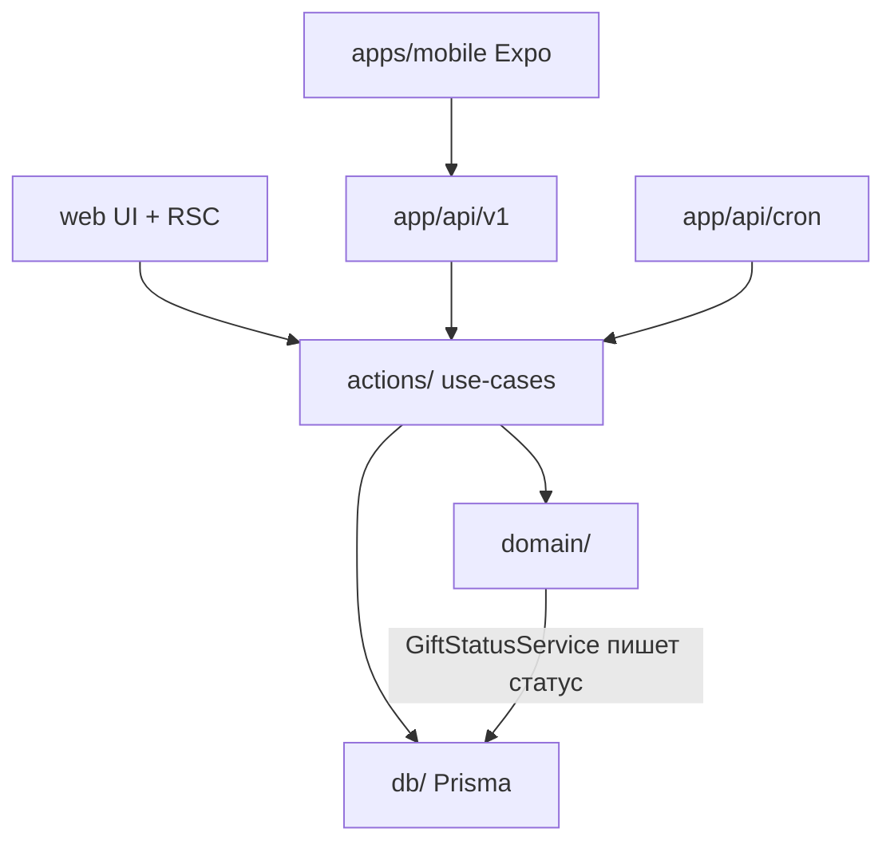
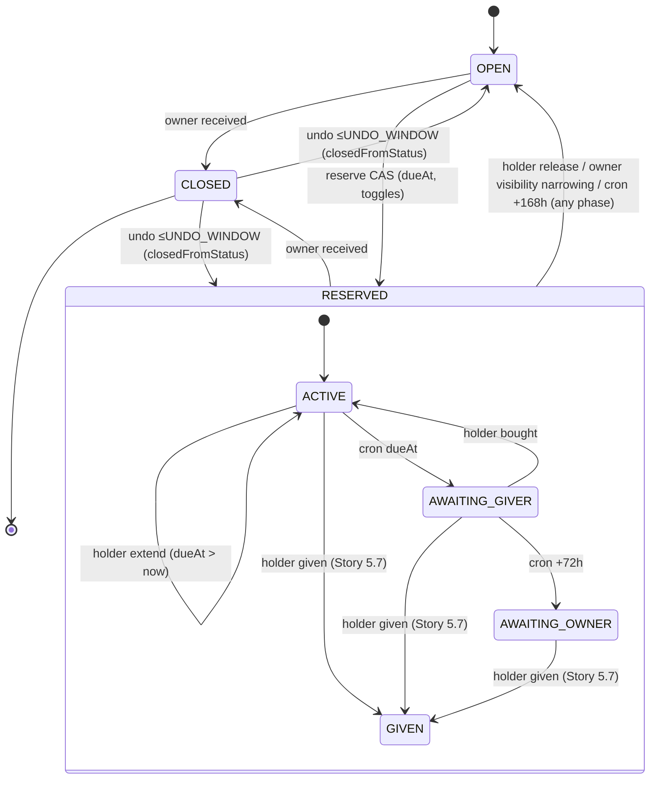

# Architecture Spine — Gift List (MVP)

## Design Paradigm

**Modular monolith · layered Next.js App Router, два клиента.** Один серверный деплойный юнит. Правила домена не живут в React и не дублируются в вебе и в нативном клиенте (AD-17).

| Слой | Каталог | Может зависеть от |
|------|---------|-------------------|
| Server pages + admin (Next.js) | `apps/web/src/app/` (кроме `api/`) | actions, components, `packages/contracts`, `packages/ui` |
| App UI (Android, iOS, браузер) | `apps/mobile/` | только HTTP `api/v1`, `packages/contracts`, `packages/ui` |
| Contract | `packages/contracts/` | только zod и JSON-каталоги переводов (без React, Prisma, env) |
| UI kit | `packages/ui/` | только Tamagui и React; без API, Prisma, env, переводов |
| HTTP / cron | `apps/web/src/app/api/` | те же use-case, что и actions |
| Application | `apps/web/src/actions/`, `apps/web/src/lib/auth/` | domain, db |
| Domain | `apps/web/src/domain/` | ничего внешнего (чистые правила + порты ошибок) |
| Persistence | `apps/web/src/db/` | Prisma client only |



Зависимости только **вниз**. Ни веб, ни Expo не импортируют Prisma и не обходят `VisibilityPolicy` / `GiftStatusService`. `apps/mobile` не импортирует `apps/web`.

## Invariants & Rules

### AD-1 — Слои и направление зависимостей

- **Binds:** all
- **Prevents:** бизнес-логика в UI; параллельный SQL из компонентов/cron в обход сервисов
- **Rule:** Мутации продукта для веба — Server Actions. Нативный клиент вызывает Route Handlers `app/api/v1/*`. Cron и webhooks — Route Handlers `app/api/cron/*` и `app/api/webhooks/*`. Все три адаптера **вызывают те же domain/application методы** и не копируют правила. Набор use-case один; какой клиент показывает экран, решает D-40, а не сервер: метод `api/v1`, нужный только приложению, допустим, но правило в нём не дублируется. Domain не импортирует React/Next. Prisma — из `db/` и application/domain-writer сервисов по AD-8.

### AD-2 — UI-стек: общий пакет на Tamagui `[ADOPTED D-47]`

- **Binds:** весь UI `apps/mobile` и `apps/web`, design tokens
- **Prevents:** два набора компонентов и две копии токенов; разный вид одной карточки в приложении и на `/l`
- **Rule:** UI приложения Expo (Android, iOS, браузер) и Next-страниц — пакет `packages/ui` на Tamagui. Пакет отдаёт исходники TS без сборки, как `packages/contracts`, и транспилируется Next через `transpilePackages`. В пакете — тема Tamagui со значениями из frontmatter DESIGN.md (единственный источник токенов в коде) и компоненты; запросов к API, Prisma, env и переводов в нём нет — тексты приходят пропсами. Шрифты пакет не грузит: приложение передаёт имена начертаний expo-font, Next — CSS-переменные `next/font`. Next-страницы рендерятся на сервере, CSS Tamagui попадает в HTML (`useServerInsertedHTML`). Компоненты Tamagui импортируются только по подпутям (`@tamagui/core`, `@tamagui/stacks`, `tamagui/dialog` …), не из `"tamagui"` целиком. shadcn/ui, Tailwind и `@base-ui/react` в репозитории не используются. По API Tamagui v3 сверяться с `tamagui.dev/llms.txt` и `*.manifest.ts` компонентов.

  **Уточнения (2026-11-10, `sprint-change-proposal-2026-11-10-ui-polish.md`).**
  1. **Safe area.** Тонкая обёртка над `SafeAreaView` / `useSafeAreaInsets` из `react-native-safe-area-context` в `packages/ui` **допустима**: это единственное исключение из «только Tamagui и React», потому что `react-native-safe-area-context` уже peer-зависимость `@tamagui/sheet`, а обёртка не содержит API, env, данных и текстов. Экраны перестают повторять `SafeAreaView style={{ flex: 1 }}` вручную; вложенных обёрток не ставится.
  2. **Каталог компонентов.** Visual-каталог `packages/ui` — **Storybook для web** (`@storybook/react-native-web-vite`: react-native-web + Vite, Story 1.10), объявленный dev-зависимостью. Сторис лежат в `packages/ui/src/**/*.stories.tsx`, конфиг — в корне (`.storybook/`), в `src/index.ts` и в экраны они не импортируются, поэтому в прод-бандлы Next и Expo не попадают; сборка каталога (`storybook-static/`) в git не кладётся. `/ui-check` в `apps/web` остаётся dev-проверкой серверного рендера Next и каталогом компонентов не считается. Вторая платформа (on-device Storybook) в R1 не вводится.

### AD-3 — Аутентификация `[ASSUMPTION]`

- **Binds:** FR-1..FR-3, A-1..A-3, D-21, AD-17
- **Prevents:** два источника пользователей; SMS-вход; OAuth в MVP; сессия натива мимо Better Auth
- **Rule:** **Better Auth** — email + пароль, одна таблица пользователей и database sessions. Браузер (Next-страницы и веб-сборка приложения на том же домене): cookie httpOnly. Android и iOS: серверный плагин `@better-auth/expo` **той же версии**, что пакет `better-auth`, плюс `bearer()`; клиент Expo хранит токен в `expo-secure-store` и шлёт `Authorization`. `trustedOrigins` включает scheme приложения. Сброс пароля и опциональное confirm-письмо — Resend. Ответы login и forgot **не** раскрывают, существует ли email (FR-2). Регистрация на занятый email отвечает `VALIDATION` с `reason: EMAIL_TAKEN` — «Этот email уже зарегистрирован» (решение Sergey 2026-10-29, EXPERIENCE «Ошибки форм»); попытки ограничены rate limit. OAuth и SMS-вход вне MVP. Сессия обязательна для брони, не для чтения PUBLIC-желаний по ссылке (AD-7).

  **Политика пароля при установке (ред. 2026-11-18, `sprint-change-proposal-2026-11-18-password-policy.md`, approved by Сергей 2026-11-18).** Новый пароль задаётся при регистрации, сбросе и любой смене. Минимум 12 и максимум 128 единиц UTF-16 (`String#length` — так длину считает Better Auth), без правил состава. Единственные числа — `PASSWORD_MIN` и `PASSWORD_MAX` в `packages/contracts/src/auth.ts`: их же берут zod-схемы регистрации и сброса и `emailAndPassword.minPasswordLength` / `maxPasswordLength`. Вход эти минимум не применяет: нижняя граница 1, верхняя `PASSWORD_MAX`, чтобы старый более короткий пароль входил. Проверка по базе утёкших паролей — плагин Better Auth `haveIBeenPwned` (k-anonymity: наружу уходит только 5 символов SHA-1). Таймаут проверки — 1500 мс. Таймаут, обрыв сети и любой другой сбой HIBP — **fail-open**: регистрация и сброс продолжаются, пароль и хеш в лог не пишутся. При входе HIBP не вызывается, в том числе на ветке «пользователь не найден», где Better Auth хеширует пароль только чтобы выровнять время ответа. Отказ — конверт AD-12 `{ code: "VALIDATION", field: "password", reason }` с `reason` `PASSWORD_TOO_SHORT`, `PASSWORD_TOO_LONG` или `PASSWORD_PWNED`. Сырые `POST /api/auth/reset-password` и `POST /api/auth/change-password` подчиняются тем же границам и той же проверке; `/sign-in/email`, `/sign-up/email` и `/request-password-reset` по-прежнему закрыты до обработчика. Короткий или утёкший пароль при сбросе не гасит ссылку.

  **Текущий пароль нельзя задать снова (ред. 2026-11-18, `sprint-change-proposal-2026-11-18-password-reuse.md`, approved by Сергей 2026-11-18, CLE-92).** При сбросе и при смене новый пароль сравнивается с действующим хешем credential-аккаунта через `ctx.password.verify`. Своего хеширования и таблицы истории нет. Совпадение — конверт AD-12 `{ code: "VALIDATION", field: "password", reason: "PASSWORD_REUSED" }`, текст «Этот пароль уже используется. Выберите другой.» Хеш и пароль в лог не пишутся, ссылка сброса не гаснет. Регистрация и вход эту сверку не делают. Сырые `/reset-password` и `/change-password` её не обходят. На `/change-password` отказ звучит только после подтверждения `currentPassword` из запроса: неверный текущий пароль по-прежнему отвечает как неверный и не сообщает, совпал ли новый с хранимым. Запрос forgot не меняется (одинаковый ответ, AD-3).

  **Смена email (ред. 2026-11-26, `sprint-change-proposal-2026-11-26-ui-review.md`, D-58, FR-56).** Смена идёт средствами Better Auth без новых зависимостей. Пользователь запрашивает новый адрес из `/profile` (веб-сборка и Android/iOS — через `api/v1`, Next-страницы пользователя не имеют). На **новый** адрес уходит одноразовая ссылка с ограниченным сроком; до перехода по ней `User.email` не меняется и вход остаётся по старому адресу. Применение — только после успешного перехода; после применения на **старый** адрес уходит уведомление «Email изменён». Ссылка одноразовая, просроченная и повторно использованная отклоняются понятным сообщением. Частота запросов ограничена тем же rate limit, что у auth (AD-3); занятый адрес отклоняется тем же текстом, что при регистрации (`EMAIL_TAKEN`), без раскрытия существования аккаунта до подтверждения. Активные сессии не гасятся, `User.nick`, дружба, подписка и профильные поля не меняются.

### AD-4 — Система записи `[ASSUMPTION]`

- **Binds:** all persistent state
- **Prevents:** разрозненные store
- **Rule:** PostgreSQL — единственный SoR. Prisma ORM **7.10.0** + миграции. Prod: managed Postgres (Neon preferred).

### AD-5 — Деплой и окружения `[ASSUMPTION]`

- **Binds:** ops envelope R1, D-15, D-17
- **Prevents:** разные хосты без явного решения; Vercel как де-факто целевой хост
- **Rule:** **Этап разработки:** Web → Vercel (Hobby) — хостинг разработки, **не целевой**; DB → managed Postgres; email → Resend; секреты — env хостинга.
  **Переезд** обязателен до публикации в сторе (D-15). До этого сервер остаётся на Vercel. Юрлицо и место хостинга выбираются к публикации (Q-7), не сейчас. Hobby — только некоммерческая разработка. Публикация сборки в Google Play или App Store с API на Vercel запрещена.
  **Целевая схема:** Docker-образ (`output: 'standalone'`) → сборка в GitHub Actions → деплой на собственный сервер в РБ или РФ. Провайдер и место хостинга не выбраны (Deferred). После переезда репозиторий становится приватным (D-17).
  Таймеры брони (D-12, D-49) — Route Handler `api/cron/reservation-timers` (секрет) → **только** `GiftStatusService.processReservationTimers()`: напоминание держателю за 1–2 дня до Срока (только держателю; нужен ли для него новый `Notification.kind` — вопрос реализации S9b-2, см. AD-14); ACTIVE→AWAITING_GIVER при `dueAt ≤ now`, `RESERVATION_DUE` называет дату снятия (`dueAt + 7 дней`) и не предлагает продление — после Срока продление запрещено; AWAITING_GIVER→AWAITING_OWNER при `phaseAt ≤ now−72h` (внутренняя фаза, владельцу ничего не отправляется); RESERVED→OPEN при `dueAt ≤ now−168h` в любой фазе и независимо от `bought` (7 дней после Срока). Напоминания о датах — `api/cron/date-reminders` (AD-23). Срок жизни желания — `api/cron/wish-expiry` (AD-8, D-26). Планировщик любой внешний (AD-16). Email — Resend. Бинарники Expo на Vercel не деплоятся: EAS Build или локальный `expo prebuild`. Веб-сборка приложения деплоится вместе с `apps/web` (AD-26). Секреты сторов, push и pepper телефонов — только env, не git (D-17). Staging API = preview + отдельная DB.

### AD-6 — Один список, токен, профиль `[ADOPTED D-23]`

- **Binds:** D-23, D-29, FR-9, FR-27, FR-28, A-25, A-26
- **Prevents:** два списка; URL от ника; ротация ссылок; утечка числа скрытых желаний
- **Rule:**
  1. У пользователя **ровно один** `List`. Создаётся при регистрации; API создания/удаления списков в MVP **нет**. Колонки `type` `DISCOVERABLE|FRIENDS_ONLY` нет. Видимость — на `Gift` (AD-7).
  2. Path шаринга = `/l/:publicToken`. `List.publicToken` = opaque CUID2, глобально UNIQUE, **immutable**. Смена ника не трогает token.
  3. Профиль = `/u/:nick` отдельно и показывает только те желания, которые зрителю разрешает AD-7. Это не второй URL списка.
  4. Публичная схема URL только `/l/:publicToken` — без query/`listId` альтернатив. Приглашение — отдельный path `/i/:token` (AD-21).

### AD-7 — Видимость желания (единый gate) `[ADOPTED D-23, D-29, D-30]`

- **Binds:** FR-7, FR-8, FR-11, FR-12, FR-27, FR-31, D-13, D-23, D-29, D-30, D-31, D-49, A-11, A-12, A-14, NFR privacy
- **Prevents:** утечка FRIENDS/SECRET; счётчик скрытых желаний; различимый ответ на скрытую причину (Block, скрытый список, неизвестный токен) — единый 404 обязателен; второй read-owner; утечка брони владельцу
- **Rule:** Единственная `VisibilityPolicy.canSee(viewer, gift)` решает каждое желание. Ответ найденного списка — `{ access: "gifts", gifts: [...] }`; «не найдено» — HTTP 404 `NOT_FOUND` конвертом AD-12, без полей списка. Отдельных `friends_only_gate` и `anon_gate` нет.

  **Порядок на список и профиль:**
  1. Список/token или профиль не найден → HTTP 404 `NOT_FOUND` (AD-12).
  2. `Block` в любую сторону → тот же HTTP 404 `NOT_FOUND` (и для `/l/:token`, и для `/u/:nick`): статус, тело и заголовки совпадают с неизвестным token/ником, кроме неизбежных.
  3. Иначе `access=gifts`, а в `gifts` только желания, прошедшие фильтр ниже. Пустой набор — пустое состояние «нет открытых желаний». **Запрещено** отдавать число, названия и факт существования отфильтрованных желаний.

  **Единый 404 публичных чтений (ред. 2026-11-17, `sprint-change-proposal-2026-11-17-not-found-404.md`, approved by Сергей 2026-11-17 (via Евгений t434u)).** `GET /api/v1/l/:token`, `GET /api/v1/i/:token` и `GET /api/v1/u/:nick` на «не найдено» отвечают HTTP 404 и одним конвертом AD-12 `{ ok: false, code: "NOT_FOUND", message }` — без `reason`, `field` и `params`. Неизвестный или битый token/ник, скрытый либо недоступный список и `Block` в любую сторону дают неразличимый ответ: одинаковые статус, тело и заголовки (кроме неизбежных, например `Date`). Причина не подсказывается: anti-enumeration важнее диагностики (как приватный репозиторий на GitHub). `access: "not_found"` с `ok: true` больше нет — успех приходит только для найденного списка или профиля.

  **Фильтр желания (`Gift.visibility`):**
  | Значение | Кто видит |
  |----------|-----------|
  | `SECRET` | только владелец |
  | `FRIENDS` | владелец и принятая `Friendship` |
  | `PUBLIC` | владелец, друзья, подписчик (`Subscription`), зритель с ребром `ContactMatch` (AD-18), любой обладатель `/l/:token`, включая анонима |

  Поиск без отношения отдаёт карточку личности (ник, имя) и **ноль** желаний, пока нет подписки, дружбы, совпадения по телефону или ссылки. `hideFromSearch` убирает человека только из текстового поиска; совпадение по телефону и прямые URL работают.

  **Профильные данные (ред. 2026-11-26, D-58, FR-54, FR-55, AD-29).** ДР (только день и месяц, без года), пол, страна и «Обо мне» не входят в фильтр желаний и решаются отдельным правилом профиля: их получает **только принятый Друг** при включённом у `владельца профиля` переключателе `profileVisibleToFriends`; сам пользователь — всегда; подписчик, зритель по ссылке, `ContactMatch`, аноним и любой другой зритель — никогда. При выключенном переключателе Друг видит только имя, ник и аватар. Имя, ник и аватар видны всем, кто может открыть `/u/:nick` (Block — AD-7 шаг 2). Личные даты (`UserDate`, FR-38) сохраняют собственную видимость `only_me | friends | everyone` и общим переключателем не управляются. Желания, интересы и даты этим правилом не открываются. Профильные поля не отдаются ни в `/l/:token`, ни в поиске, ни в уведомлениях.

  **Матрица чтения подарка:**
  | Контекст | Поля |
  |----------|------|
  | желание прошло фильтр | Полная gift card (AD-12) |
  | Viewer = `reservedById` и `status=RESERVED` (A-14 / FR-25) | **Только reservation card:** `giftId`, `titleSnapshot`, `status`, `ownerNick`, CTA снять. Без остальных желаний владельца |
  | «не найдено» (HTTP 404 `NOT_FOUND`) | Нет полей списка и gift-полей |
  | Owner | Все свои желания, включая `SECRET` |

  **Поля брони по роли зрителя (D-13, D-49):**
  | Поле | Держатель | Владелец | Другие с `access=gifts` |
  |------|-----------|----------|--------------------------|
  | status | да | **нет**: `RESERVED` отдаётся как `OPEN`; `CLOSED` остаётся `CLOSED` | да |
  | reservedBy | да | **нет**: всегда `null` | только `holderVisibleToOthers` |
  | bought | да | **нет** | да |
  | phase | да | **нет** | да, только этап (label): «Забронировано» / «Куплено» / «Подарено»; остальные поля фазы — нет |
  | dueAt | да | **нет** | нет |
  | visibility toggles | да (один: «видим другим») | нет | нет |
  | ownerAction | нет | **нет**: всегда `null` | нет |

  **Правило владельца (D-49, `sprint-change-proposal-2026-11-25-surprise.md`).** Владелец **не получает ни одного признака Брони**: ни `status=RESERVED`, ни `reservedBy`, ни `bought`, ни `phase`, ни `dueAt`, ни `ownerAction`, ни меток, ни уведомлений и писем о брони. Забронированное желание в любом владельческом чтении (list, one, свой `/u/:nick`, ответы PATCH, close, undo-close, restore) выглядит как `OPEN` (`reservedBy: null`, `ownerAction: null`). Ответы и ошибки одинаковы с бронью и без неё — ни `VALIDATION`, ни `CONFLICT`, ни 404 сверх обычных не выдают бронь. Preflight-предупреждений владельцу о `BOUGHT` / `GIVEN` больше нет: перед «Изменить», «Удалить» и сужением видимости показывается нейтральное предупреждение, не зависящее от брони. `holderVisibleToOwner` в MVP всегда `false`; колонка сохраняется, миграции нет. Reservation card держателя (A-14) дополняется полями `dueAt`, `phase`, `bought`, `holderVisibleToOthers` и видна только держателю.

  **Сужение видимости Владельцем (FR-10, ред. 2026-11-11; попап уточнён D-49, 2026-11-25).** Для снятия брони при смене `Gift.visibility` «есть ли доступ» считается как у обычного зрителя желания — фильтром этой AD-7 (`SECRET` / `FRIENDS` / `PUBLIC`), **без** исключения reservation card. Иначе `SECRET` никогда не снимал бы бронь. Исключение A-14 / FR-25 (`reservedById` видит reservation card после разрыва дружбы или блока) остаётся только для потери отношения и к смене видимости Владельцем не применяется. Сужает и расширяет видимость Владелец в любой момент, кроме `CLOSED` и архива; снятие — через `GiftStatusService` (AD-8), в одной транзакции с записью поля; повторное расширение бронь не восстанавливает. Перед **любым** сужением видимости открытого не-секретного желания клиент показывает нейтральное предупреждение «Кто-то мог уже забронировать или купить этот подарок» с действием «Изменить» и «Отмена», которое **никогда** не зависит от наличия брони (D-49); после MVP — только когда даритель реально выпадает из круга (CLE-128). Если держатель теряет доступ, он получает уведомление, а Владелец не видит ничего особого.

  Любой list/gift read API (включая профиль) вызывает тот же `resolve`; сырой `findMany` по `listId` без policy запрещён. FR-25 — исключение только через reservation-card матрицу выше.

### AD-8 — Статусы подарка; единственный writer

- **Binds:** FR-10, FR-12, FR-17, FR-29..FR-32, D-12, D-13, D-49, UX-A11
- **Prevents:** dual mutation paths; self-reserve; reopen без решения; авто-снятие купленной брони; утечка брони владельцу
- **Rule:** Enum DB: `OPEN | RESERVED | CLOSED`. **Только** `GiftStatusService` выполняет Prisma/SQL, меняющий `status`, колонки брони / закрытия и `archivedAt` (AD-9). Адаптеры — тонкие вызовы сервиса.

  `Gift.quantity`: `SINGLE | UNLIMITED` (D-25, уточнено D-49). `UNLIMITED` не переходит в `RESERVED` (отказ `VALIDATION`). `quantity` меняется и у `RESERVED`: смена «Один раз» → «Можно дарить снова» бронь не снимает, событие держателю не шлёт и отдельного попапа не требует. Счётчик «сколько подарили» в MVP не хранится как публичное поле.

  `Gift.archivedAt`: срок жизни (D-26); ручного архива в MVP нет. Срок прошёл, когда локальная дата владельца позже `expiresOn`. Архив скрывает желание из активного списка. Восстановление → `OPEN` и сбрасывает бронь. Дублирование создаёт новое `OPEN`. Cron `wish-expiry` за 3 дня до `expiresOn` (локальная дата держателя, окно ~10:00) шлёт одно `WISH_EXPIRY_SOON`, если статус `RESERVED`; просроченное архивирует и снимает активную бронь, если `bought=false` (D-49: «Подарил» от авто-снятия не защищает; фаза `GIVEN` наступает по Story 5.7 и от снятия по сроку брони тоже не защищает). Раннее письмо задним числом не досылается.

  Переходы MVP:
  - `OPEN → RESERVED` — только `SINGLE`; даритель ≠ владелец; `dueAt`, `timeZone`, toggles обязательны. Отдельного права «забронировать первым» нет (D-28)
  - `RESERVED → RESERVED` (смена фазы / атрибутов) — держатель (продлить, bought, given, видимость для других; `given` переводит фазу в `GIVEN`, Story 5.7); cron (таймеры). Продление допустимо только при `dueAt > now()`: после Срока оно запрещено и на сервере, и в приложении (D-12). Владельческих действий с бронью нет (D-49)
  - `RESERVED → OPEN` — держатель | владелец только как следствие сужения `visibility`, из-за которого держатель теряет доступ по AD-7 | cron (через 168 ч после Срока в любой фазе, независимо от `bought`)
  - `OPEN | RESERVED → CLOSED` — владелец; reserved* **сохраняются** для аудита; пишутся `closedAt`, `closedFromStatus`; FR-25 активные = `status=RESERVED`
  - `CLOSED → closedFromStatus` — только владелец, только при `closedAt > now()-UNDO_WINDOW` (отмена; `UNDO_WINDOW` = 10 min, D-43) `[ARCH-A5]`
  - Остальные `CLOSED → *` запрещены
  - Владелец **не** может `OPEN → RESERVED` на своём подарке → `FORBIDDEN`
  - `COLLECTION` не используется в R1

  Gift CRUD: поля `title`, `description?`, `priceAmount?` (целые минимальные единицы, два знака), `priceCurrency?` (`USD|EUR|CNY|BYN|RUB`, при непустой цене по умолчанию `USD`), `linkUrl?`, `visibility`, `quantity`, `expiresOn?`, теги (AD-22, AD-25). Переноса между списками нет. Правка полей при `RESERVED` разрешена — включая `visibility` и `quantity` при `RESERVED` (ред. 2026-11-11; `quantity` — D-49); если новое значение `visibility` отнимает у держателя доступ по AD-7, бронь снимается (`RESERVED → OPEN`) через `GiftStatusService` в одной транзакции с записью поля, а повторное расширение её не восстанавливает; смена `quantity` бронь не трогает. Владелец не видит, есть ли бронь: перед «Изменить», «Удалить» и сужением видимости — одинаковое нейтральное предупреждение, ответы и ошибки одинаковы с бронью и без неё (D-49). Правка прочих полей при `RESERVED` порождает событие держателю; удаление `RESERVED` снимает бронь + событие держателю; «Хочу ещё такой» — обычное создание OPEN-копии в том же списке. Нематериальное желание — то же желание без обязательного `linkUrl`. Денежный сбор не создаётся (AD-11). Цена может отсутствовать (D-36).

  `Gift.archivedAt != null` — архивное желание для Владельца только для просмотра: правка полей или видимости → `VALIDATION` с подсказкой «Архивное желание можно только просматривать» (не `NOT_FOUND`); чужое архивное желание по-прежнему `NOT_FOUND`. «Вернуть в вишлист» (archive → `OPEN`) и «Скопировать» — отдельные операции Story 2.6, они не являются правкой архивного желания.

### AD-9 — Сериализация всех переходов статуса

- **Binds:** FR-17, FR-19 (R1), FR-29..FR-32, SM-2, D-12
- **Prevents:** двойная бронь; гонки release/close/cron; fork схемы брони
- **Rule:** R1 хранит бронь **на `Gift`** (таблицы `Reservation` в R1 **нет**):
  `status`, `visibility enum(PUBLIC|FRIENDS|SECRET)`, `quantity enum(SINGLE|UNLIMITED)`,
  `expiresOn date null`, `archivedAt timestamptz null`,
  `priceAmount int null`, `priceCurrency enum(USD|EUR|CNY|BYN|RUB) null`,
  `reservedById`, `reservedAt`, `reservationDueAt timestamptz`, `reservationTimeZone text` (IANA),
  `reservationPhase enum(ACTIVE|AWAITING_GIVER|AWAITING_OWNER|GIVEN)`, `reservationPhaseAt timestamptz`,
  `reservationBought bool default false`, `holderVisibleToOwner bool default false` (в MVP всегда `false`, D-49; колонка сохраняется, миграции нет), `holderVisibleToOthers bool default true`,
  `titleSnapshotOnReserve`, `closedAt timestamptz`, `closedFromStatus enum(OPEN|RESERVED)`.
  Индексы для cron: `(status, reservationPhase, reservationDueAt)`, `(status, reservationPhase, reservationPhaseAt)`.

  Каждый переход — одна транзакция с CAS на ожидаемый статус (+ предикат актора):

  | Transition | Predicate |
  |------------|-----------|
  | OPEN→RESERVED | `status=OPEN AND quantity=SINGLE AND archivedAt IS NULL`; set reserved*, `phase=ACTIVE` |
  | holder: extend / bought / given / visibility | `status=RESERVED AND reservedById=actor`. `extend` — только при `dueAt > now()`; после Срока продление отклоняется. `given` переводит `phase` в `GIVEN` из любой фазы (Story 5.7). Любой возврат фазы в `ACTIVE` в том же UPDATE ставит `reservationDueAt` в будущее; иначе следующий тик cron снова увидит `dueAt<=now` |
  | cron: ACTIVE→AWAITING_GIVER | `status=RESERVED AND phase=ACTIVE AND dueAt<=now()` |
  | cron: AWAITING_GIVER→AWAITING_OWNER | `phase=AWAITING_GIVER AND phaseAt<=now()-72h`; владельцу ничего не отправляется, это внутренняя фаза (D-49) |
  | cron: RESERVED→OPEN | `status=RESERVED AND dueAt<=now()-168h` в любой фазе (`ACTIVE`, `AWAITING_GIVER`, `AWAITING_OWNER`, `GIVEN`) и независимо от `bought`; clear reserved*; событие только держателю (D-49). Считается от Срока, внутренняя фаза `AWAITING_OWNER` срок не сдвигает |
  | RESERVED→OPEN (holder) | `status=RESERVED AND reservedById=actor`; clear reserved* |
  | RESERVED→OPEN (owner, только сужение visibility) | `status=RESERVED`; clear reserved*; тот же переход выполняет снятие при сужении `visibility`, отнявшем доступ у держателя (AD-7, AD-8) — в одной транзакции с записью `visibility`. Отдельного владельческого действия «снять бронь» нет (D-49) |
  | OPEN/RESERVED→CLOSED | `status = expected`; set CLOSED, `closedAt`, `closedFromStatus`; keep reserved* |
  | CLOSED→undo | `status=CLOSED AND closedAt>now()-UNDO_WINDOW AND owner=actor`; restore `closedFromStatus` |
  | OPEN→archive | `status=OPEN AND archivedAt IS NULL`; set `archivedAt` |
  | RESERVED→archive | только если `bought=false AND phase<>GIVEN`: снять бронь и set `archivedAt` одной транзакцией. При `bought` или `GIVEN` архив не автоматический: уведомление держателю, без смены статуса |
  | archive→OPEN (owner) | `status=OPEN AND archivedAt IS NOT NULL AND owner=actor`; снять `archivedAt`, заменить `expiresOn` |

  `dueAt` = конец выбранной даты в `reservationTimeZone`, вычисляется на сервере; валидация `today ≤ date ≤ today+30` в том же поясе (ARCH-A14).

  `rowCount ≠ 1` → `CONFLICT`. Клиентский optimistic UI не авторитетен.

### AD-10 — Дружба `[ADOPTED D-10]`

- **Binds:** FR-13..FR-15, FR-23, FR-24, A-11, A-12, A-16
- **Prevents:** invite как источник FO; дубли рёбер; Block в обход policy
- **Rule:**
  1. FO ↔ существует строка `Friendship` (не статус инвайта).
  2. Pending = `FriendshipInvite` (направленный). Accept = одна транзакция: insert `Friendship(userLowId,userHighId)` UNIQUE, удалить **все** инвайты между парой. Если встречный pending при создании инвайта — **auto-accept** тем же протоколом.
  3. Reject/cancel удаляет инвайт и пишет `InviteCooldown(pair, until=now+24h)` (A-16). Повтор раньше срока запрещён.
  4. Unfriend: delete Friendship + инвайты пары. Block: то же + delete `Subscription` в обе стороны + insert `Block`; новые инвайты запрещены; видимость — AD-7 шаг 2.
  5. Подписка не является дружбой и не проходит фильтр `FRIENDS` (AD-19). Регистрация по `/i/:token` создаёт Friendship (AD-21). Регистрация по `/l/:token` — нет.

### AD-11 — Шов оплаты без сборов `[ADOPTED D-25]`

- **Binds:** A-24, A-17..A-21, FR-4, FR-16, D-25
- **Prevents:** ledger и Сбор в MVP; таблица Contribution «на потом», которую уже нельзя честно ввести
- **Rule:** Нет таблиц платежей, ЮKassa, Contribution и платной подписки. Цена желания — ориентир в валюте AD-25, не платёж. Статус `COLLECTION` не вводится. Совместный денежный сбор отклонён навсегда (D-25). Монетизации в MVP нет. Будущая платная подписка оформляется на сайте, не через IAP магазина (D-38). Заглушки оплаты и подписки в UI запрещены.

### AD-12 — Wire-контракт мутаций и карточек

- **Binds:** all write/read DTOs, D-13, D-49, FR-31, UJ-2
- **Prevents:** разнобой shapes; различимый ответ на скрытую причину («не найдено» — единый 404); утечка имени держателя и любого признака брони владельцу
- **Rule:** Action result: `{ ok: true, data } | { ok: false, code, message, reason?, field?, params? }`. `reason` — закрытый zod-enum в `packages/contracts` (например `EMAIL_TAKEN`, `NICK_TAKEN`, `DUE_OUT_OF_RANGE`, `DATES_LIMIT`); `field` — имя поля формы; `params` — только примитивы и ISO-строки. Текст пользователю — по AD-27. Коды **закрытый** набор: `UNAUTHENTICATED | FORBIDDEN | NOT_FOUND | CONFLICT | VALIDATION | RATE_LIMITED`. «Не найдено» — не успешный ответ: HTTP 404 и конверт `{ ok: false, code: "NOT_FOUND", message }`.

  Ответ найденного списка: `{ ok: true, data: { access: "gifts", gifts } }` — только найденный. Ветки `not_found` в успешной схеме нет. Иного конверта нет: «не найдено» приходит ошибкой `NOT_FOUND`, а не `ok: true` с `access`.

  **Единый 404 публичных чтений (ред. 2026-11-17, `sprint-change-proposal-2026-11-17-not-found-404.md`, approved by Сергей 2026-11-17 (via Евгений t434u)).** `GET /api/v1/l/:token`, `GET /api/v1/i/:token` и `GET /api/v1/u/:nick` на «не найдено» отвечают HTTP 404 и **одним** конвертом ошибки `{ ok: false, code: "NOT_FOUND", message }`, без `reason`, `field` и `params`. Неизвестный или битый token/ник, скрытый или недоступный список и `Block` в любую сторону дают неразличимый ответ — одинаковые статус, тело и заголовки, кроме неизбежных (`Date`). Причина не подсказывается. `GET /api/v1/me/gifts` — владельческое чтение: список создаётся при регистрации (AD-6), а его отсутствие у владельца остаётся `NOT_FOUND`. Next-страницы `/l/:token` и `/i/:token` при «не найдено» вызывают `notFound()`: реальный HTTP 404, общий not-found UI каркаса (тот же текст из i18n и тот же общий футер), `noindex`; метаданные документа не меняются.

  Gift card — закрытый набор, один и тот же для веба и Expo (`packages/contracts`):
  `{ id, title, description, priceAmount: number|null, priceCurrency: "USD"|"EUR"|"CNY"|"BYN"|"RUB"|null, linkUrl, visibility: "PUBLIC"|"FRIENDS"|"SECRET", quantity: "SINGLE"|"UNLIMITED", expiresOn: string|null, archivedAt: string|null, tags: { catalogId: string|null, label: string }[], status: "OPEN"|"RESERVED"|"CLOSED", reservedBy: null | { id, nick, displayName }, reservationLabel: null | "BOUGHT" | "GIVEN", ownerAction: null | "CONFIRM_GIVEN" | "EXPIRED_NO_REPLY" }`.
  `reservedBy` — по матрице AD-7 (D-13) и может быть `null` при `RESERVED`. Для владельца `RESERVED` отдаётся как `OPEN` (`reservedBy: null`, `ownerAction: null`, `reservationLabel: null`), а `CLOSED` остаётся `CLOSED` (D-49). `reservationLabel` — только не-владельцу; `ownerAction` в MVP не используется и всегда `null` (поле остаётся в контракте до отдельной чистки). Держателю дополнительно — `reservation: { dueAt, phase, bought, holderVisibleToOthers }`. Пустая цена — оба поля `null`. Непустая цена без выбранной валюты сохраняется как `USD`. `visibility` чужое желание не раскрывает: в выдаче только те карточки, которые фильтр уже пропустил.

  **Карточка брони (ред. 2026-11-26, D-56, FR-25).** DTO карточки брони расширяется закрытым набором: `{ giftId, titleSnapshot, status, ownerNick, ownerDisplayName?, dueAt, phase, bought, holderVisibleToOthers, priceAmount: number|null, priceCurrency: "USD"|"EUR"|"CNY"|"BYN"|"RUB"|null, photoUrl: string|null, canOpenGift: boolean }`. `priceAmount` / `priceCurrency` — **текущая** цена желания (не снимок на момент брони); оба `null`, если желание больше недоступно держателю (`canOpenGift = false`) или цены нет. `photoUrl` — `null` до появления фото у желания; когда фото появится (ARCH-A18), значение выдаётся по правилам AD-7 для держателя. Остальные поля карточки не добавляются: теги, описание, видимость и чужие желания в DTO карточки брони не входят (AD-7 матрица, A-14). `ownerNick` — ссылка на `/u/{ник}` у держателя по D-55; имя владельца при этом не раскрывает бронь никому, кроме держателя. `canOpenGift` вычисляется тем же `VisibilityPolicy` для держателя после разрыва дружбы или блока.

  **Страница желания (ред. 2026-11-26, D-63, FR-57).** Нажатие на карточку в любом списке ведёт на `/gifts/{id}`; страница читает тот же gift card по AD-7. Владелец читает **только** `GET /api/v1/me/gifts/:id` (owner-ветка), без брони и без `reservation`; `RESERVED` отдаётся как `OPEN` (D-49). Чужой или скрытый `id`, архивное чужое и Block дают тот же `NOT_FOUND`, что и раньше. Анонимная страница Next `/l/:token/:giftId` строит тот же ответ, что и `/l/:token`, и ничего сверх него не отдаёт. Отдельной кнопки «Поделиться желанием» нет.

  **Размер тела запроса (2026-11-10).** Мутация с телом больше 32 КиБ (32768 байт) отклоняется до `JSON.parse`: HTTP 413 и конверт AD-12 `{ ok: false, code: "VALIDATION", message, reason: "PAYLOAD_TOO_LARGE" }`, без `field`. Закрытый `ErrorCode` не расширяется — размера в нём нет, номер ответа несёт `reason`, расширяемая часть конверта (`apps/web/src/lib/api-v1.ts`). `Content-Length` — только ранний отказ: без заголовка (chunked) тело читается с бюджетом, и поток отменяется при превышении. Клиент показывает `common.errors.reason.PAYLOAD_TOO_LARGE` (AD-27).

### AD-13 — Идентификаторы, ник, поиск

- **Binds:** FR-5, FR-6, FR-8, A-5, A-6, A-26, UX-A6
- **Prevents:** nick как PK; утечка через поиск
- **Rule:** PK = CUID2. Ник: 3–24 `[a-z0-9_]`, уникальность case-insensitive (`nickNormalized`). Текстовый поиск: точный/префикс ник + нечёткое displayName с лимитом, сравнение через `normalizeForSearch()` (AD-27); ищет любого пользователя, не только контакты (D-30); `hideFromSearch=true` исключает из этой выдачи. Прямые `/u/...` и `/l/...` работают по AD-7. Совпадение по телефону — отдельный endpoint (AD-18), не этот поиск. `User.phoneE164` опционален и уникален; вход по нему запрещён (D-21). Timestamps `timestamptz` UTC.

### AD-14 — Уведомления `[ASSUMPTION A-22]`

- **Binds:** FR-26, FR-31, FR-12, D-49, SM-C1, NFR privacy
- **Prevents:** push-scope; FO leak в нотификациях; утечка брони владельцу; повторные «пинги»
- **Rule:** MVP — in-app `Notification` + email (Resend). Каналы получателя: in-app и email, по категориям (FR-52). Нативный push в MVP нет (Q-9). Одно событие → одна запись `Notification` (+ одно письмо, если канал email включён и событие в email-перечне).
  `Notification.deliverAfter timestamptz` — для закрытия (= `closedAt + UNDO_WINDOW`, 10 min); отмена удаляет недоставленную запись. Доставка отложенных писем — механизм на выбор dev (after-response task или cron), допустимая задержка ≤ 1 ч.
  Закрытый `Notification.kind`: `FRIEND_INVITE`, `FRIEND_ACCEPT`, `FRIEND_REJECT`, `RESERVATION_CREATED`, `RESERVATION_RELEASED`, `RESERVATION_DUE`, `RESERVATION_OWNER_ASK`, `RESERVATION_KEPT_BY_OWNER`, `RESERVATION_AUTO_RELEASE`, `GIFT_EDITED`, `GIFT_DELETED`, `GIFT_CLOSED`, `GIFT_GIVEN`, `DATE_FRIEND`, `DATE_OWN`, `SUGGESTION`, `WISH_EXPIRY_SOON`, `WISH_EXPIRY`. Другие kind запрещены. Email — подмножество: события брони из FR-26, напоминания дат, `SUGGESTION`, `WISH_EXPIRY_SOON` и `WISH_EXPIRY`, если у получателя включён канал email. `WISH_EXPIRY_SOON` — ровно за 3 дня до `expiresOn` (D-26).
  `RESERVATION_KEPT_BY_OWNER` — одно in-app уведомление держателю об успешном продлении брони владельцем (Story 5.6, FR-26). В MVP владелец бронь не видит и продлить её не может (D-49): действие и событие не создаются; kind остаётся в закрытом наборе для истории. Payload содержит `titleSnapshot` и новый срок в ISO-формате. Дата отображается в часовом поясе брони.
  **Напоминание до Срока (D-12, дополнение 2026-11-25).** За 1–2 дня до `reservationDueAt` держателю уходит одно напоминание «Если не продлить, бронь снимется через 7 дней после этой даты»; только держателю. В закрытом наборе kind нет типа для напоминания до Срока. Нужен ли новый kind или можно обойтись без него — вопрос реализации S9b-2; здесь набор и схема не меняются. `RESERVATION_DUE` называет дату снятия (`dueAt + 7 дней`) и не предлагает продление: после Срока продление запрещено.
  **Уведомления владельцу о брони (D-49, `sprint-change-proposal-2026-11-25-surprise.md`, CLE-124).** Владельцу не создаются `RESERVATION_CREATED`, `RESERVATION_RELEASED` (owner), `RESERVATION_OWNER_ASK`, `RESERVATION_AUTO_RELEASE` (owner) и `GIFT_GIVEN` с вопросом «Подарок у вас?». Старые строки этих видов не показываются владельцу при чтении (лента, счётчик непрочитанных, рассылка писем), но остаются в БД; миграции нет. После «Подарил» владельцу уходит одно общее письмо без названия желания и имени дарителя (FR-30); отдельного in-app уведомления и kind для него нет. Payload и письма: не содержат названий желаний, которые получатель не может видеть (AD-7); не содержат дат, которые он не может видеть (AD-23); держателю — `titleSnapshot`; владельцу — ни одного признака брони: ни `status`, ни `reservedBy`, ни `bought`, ни `phase`, ни `dueAt`, ни `ownerAction` (D-49). Принятие идеи создаёт обычное желание (`OPEN`, количество выбирает получатель, по умолчанию `SINGLE`); видимость выбирает получатель. Колонки `priorityReserverId` нет (D-28). Имя отправителя в payload есть только если он его раскрыл.

### AD-15 — Тестирование инвариантов `[ASSUMPTION]`

- **Binds:** AD-7, AD-9, AD-14, SM-2, FR-12, FR-31, D-49, D-63
- **Prevents:** «забытые» гонки и privacy в epics; утечка брони владельцу
- **Rule:** Обязательные автотесты (уровень ниже выбирает runner): (1) параллельные две брони SINGLE → ровно одна success; (2) аноним по `/l/:token` получает только PUBLIC и не получает число остальных; (3) Block + валидный token → HTTP 404 `NOT_FOUND`, статус, тело и заголовки идентичны неизвестному токену; (4) unfriend + активная бронь → reservation card без остальных желаний; (5) владелец не получает ни одного признака брони: ни `status=RESERVED`, ни идентичности держателя, ни `bought`, ни `phase`, ни `dueAt`, ни `ownerAction` — ни в gift card, ни в Notification, ни в письме; ответы и ошибки одинаковы с бронью и без неё (D-49); (6) cron снимает бронь через 168 ч после Срока в любой фазе и независимо от `bought`; `bought=true` и `GIVEN` не защищают (D-49); (7) гонка cron-таймера и действия держателя → ровно один переход; (8) отмена закрытия после `UNDO_WINDOW` → `CONFLICT`; (9) `UNLIMITED` → отказ брони; (10) подписчик не получает FRIENDS и даты; (11) регистрация по `/l/` не создаёт Friendship, по `/i/` создаёт; (12) сопоставление телефонов не пишет сырые номера; (13) владелец не отличает забронированное желание от открытого: list, one, свой `/u/:nick`, PATCH, close, undo-close, restore, keep и удаление дают одинаковые данные и ошибки с бронью и без неё (D-49); (14) страница владельца `/gifts/{id}` читает только `GET /api/v1/me/gifts/:id`, не получает `reservation`, `reservedBy`, `status=RESERVED`, срока и этапа; анонимная `/l/:token/:giftId` не отдаёт ничего сверх `/l/:token` (D-63). Остальной test pyramid — на epics.

### AD-16 — Переносимость `[ADOPTED D-16]`

- **Binds:** весь серверный код, AD-5, D-16, D-17
- **Prevents:** код, который работает только на Vercel; блокировка переезда на Docker; утечка секретов из публичного репозитория
- **Rule:** Запрещены платформенные сервисы Vercel (Cron, Blob, KV, Edge Config) и иные API, доступные только на одной платформе. Сборка сервера обязана работать как `output: 'standalone'` в Docker-образе. Задачи по расписанию — Route Handler под `app/api/cron/*`, защищённый секретом и вызываемый любым внешним cron; cron таймеров брони — **только** через `GiftStatusService.processReservationTimers()`, cron срока желания — только через `GiftStatusService.processWishExpiry()` (AD-1, AD-8). Конфигурация — только через `env.ts`; секретов в репозитории нет (он публичный до переезда). Секреты EAS и сторов — вне git.

### AD-17 — Граница нативного клиента `[ADOPTED D-20]`

- **Binds:** весь UI, AD-1, AD-2, AD-3, D-20
- **Prevents:** Expo вызывает Server Actions; две копии доменных правил
- **Rule:** Каталог `apps/mobile` — Expo SDK **58** (`expo` 58.0.20), одна кодовая база на iOS и Android. Первая публикация — Google Play. Сборка iOS и отправка в App Store идут после неё (D-20). Клиент обращается только к `app/api/v1` JSON с конвертом AD-12. Приложение — полный клиент на Android, iOS и в браузере (react-native-web, D-40). Платформенные модули (`expo-contacts`, `expo-secure-store`) подключаются через платформенные файлы; веб-сборка без них собирается, сверка контактов в браузере не предлагается. Next.js отдаёт только серверные страницы: `/l/:token` (первый показ анониму и мета-теги превью), `/l/:token/:giftId` (страница одного желания анониму, D-63), `/i/:token`, `/unsubscribe/:token`, `/admin`, `.well-known`. Отдельного UI пользователя на Next.js нет. Выход iOS — шаг публикации и не меняет это правило. Общий код между клиентами — `packages/contracts` (zod-схемы и каталоги переводов AD-27, без React) и `packages/ui` (компоненты и тема, AD-2, без логики и данных); импорт `apps/web` из Expo запрещён. SDK 58 рассчитан на React Native 0.88 и React 19.3.0; веб — на той же версии React (AD-28). Отображаемое имя — AD-24, не строковый литерал в экранах.

### AD-18 — Сопоставление телефонной книги `[ADOPTED D-21, D-30]`

- **Binds:** FR-40, FR-50, D-21, D-30
- **Prevents:** своя база чужих контактов; «анонимный» хеш номера; отказ приложения без доступа к книге
- **Rule:** Канон номера — E.164: только `+` и цифры, без пробелов, страна обязательна. Номер без кода страны не угадывается и в сверку не идёт. Свой номер: колонки `User.phoneE164` (unique, nullable) и `User.phoneHmac` (hex HMAC-SHA256 того же канона, unique, nullable). Pepper — env, не репозиторий. Несолёный хеш запрещён. Endpoint принимает пачку уже канонических номеров, считает HMAC и ищет `phoneHmac`. Сырой номер запроса не пишется. Успех создаёт ребро `ContactMatch(scannerId, foundUserId)` без телефона — это и есть «знает номер» для AD-7 на следующих открытиях профиля. Подписка этим ребром не создаётся. В приглашениях нет «выбрать всех» (Apple 5.1.2(v)). Отказ в разрешении оставляет текстовый поиск (AD-13).

### AD-19 — Подписка `[ADOPTED D-30]`

- **Binds:** FR-46, D-30, AD-7, AD-10
- **Prevents:** подписка как чёрный ход к желаниям «для друзей»; взаимность по умолчанию
- **Rule:** `Subscription(subscriberId, targetId)` уникальна, создаётся без подтверждения. Даёт фильтр `PUBLIC` и ничего больше. Снятие — любой стороной. Block удаляет обе направленные подписки (AD-10).

### AD-20 — Удаление аккаунта `[ADOPTED D-33]`

- **Binds:** FR-51, D-33, Q-3
- **Prevents:** релиз в App Store с удалением только письмом автору; разное удаление на вебе и в Expo
- **Rule:** Единственная команда `deleteAccount(userId)`. Её вызывают веб и Expo. Better Auth не отдаёт отдельный delete наружу: сессии cookie и bearer гасятся внутри этой команды. Порядок: активные брони этого пользователя снимаются через `GiftStatusService` (CAS) с событием другой стороне и `titleSnapshotOnReserve`; затем удаляются строки, которые создал сервис, включая `phoneE164` и `phoneHmac`; ссылка `/l/:token` становится HTTP 404 `NOT_FOUND`. Прямой `deleteUser` Better Auth и SQL `onDelete` мимо сервиса запрещены. Срок хранения — Q-3; до ответа исключения пустые. Кнопка в настройках, с подтверждением. Кнопка входит в первую сборку Google Play. Перед отправкой в App Store отдельно проверяется формулировка Apple 5.1.1(v).

### AD-21 — Приглашение и ссылка на вишлист `[ADOPTED D-29]`

- **Binds:** FR-47, FR-27, D-29, AD-10
- **Prevents:** дружба от просмотра чужого вишлиста; дружба от префетча ссылки
- **Rule:** У пользователя один immutable invite-token, path `/i/:token`. Регистрация с этим token в той же транзакции создаёт `Friendship`, если нет Block. Уже зарегистрированный открывает подтверждение; без подтверждения ребро не создаётся. Регистрация или вход с `/l/:publicToken` дружбу и подписку не создают. После входа тот же URL вишлиста.

### AD-22 — Админка и теги `[ADOPTED D-27, D-32]`

- **Binds:** FR-44, FR-49, D-27, D-32
- **Prevents:** админка внутри бинарника стора; свои теги в общей статистике до модерации
- **Rule:** `User.role = USER | ADMIN`. `/admin` только на вебе, только ADMIN. Редакционные подборки — сущности `EditorialCollection` / `EditorialItem`, наполнение вручную, без AI. Тег желания: либо id из фиксированного каталога (старт: `мечта`, `нужно сейчас`, `когда-нибудь`; ADMIN может добавить фиксированные, указывая подпись для каждого языка, AD-27), либо custom-текст. Custom виден на желании тем, кто видит желание, и не входит в агрегаты. В каталог он попадает только после нормализации и одобрения ADMIN. Секретные желания в любые агрегаты не входят.

### AD-23 — Даты профиля `[ADOPTED D-18, D-22, D-31]`

- **Binds:** FR-33..FR-38, D-18, D-22, D-31
- **Prevents:** напоминание тому, кто дату не видит; госпраздники в календаре; второй источник часового пояса
- **Rule:** `User.timeZone` IANA, not null, default `UTC` — единственный пояс пользователя. `reservationTimeZone` на брони — снимок на момент Срока, не второй источник правки. **День рождения (D-58, AD-29):** `User.birthDay int?` и `User.birthMonth int?` (1–12 / 1–31, nullable, пара заполняется вместе), **год не хранится**; 29 февраля разрешено. Формат хранения — только день и месяц; `formatDate()` собирает дату в UTC, чтобы день не съезжал. Видимость ДР — общий `User.profileVisibleToFriends` (AD-29): принятый Друг видит при включённом переключателе, себе — всегда, остальным — никогда. Отдельного `yearVisibility` у ДР нет. `UserDate` остаётся только для личных дат: `kind CUSTOM`, день, месяц, год опционален, `visibility only_me|friends|everyone` (default `friends`). `only_me` — владелец. `friends` — принятая дружба. `everyone` — любой зритель профиля после проверки Block, включая анонима на `/u/:nick`, подписчика и `ContactMatch`. Дата не входит в ответ `/l/:token`. CUSTOM — не больше 10; год — отдельный флаг `yearVisibility`, default `only_me`; видимость даты `everyone` год сама не открывает. Напоминание дарителю (T-14) — только другу, которому дата видна (для ДР — при включённом общем переключателе), и только при видимом ему `OPEN` желании. Напоминание владельцу (T-30) — только о своём ДР. `ReminderLog` UNIQUE(получатель, subjectId, год, kind): `subjectId` — `UserDate.id` для личной даты и `User.id` для ДР. Cron `api/cron/date-reminders`. Напоминания не стоят за платёжным флагом (D-39). Интересы (FR-39) в MVP не создаются; видимость по умолчанию — друзья (D-31).

### AD-24 — Имя продукта и публичный контакт `[ADOPTED D-35, D-48]`

- **Binds:** весь UI веба и Expo
- **Prevents:** два захардкоженных названия; смена имени правкой экранов
- **Rule:** Значения по умолчанию — константы в `packages/contracts/src/brand.ts`: `PRODUCT_NAME = "WishMoon"`, `AUTHOR_EMAIL = "support@wishmoon.clever-agency.dev"` (D-35, ред. 2026-11-18, `sprint-change-proposal-2026-11-18-domain-and-mailboxes.md`, approved by Sergey), а `AUTHOR_MAILTO` и `authorMailto(subject?)` — производные от `AUTHOR_EMAIL` (одна точка правки адреса). Это единственный источник: литерала имени и адреса нет ни в `apps/web`, ни в `apps/mobile`, ни в `app.config.ts`, ни в скриптах сборки. Веб читает имя через `env.ts`, приложение — через `src/config/env.ts`; оба падают на константу, когда переменная пуста. `BRAND_NAME` (веб) и `EXPO_PUBLIC_BRAND_NAME` (сборка Expo) — осознанное переопределение, не второй источник: обе стороны получают его из одной переменной CI, `sync-spa.mjs` передаёт в Expo `BRAND_NAME` и очищает ручное значение, поэтому SSR и SPA не расходятся. `AUTHOR_EMAIL` окружением не переопределяется. «Написать в техподдержку» — ссылка `mailto:` из `AUTHOR_MAILTO`; `EXPO_PUBLIC_AUTHOR_URL` удаляется. У вошедшего ссылка есть только в `/profile`, в футере — только у экранов без входа и на Next-страницах (D-53). Адрес для запросов о данных и удалении — `privacy@wishmoon.clever-agency.dev` (D-48); когда он понадобится в коде (ссылка на политику), это константа `PRIVACY_EMAIL` в том же файле, не литерал. Домен эта переменная не задаёт: он выбран (D-48) и приходит из конфигурации окружения (AD-26).

### AD-25 — Валюта цены `[ADOPTED D-36, D-37]`

- **Binds:** FR-10, AD-12
- **Prevents:** рубль по умолчанию на одном клиенте и доллар на другом; произвольный ISO-код
- **Rule:** Цена необязательна. Если она есть, `priceCurrency` — ровно одно из `USD`, `EUR`, `CNY`, `BYN`, `RUB`, иначе `VALIDATION`. Невыбранная валюта при непустой сумме — `USD`. Сумма хранится целым числом минимальных единиц; у всех пяти валют два знака после запятой. Поле не проводит платёж.

### AD-26 — Монорепозиторий и ссылки в клиенты `[ADOPTED D-40, D-41, D-48, D-65]`

- **Binds:** весь репозиторий, AD-17, AD-14, FR-26, FR-27, FR-47
- **Prevents:** второй репозиторий и рассинхрон типов; письмо, которое ведёт только в браузер или только в приложение; архитектура «на время без iOS»
- **Rule:** Один репозиторий, npm workspaces: `apps/web` (Next.js: сервер, `api/v1`, cron, серверные страницы, `/admin`, Prisma, env; раздаёт веб-сборку приложения), `apps/mobile` (Expo), `packages/contracts` (zod-схемы AD-12, gift card, коды ошибок, каталоги переводов AD-27; без React, Prisma и env), `packages/ui` (Tamagui-компоненты и тема, AD-2). Prisma и секреты живут только в `apps/web`. **Один домен.** Веб-сборка приложения (`expo export --platform web`, SPA) публикуется вместе с `apps/web`. Next.js обслуживает свои пути (`/api`, `/l`, `/i`, `/unsubscribe`, `/admin`, `/.well-known`), всё остальное отдаёт SPA (fallback rewrite). Поэтому сессия в браузере — cookie того же домена, без CORS. `/l/:token` при наличии сессии или по «Куплю сам» передаёт пользователя на экран приложения `/wishlist/:token`; туда же ведёт `?next=` после входа; `?next=` принимает только относительный путь того же домена (иначе — главный экран). Этот путь отдаёт SPA fallback. Next.js передаёт путь `/wishlist` веб-сборке (UX-A18). Все ссылки наружу (письма, копирование вишлиста, приглашение) — `https://{домен}/…`. Публичные ссылки `/l/:token`, `/l/:token/:giftId` и `/i/:token` сейчас открываются в браузере (D-65). В отдельной поставке Раунда 1 (CLE-108) для публичных путей `/l/*`, `/i/*` и `/wishlist/*` настраиваются Android App Links (`assetlinks.json`) и iOS Universal Links (`apple-app-site-association`). Нативный клиент открывает нужный экран и сохраняет назначение после входа. При отсутствии приложения или ассоциации адрес открывается в браузере. Домен — конфигурация (D-48: `wishmoon.clever-agency.dev`, staging — `staging.wishmoon.clever-agency.dev`); на этапе разработки — домен хостинга разработки. Флаг `IOS_APP_PUBLISHED` включает ссылку в App Store в подсказке «установите приложение» без правки кода. Деплой: веб-сборка приложения собирается в том же CI, что `apps/web`, и уходит на тот же хост (Vercel сейчас, Docker после переезда, AD-5).

### AD-27 — Мультиязычность `[ADOPTED D-46]`

- **Binds:** весь UI `apps/mobile`, серверные страницы `apps/web`, письма, `Notification`, AD-12, AD-13, AD-14, AD-22, AD-24, AD-26
- **Prevents:** два формата сообщений и плюралов; две формулировки одного события в приложении и в письме; уведомление, застывшее на языке момента создания; разный язык у приложения и у писем одного пользователя; язык в URL, ломающий App Links; поиск, который находит «Алёну» в одном месте и не находит в другом
- **Rule:** **Библиотеки.** `apps/web` — `next-intl` (и `createTranslator` для писем и cron — тоже из `next-intl`); `apps/mobile` — `use-intl` той же точной версии (поднимать парой). Формат один — ICU MessageFormat. `intl-messageformat` приходит транзитивно и напрямую не ставится и не импортируется. Плюралы, даты, числа и цены — только через ICU и `Intl`; ручная склейка строки с числом запрещена.
  **Каталоги.** JSON-каталоги, `SUPPORTED_LOCALES`, `DEFAULT_LOCALE = 'ru'`, `negotiateLocale()`, `normalizeForSearch()`, `formatPrice()` и `formatDate()` — в `packages/contracts/src/i18n`, без React (AD-17). Наружу — только через `src/i18n/index.ts`, реэкспорт из `src/index.ts`; JSON импортируется относительным путём без import attributes (`resolveJsonModule`, `src/**/*.json` в tsconfig). Исходный язык — `ru`; ключ — контракт, перевод — данные. Пространства имён: `common` (всё, что нужно двум потребителям: ошибки, события уведомлений, статусы), `app`, `web`, `email`. Строки интерфейса в компонентах и шаблонах писем запрещены. Имя продукта в каталоге не пишется: только аргумент `{brand}`, который подставляет обёртка каждого потребителя из AD-24.
  **Ошибки.** Клиент показывает текст `common.errors.reason.<reason>`, если `reason` есть, иначе `common.errors.code.<code>` (AD-12). `message` — английская диагностика; клиенты её не показывают и не разбирают.
  **Уведомления.** `NotificationPayload` — zod-union по `kind` в `packages/contracts`, только примитивы и ISO-строки, без готовых текстов и отформатированных дат. Текст события — один ключ `common.notifications.<KIND>`: его показывает лента в приложении и первая строка письма. `email` хранит только тему, обрамление и кнопки. Лента строится на языке зрителя, письмо — в момент отправки на `User.locale` получателя; неизвестный клиенту `kind` показывается текстом `common.notifications.UNKNOWN`.
  **Теги.** Фиксированные теги каталога (AD-22) — данные БД, не JSON: `slug` неизменен, `labels jsonb` обязан содержать каждый язык из `SUPPORTED_LOCALES`. Сервер кладёт в `tags[].label` подпись на языке запроса; клиенты всегда показывают `label`. Это единственное исключение из правила «тексты не приходят с сервера». Свои теги и данные пользователей не переводятся.
  **Язык.** `negotiateLocale(preferred: string[])` сопоставляет по языковому субтегу с `SUPPORTED_LOCALES`, иначе `ru`. Expo всегда шлёт `Accept-Language` с языком устройства (`expo-localization`). До входа UI — на языке устройства или браузера; после входа — `User.locale` из профиля. `User.locale` — `text`, проверяется zod по `SUPPORTED_LOCALES`, по умолчанию `ru`; пишется только при создании пользователя (из `Accept-Language`) и методом профиля `api/v1`. Next-страницы (`/l`, `/i`, `/unsubscribe`) выбирают язык через `negotiateLocale()` из `Accept-Language`, `lang` у `<html>` — выбранный; их ответы — `Vary: Accept-Language` или `Cache-Control: private`. Сегмента языка в URL нет. Админка — только `ru`.
  **Поиск и сортировка.** Поиск (AD-13) сравнивает только через `normalizeForSearch()`: NFC, нижний регистр, `ё → е`, `й` остаётся `й`; на сервере — нормализованная колонка, на клиенте — та же функция. `Intl.Collator` с `sensitivity: 'base'` для поиска запрещён; `Intl.Collator(locale).compare` — только сортировка.
  **Форматы.** `formatDate()` для дат без времени (ДР, личные даты, `expiresOn`) форматирует в `UTC`, чтобы день не съезжал; моменты — в `User.timeZone`. `formatPrice()` — `Intl.NumberFormat` с кодом валюты AD-25; вид валюты задаёт UX.
  **Hermes.** Только на Android и iOS, не в веб-сборке, первым импортом: `@formatjs/intl-pluralrules/polyfill-force.js`, затем `locale-data` для каждого из `SUPPORTED_LOCALES`. Остальные полифилы — только если smoke-тест падает, с версией в Stack. В приложении запрещены `RelativeTimeFormat`, `ListFormat`, `DisplayNames`, `formatRange`, compact-нотация и `signDisplay`, пока их не покрывает полифил. Smoke-тест на трёх платформах: «1 желание · 3 желания · 5 желаний · 21 желание», цена BYN и RUB, дата `ru`, сортировка «Алёна / Алена / Яна».

### AD-28 — Версии и копии зависимостей UI `[ADOPTED D-47]`

- **Binds:** корневой `package.json`, `package-lock.json`, AD-2, AD-17
- **Prevents:** две копии React или `@tamagui/*` и разорванные React-контексты (портал, меню); падение на Android, которое не видно в браузере
- **Rule:** React и `react-dom` в `apps/web` и `apps/mobile` — одна точная версия, та, на которую рассчитан Expo SDK; поднимать парой вместе с SDK. Корневой `package.json` держит `overrides` для `react` и `react-dom` на этой версии. Все `@tamagui/*` и `tamagui` — одна точная версия; `@tamagui/native` объявлен зависимостью корневого `package.json`, иначе npm раскладывает его вложенными копиями. Проверка в CI падает, если в дереве больше одной копии `react`, `react-dom`, `tamagui` или любого `@tamagui/*`. Metro — без правил подмены путей (`resolveRequest`) для React и Tamagui. Пакеты, у которых версия закреплена в одном месте и не закреплена в другом (как `@better-auth/core` при `better-auth`), закрепляются явно.

  Dev-инструменты (Storybook и его аддоны, `vite`) версию React и Tamagui не меняют: после любой установки проверка копий (`scripts/check-boundaries.mjs`) обязана оставаться зелёной, а вложенные `react`, `react-dom`, `tamagui` и `@tamagui/*`, пришедшие из dev-зависимостей, недопустимы так же, как из рантайма (2026-11-10, Story 1.10).

### AD-29 — Профиль пользователя: поля и видимость `[ADOPTED D-58]`

- **Binds:** FR-7, FR-33, FR-43, FR-54, FR-55, D-21, D-31, D-58, D-59, D-64
- **Prevents:** второй источник профиля; утечка профильных данных подписчику и зрителю по ссылке; хранение года рождения; правка данных в двух местах
- **Rule:** Профильные поля живут только на `User`: `birthDay int?`, `birthMonth int?` (пара, без года), `gender enum(MALE|FEMALE)?` (`null` — «не указан»), `country char(2)?` (ISO 3166-1 alpha-2), `about text?` (≤ 500 знаков), `profileVisibleToFriends bool not null default true`. Валидация — zod в `packages/contracts` и на сервере: пол вне набора, страна вне ISO, «Обо мне» > 500, день/месяц вне календаря → `VALIDATION` с `field`. Названия стран клиент строит через `Intl.DisplayNames`; сервер хранит только код. Год не принимается и не хранится; 29 февраля разрешено.
  **Чтение:** `GET /api/v1/me/profile` — свои поля всегда; `GET /api/v1/u/:nick` — профильные поля только когда зритель — принятый Друг и `profileVisibleToFriends = true`, иначе полей в ответе нет (не `null`-заглушки с составом). Имя, ник и аватар (`User.image`, пока инициалы) видны всем, кто может открыть профиль, как и раньше. Подписчик, `ContactMatch`, зритель `/l/:token`, аноним и Block не получают профильных полей никогда. Личные даты (AD-23) отдельны и сохраняют свою видимость. Профильные поля не входят в gift card, `/l/:token`, поиск и уведомления.
  **Запись:** `PATCH /api/v1/me/profile` — единственный путь правки имени, ника, профильных полей и переключателя. Правка email — AD-3 (FR-56). `/profile` — экран данных, `/settings` — только настройки (D-59). Фото профиля ждёт хранилища (ARCH-A18, Story 2.7); до этого — инициалы, `User.image` не используется.
  **Страница `/u/:nick`:** аватар, имя, ник, ДР, пол, страна, «Обо мне», ниже открытые желания по AD-7; свой профиль выглядит так же и ведёт на `/profile` для правки.

### AD-30 — Оболочка навигации вошедшего `[ADOPTED D-50]`

- **Binds:** FR-5..FR-8, FR-25, FR-27, D-50, AD-17, AD-26
- **Prevents:** навигация только на пяти корневых экранах; потеря «назад» и выбранного раздела при переносе `AppShell`; вкладки на экранах без входа
- **Rule:** Единственная оболочка `AppShell` (боковое меню `SidebarNav` на expanded+ и нижние вкладки на compact/medium) оборачивает **весь стек** экранов вошедшего в `apps/mobile/app/(app)/_layout.tsx`, а не только группу вкладок. Внутри `(app)` — все маршруты вошедшего: корневые вкладки, `/u/:nick`, `/settings`, `/notifications`, `/gifts/:id` и формы желания (включая прилипшую «Куплю сам»), `/wishlist/:token`, `/invite/:token`, «не найдено» для вошедшего. Экраны без входа (`/login`, `/register`, `/forgot`, `/reset`, анонимные `/l`, `/i`, «не найдено» для анонима) остаются вне оболочки. Активный раздел выводится из пути/происхождения и подсвечивается (`aria-current` в браузере, `selected` на телефоне); нижняя панель строится на `NavItem` + `usePathname`, без `TabTrigger`, потому что вне tabs-навигатора он не работает. Системное «назад» Android, жест iOS и кнопка браузера сохраняют прежнее поведение; глубокая ссылка открывает экран внутри правильного раздела. Состав пунктов — UX-A13; высота и safe area — DESIGN.md.

## Consistency Conventions

| Concern | Convention |
| --- | --- |
| Naming entities | `User`, `List` (один), `Gift.visibility` (`PUBLIC` \| `FRIENDS` \| `SECRET`), `Gift.quantity` (`SINGLE` \| `UNLIMITED`), `Friendship`, `Subscription`, `FriendshipInvite`, `InviteLink`, `Block`, `Notification`, `UserDate`, `EditorialCollection` |
| Files | kebab-case файлы; PascalCase типы; domain без React |
| Status on wire | English enum `OPEN\|RESERVED\|CLOSED`; UI labels из UX (открыт/…) |
| Money R1 | `priceAmount` + `priceCurrency`; пустая цена — оба null; показ по коду валюты, не по зашитому ₽ (AD-25) |
| Errors | AD-12 closed codes |
| Authz | AD-7 + ownership; object-level |
| Logging | audit смены Gift.status (actor, from→to, at) |
| Config | typed `env.ts` (zod); секреты не в клиент |
| Locale / theme | Пилот `ru`; ключи каталога и ICU по AD-27; light only |
| Hide from search | `User.hideFromSearch` boolean default false |
| Профиль | `User.birthDay` / `birthMonth` без года, `gender` (`MALE\|FEMALE\|null`), `country` ISO alpha-2, `about` ≤ 500, `profileVisibleToFriends` default true (AD-29) |
| Навигация | `AppShell` над всем стеком `(app)`; экраны без входа — вне оболочки (AD-30) |
| Карточка брони | `titleSnapshot`, `ownerNick`, `dueAt`, `phase`, `bought`, `holderVisibleToOthers`, `priceAmount` (текущая цена), `priceCurrency`, `photoUrl` (null до фото), `canOpenGift` (AD-12) |

## Stack

| Name | Version |
| --- | --- |
| Next.js (App Router) | 16.3.8 |
| React (веб и Expo, одна версия, AD-28) | 19.3.0 |
| Expo SDK | 58.0.20 (на 2026-10-29 есть патч 58.0.21) |
| React Native (через SDK 58) | 0.88 |
| expo-contacts | 58.0.9 |
| @better-auth/expo | 1.7.6 (равна установленному better-auth; поднимать только парой) |
| TypeScript | create-next-app default at scaffold |
| Tamagui (`tamagui`, `@tamagui/*`) | 3.1.10 (одна версия всех пакетов, AD-28) |
| Storybook (`storybook`, `@storybook/react-native-web-vite`) — dev-only, visual-каталог `packages/ui` (Story 1.10) | 10.6.7 (framework требует `storybook ^10.6.7`, `vite ^5…^8`; в репозитории vite 8.3.5 транзитивно через vitest) |
| Better Auth | 1.7.6 |
| Prisma + `@prisma/client` | 7.10.0 (pin; не `latest` → 8 RC) |
| PostgreSQL | 16+ managed |
| Zod | 4.6.5 |
| next-intl (веб) / use-intl (Expo, письма) | 4.14.9 (одна версия, поднимать парой) |
| expo-localization | 58.0.5 |
| intl-messageformat | транзитивно через use-intl (`^11.1.0`, сейчас 11.2.15); отдельно не ставить |
| @formatjs/intl-pluralrules (полифил Hermes, только native) | 6.3.16 |
| `@paralleldrive/cuid2` | 3.3.0 |
| Resend | 6.31.0 |
| Hosting | Разработка: Vercel (Hobby) + Neon (preferred) + Resend; цель: Docker-образ (`standalone`) на собственном сервере РБ/РФ (AD-5) |

Проверено npm view / Next security release 2026-09-30; i18n-пакеты — npm view 2026-10-29; Storybook — npm view 2026-11-10 (`storybook` 10.6.7, `@storybook/react-native-web-vite` 10.6.7, peer `react ^16.8…^19`, `react-native-web ^0.19.12…^0.21`, `vite ^5…^8` — все выполнены текущими версиями).

## Structural Seed

```text
apps/
  web/                        # Next.js: сервер + серверные страницы + админка; раздаёт веб-сборку приложения (AD-26)
    prisma/
    src/
      app/
        admin/                # AD-22, web only
        l/[token]/            # public link, anonymous PUBLIC wishes
        l/[token]/[giftId]/   # anonymous wish page (D-63)
        i/[token]/            # invite
        unsubscribe/[token]/
        .well-known/          # assetlinks.json, apple-app-site-association
        api/v1/               # native adapter, AD-17
        api/cron/reservation-timers/
        api/cron/date-reminders/
        api/cron/wish-expiry/
      actions/
      domain/
        visibility.ts
        gift-status.ts
        friendship.ts
      db/
      components/             # компоненты только из packages/ui (AD-2)
      lib/
        auth.ts
        env.ts
  mobile/                     # Expo SDK 58 — полный клиент: Android, iOS, браузер; не импортирует apps/web
packages/
  contracts/                  # zod wire types AD-12, без React/Prisma/env
    src/i18n/                 # каталоги ru/*.json, SUPPORTED_LOCALES, negotiateLocale (AD-27)
  ui/                         # Tamagui: тема из DESIGN.md + компоненты, AD-2
    src/*.stories.tsx         # visual-каталог, dev-only: не импортируется приложениями (Story 1.10)
.storybook/                   # конфиг Storybook (web, RNW + Vite): dev-зависимость, AD-2
```

```mermaid
erDiagram
  User ||--|| List : owns
  List ||--o{ Gift : contains
  User ||--o{ Gift : reservedBy
  User ||--o{ FriendshipInvite : sends
  User ||--o{ Friendship : edge
  User ||--o{ Subscription : follows
  User ||--o{ Block : blocks
  User ||--o{ Notification : receives
  User ||--o{ UserDate : dates
  User ||--o{ ContactMatch : found
  User ||--o| InviteLink : invites
  List {
    string id PK
    string publicToken UK
    string ownerId
  }
  Gift {
    string id PK
    enum status
    int priceAmount
    string priceCurrency
    string reservedById
    datetime reservedAt
    datetime reservationDueAt
    string reservationTimeZone
    enum reservationPhase
    datetime reservationPhaseAt
    bool reservationBought
    bool holderVisibleToOwner (MVP: always false, D-49)
    bool holderVisibleToOthers
    string titleSnapshotOnReserve
    datetime closedAt
    enum closedFromStatus
  }
```



## Capability → Architecture Map

| Capability / Area | Lives in | Governed by |
| --- | --- | --- |
| FR-1..3 Auth | `lib/auth`, экраны приложения | AD-3, AD-13 |
| FR-4 Email gate payments | — R2 | AD-11 |
| FR-5..8 Profile / search / hide | `u/[nick]`, `search` | AD-7, AD-13, AD-29 |
| FR-33..37, FR-43, FR-54, FR-55 Профиль и даты | `User`, `UserDate`, cron date-reminders, `/profile`, `/u/[nick]` | AD-7, AD-23, AD-29 |
| FR-57 Страница желания | `gifts/[id]`, `l/[token]/[giftId]` | AD-7, AD-12, AD-15, AD-26 |
| FR-9..12 Один список, CRUD, видимость | actions + domain | AD-1, AD-6, AD-7, AD-8 |
| FR-27..28 Публичная ссылка | `l/[token]` | AD-6, AD-7, AD-21 |
| FR-13..15,23..24,46,47 Дружба, подписка, инвайт | `domain/friendship` | AD-10, AD-19, AD-21 |
| FR-40, FR-50 Телефон и книга | `api/v1` + Expo | AD-18 |
| FR-38, FR-33..37 Даты | `UserDate`, cron date-reminders | AD-23 |
| FR-44, FR-49 Админка и теги | `app/admin` | AD-22 |
| FR-48 Предложить идею | Раунд 1.5 (D-42); правила уже в AD-14 | AD-14, D-28 |
| FR-51 Удаление аккаунта | settings + Expo | AD-20 |
| Нативный клиент | `apps/mobile` | AD-17 |
| Приложение в браузере, серверные страницы, ссылки | веб-сборка `apps/mobile`, `apps/web/src/app` (`/l`, `/i`, `/unsubscribe`, `/admin`), `.well-known` | AD-17, AD-26 |
| Монорепозиторий | `apps/*`, `packages/contracts` | AD-26 |
| FR-17 Reserve / release / close | `GiftStatusService` | AD-8, AD-9, AD-12 |
| FR-29..FR-32 Срок, отметки, видимость, закрытие | `GiftStatusService`, cron `reservation-timers` | AD-5, AD-7, AD-8, AD-9, AD-12, AD-14 |
| FR-25 My reservations | reservation card queries | AD-7 matrix, AD-9 |
| FR-26 Notifications | Notification + UI | AD-14 |
| A-24 / R2 payments | deferred | AD-11 |
| Race/privacy tests | test suite | AD-15 |
| Ops cron таймеры брони | cron → GiftStatusService | AD-5, AD-9, AD-16 |
| Деплой, переезд, Docker | Dockerfile / GitHub Actions (после триггера) | AD-5, AD-16 |

## Deferred

| Item | Why wait |
| --- | --- |
| Платная подписка на сайте | D-38; в MVP нет, IAP магазина не используем |
| OAuth, SMS-вход, нативный push | Push — кандидат Раунда 1.5 (Q-9); OAuth и SMS вне MVP |
| Банк идей и наблюдения, автосопоставление | D-24: список в Раунде 2, сопоставление позже |
| Тайный Санта, группы, AI-разбор желаний, «часто добавляют/выбирают», рекомендации блогеров | D-32; блогеры ещё и Q-14 |
| Share-sheet, per-gift links, OG design | вне MVP |
| Предложить идею | D-42: Раунд 1.5 |
| Первое право брони предложившего | Снято (D-28). Срок предупреждения о желании — 3 дня (D-26) |
| Канал жалоб, если его потребует закон | D-34: в MVP функции нет; сверка до публикации, `pre-release-checklist.md` |
| Второй язык интерфейса и «Настройки → Язык», dark mode | D-46: каркас по AD-27, язык добавляется каталогом и строкой в `SUPPORTED_LOCALES`; UX-A8 |
| Redis rate-limit prod hardening | пилот; soft |
| Prisma 8 | RC; revisit after GA |
| Финальный бренд/домен | Закрыт: WishMoon, `wishmoon.clever-agency.dev` (D-35, D-48) |
| Юрлицо и место хостинга | Q-7, до публикации. До этого сервер остаётся на Vercel (D-15). Публикация в стор до переезда запрещена |
| Мультирегиональная модель (домашний регион + общий каталог ников; `homeRegion`) | PRD Q-8; чат 1 `discussion-backlog-2026-10-11.md`; сейчас не строим |
| Внешний планировщик для `api/cron/*` | к Story 2.6 (`wish-expiry`), к Story 5.6 (`reservation-timers`); при переезде — cron хоста |
| Полная test pyramid / e2e tooling | epics; AD-15 задаёт минимум |

## Open assumptions (не блокеры)

| ID | Решение spine | Источник |
|----|---------------|----------|
| ARCH-A1 | Принято как D-34: жалоб в MVP нет. Юридическая сверка — чеклист перед публикацией | D-34 |
| ARCH-A2 | Имя — WishMoon, дефолт в `packages/contracts`, переопределение `BRAND_NAME` (AD-24). Домен — `wishmoon.clever-agency.dev` | D-35, D-48 |
| ARCH-A3 | Снято для механизма: удаление в приложении обязательно (AD-20, D-33). Срок хранения по-прежнему Q-3 | Q-3 |
| ARCH-A4 | Принято: цена необязательна, валюта из AD-25 | D-36, D-37 |
| ARCH-A5 | Нет reopen CLOSED в R1, кроме отмены владельцем в течение `UNDO_WINDOW` = 10 min (было 10 s; D-43 — WCAG 2.2.1). Константа одна на сервере; клиент берёт срок из ответа (`undoUntil`), а не из своего таймера | UX-A11, D-12, D-43 |
| ARCH-A6..A11 | Ник UX-A6; RU; light; cron; soft RL; Vercel+Neon+Resend только на этапе разработки (AD-5) | UX + ops |
| ARCH-A12 | Auto-accept при встречном pending инвайте | AD-10 |
| ARCH-A13 | `titleSnapshot` на бронь для A-14 path и писем держателю | AD-7, AD-14 |
| ARCH-A14 | Срок брони = конец даты в IANA-поясе дарителя (из устройства или браузера, fallback UTC); хранится как `reservationDueAt timestamptz` | A-27 |
| ARCH-A17 | Принято: видимость нового желания по умолчанию — `PUBLIC` («всем»), в том числе при «Добавить в мой вишлист» из подборки. Владелец меняет её в форме желания; чипа на карточке нет (D-54). Решение Sergey 2026-10-28 (PRD D-44) | D-23, readiness 2026-10-28 |
| ARCH-A15 | Таймеры брони и срок желания вызываются внешним планировщиком раз в час (не Vercel Cron); вызов идемпотентен, пропуск запуска только сдвигает переходы | D-12, переносимость |
| ARCH-A16 | Предупреждение о сроке жизни желания — за 3 дня (D-26). Первого права брони нет (D-28) | D-26, D-28 |
| ARCH-A18 | **Открыто, решить до Story 2.7.** Фото желания (D-45, FR-53): файлы — в S3-совместимом объектном хранилище (не Vercel Blob — Rule выше), в `Gift` — только `photoKey` и `photoThumbKey`; в gift card (AD-12) — `photo: null \| { url, thumbUrl }`, где `url` — короткоживущая подписанная ссылка, выданная после VisibilityPolicy (AD-7); бакет не публичный. Загрузка — presigned PUT от сервера; сервер проверяет тип и размер (≤ 500 КБ). Ужатие и удаление EXIF — на клиенте (UX-A19). Провайдер выбрать с учётом рынков BY/RU | D-45, AD-7, AD-12 |
| ARCH-A19 | Закрыто 2026-10-29 → AD-27: `next-intl` + `use-intl`, ICU, каталоги в `packages/contracts/src/i18n`, `User.locale`, язык Next-страниц из `Accept-Language`, без языка в URL. Решение Sergey | D-46, AD-17 |
