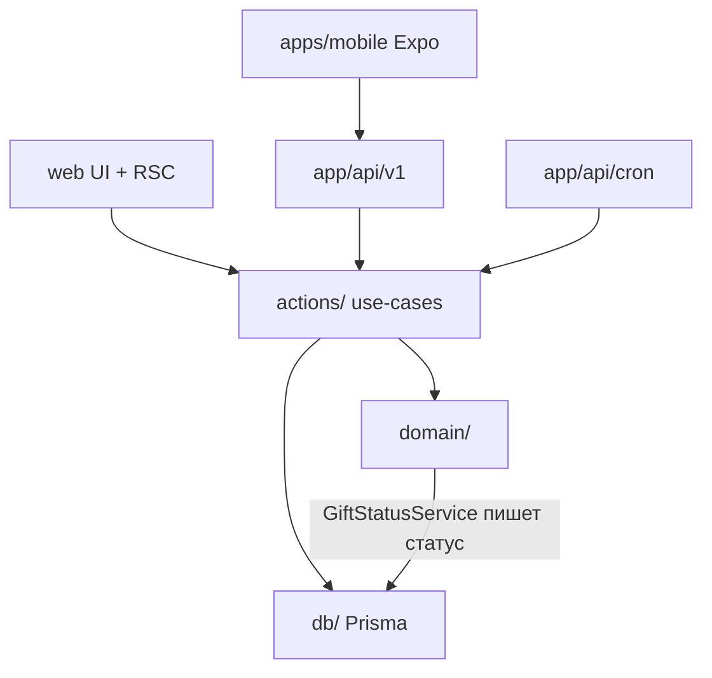
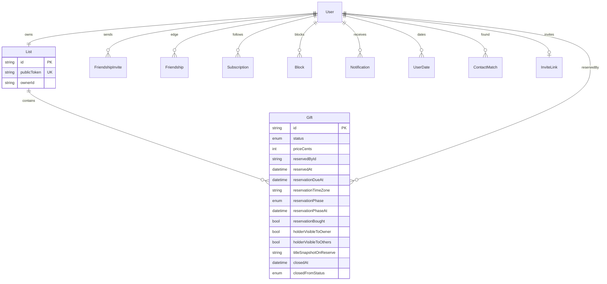

# Architecture Spine — Gift List (MVP)

## Design Paradigm

**Modular monolith · layered Next.js App Router, два клиента.** Один серверный деплойный юнит. Правила домена не живут в React и не дублируются в вебе и в нативном клиенте (AD-17).

| Слой | Каталог | Может зависеть от |
|------|---------|-------------------|
| Web UI | `src/app/` (кроме `api/`) | actions, components |
| Native UI | `apps/mobile/` | только HTTP `api/v1` и общий контракт |
| HTTP / cron | `src/app/api/` | те же use-case, что и actions |
| Application | `src/actions/`, `src/lib/auth/` | domain, db |
| Domain | `src/domain/` | ничего внешнего (чистые правила + порты ошибок) |
| Persistence | `src/db/` | Prisma client only |



Зависимости только **вниз**. Ни веб, ни Expo не импортируют Prisma и не обходят `VisibilityPolicy` / `GiftStatusService`. `apps/mobile` не импортирует `src/`.

## Invariants & Rules

### AD-1 — Слои и направление зависимостей

- **Binds:** all
- **Prevents:** бизнес-логика в UI; параллельный SQL из компонентов/cron в обход сервисов
- **Rule:** Мутации продукта для веба — Server Actions. Нативный клиент вызывает Route Handlers `app/api/v1/*`. Cron и webhooks — Route Handlers `app/api/cron/*` и `app/api/webhooks/*`. Все три адаптера **вызывают те же domain/application методы** и не копируют правила. Domain не импортирует React/Next. Prisma — из `db/` и application/domain-writer сервисов по AD-8.

### AD-2 — Starter и UI-стек `[ADOPTED UX-A1]`

- **Binds:** веб-frontend, design tokens
- **Prevents:** расхождение UI-библиотеки веба; общий React-пакет с нативным клиентом
- **Rule:** Веб уже поднят: Next.js App Router + shadcn + brand delta Forest Paper. Нативный UI — отдельное приложение Expo (AD-17) и **не** импортирует shadcn и `src/app`. Токены Forest Paper в мобильном клиенте — константы, не общий React-пакет: версии React расходятся.

### AD-3 — Аутентификация `[ASSUMPTION]`

- **Binds:** FR-1..FR-3, A-1..A-3, D-21, AD-17
- **Prevents:** два источника пользователей; SMS-вход; OAuth в MVP; сессия натива мимо Better Auth
- **Rule:** **Better Auth** — email + пароль, одна таблица пользователей и database sessions. Веб: cookie httpOnly. Натив: серверный плагин `@better-auth/expo` **той же версии**, что пакет `better-auth`, плюс `bearer()`; клиент Expo хранит токен в `expo-secure-store` и шлёт `Authorization`. `trustedOrigins` включает scheme приложения. Сброс пароля и опциональное confirm-письмо — Resend. Ответы login/register/forgot **не** раскрывают, существует ли email. OAuth и SMS-вход вне MVP. Сессия обязательна для брони, не для чтения PUBLIC-желаний по ссылке (AD-7).

### AD-4 — Система записи `[ASSUMPTION]`

- **Binds:** all persistent state
- **Prevents:** разрозненные store
- **Rule:** PostgreSQL — единственный SoR. Prisma ORM **7.10.0** + миграции. Prod: managed Postgres (Neon preferred).

### AD-5 — Деплой и окружения `[ASSUMPTION]`

- **Binds:** ops envelope R1, D-15, D-17
- **Prevents:** разные хосты без явного решения; Vercel как де-факто целевой хост
- **Rule:** **Этап разработки:** Web → Vercel (Hobby) — хостинг разработки, **не целевой**; DB → managed Postgres; email → Resend; секреты — env хостинга.
  **Триггеры переезда** (первый из): решены юрлицо и место хостинга; приближается пилот с реальными пользователями; нужно закрыть репозиторий или появилась монетизация (Hobby — только некоммерческое использование).
  **Целевая схема:** Docker-образ (`output: 'standalone'`) → сборка в GitHub Actions → деплой на собственный сервер в РБ или РФ. Провайдер и место хостинга не выбраны (Deferred). После переезда репозиторий становится приватным (D-17).
  Таймеры брони (D-12) — Route Handler `api/cron/reservation-timers` (секрет) → **только** `GiftStatusService.processReservationTimers()`: ACTIVE→AWAITING_GIVER при `dueAt ≤ now`; AWAITING_GIVER→AWAITING_OWNER при `phaseAt ≤ now−72h`; AWAITING_OWNER→OPEN при `phaseAt ≤ now−168h AND bought=false`. Напоминания о датах — `api/cron/date-reminders` (AD-23). Срок жизни желания — `api/cron/wish-expiry` (AD-8, D-26). Планировщик любой внешний (AD-16). Email — Resend. Бинарники Expo на Vercel не деплоятся: EAS Build или локальный `expo prebuild`. Секреты сторов, push и pepper телефонов — только env, не git (D-17). Staging API = preview + отдельная DB.

### AD-6 — Один список, токен, профиль `[ADOPTED D-23]`

- **Binds:** D-23, D-29, FR-9, FR-27, FR-28, A-25, A-26
- **Prevents:** два списка; URL от ника; ротация ссылок; утечка числа скрытых желаний
- **Rule:**
  1. У пользователя **ровно один** `List`. Создаётся при регистрации; API создания/удаления списков в MVP **нет**. Колонки `type` `DISCOVERABLE|FRIENDS_ONLY` нет. Видимость — на `Gift` (AD-7).
  2. Path шаринга = `/l/:publicToken`. `List.publicToken` = opaque CUID2, глобально UNIQUE, **immutable**. Смена ника не трогает token.
  3. Профиль = `/u/:nick` отдельно и показывает только те желания, которые зрителю разрешает AD-7. Это не второй URL списка.
  4. Публичная схема URL только `/l/:publicToken` — без query/`listId` альтернатив. Приглашение — отдельный path `/i/:token` (AD-21).

### AD-7 — Видимость желания (единый gate) `[ADOPTED D-23, D-29, D-30]`

- **Binds:** FR-7, FR-8, FR-11, FR-27, FR-31, D-13, D-23, D-29, D-30, D-31, A-11, A-12, A-14, NFR privacy
- **Prevents:** утечка FRIENDS/SECRET; счётчик скрытых желаний; 404 как маскировка Block; второй read-owner
- **Rule:** Единственная `VisibilityPolicy.canSee(viewer, gift)` решает каждое желание. Ответ списка — `{ access: "gifts" | "not_found", gifts: [...] }`. Отдельных `friends_only_gate` и `anon_gate` нет.

  **Порядок на список и профиль:**
  1. Список/token или профиль не найден → `not_found`.
  2. `Block` в любую сторону → `not_found` (и для `/l/:token`, и для `/u/:nick`).
  3. Иначе `access=gifts`, а в `gifts` только желания, прошедшие фильтр ниже. Пустой набор — пустое состояние «нет открытых желаний». **Запрещено** отдавать число, названия и факт существования отфильтрованных желаний.

  **Фильтр желания (`Gift.visibility`):**
  | Значение | Кто видит |
  |----------|-----------|
  | `SECRET` | только владелец |
  | `FRIENDS` | владелец и принятая `Friendship` |
  | `PUBLIC` | владелец, друзья, подписчик (`Subscription`), зритель с ребром `ContactMatch` (AD-18), любой обладатель `/l/:token`, включая анонима |

  Поиск без отношения отдаёт карточку личности (ник, имя) и **ноль** желаний, пока нет подписки, дружбы, совпадения по телефону или ссылки. `hideFromSearch` убирает человека только из текстового поиска; совпадение по телефону и прямые URL работают.

  Даты, интересы и год рождения этим фильтром **не** открываются (AD-23).

  **Матрица чтения подарка:**
  | Контекст | Поля |
  |----------|------|
  | желание прошло фильтр | Полная gift card (AD-12) |
  | Viewer = `reservedById` и `status=RESERVED` (A-14 / FR-25) | **Только reservation card:** `giftId`, `titleSnapshot`, `status`, `ownerNick`, CTA снять. Без остальных желаний владельца |
  | not_found | Нет gift-полей |
  | Owner | Все свои желания, включая `SECRET` |

  **Поля брони по роли зрителя (D-13):**
  | Поле | Держатель | Владелец | Другие с `access=gifts` |
  |------|-----------|----------|--------------------------|
  | status | да | да | да |
  | reservedBy | да | только `holderVisibleToOwner` | только `holderVisibleToOthers` |
  | bought | да | **нет** | да |
  | phase | да | только `AWAITING_OWNER` / `GIVEN` (как `ownerAction`) | только `GIVEN` (как label) |
  | dueAt | да | нет | нет |
  | visibility toggles | да | нет | нет |

  Исключение для Владельца: preflight снятия брони / удаления подарка возвращает `warning: "BOUGHT" | "GIVEN" | null` — только в ответ на это действие.
  Reservation card держателя (A-14) дополняется полями `dueAt`, `phase`, `bought`, `holderVisibleToOwner`, `holderVisibleToOthers`.

  Любой list/gift read API (включая профиль) вызывает тот же `resolve`; сырой `findMany` по `listId` без policy запрещён. FR-25 — исключение только через reservation-card матрицу выше.

### AD-8 — Статусы подарка; единственный writer

- **Binds:** FR-10, FR-12, FR-17, FR-29..FR-32, D-12, D-13, UX-A11
- **Prevents:** dual mutation paths; self-reserve; reopen без решения; авто-снятие купленной брони
- **Rule:** Enum DB: `OPEN | RESERVED | CLOSED`. **Только** `GiftStatusService` выполняет Prisma/SQL, меняющий `status`, колонки брони / закрытия и `archivedAt` (AD-9). Адаптеры — тонкие вызовы сервиса.

  `Gift.quantity`: `SINGLE | UNLIMITED` (D-25). `UNLIMITED` не переходит в `RESERVED` (отказ `VALIDATION`). Счётчик «сколько подарили» в MVP не хранится как публичное поле.

  `Gift.archivedAt`: срок жизни (D-26) или ручной архив. Архив скрывает желание из активного списка. Восстановление → `OPEN` и сбрасывает бронь. Дублирование создаёт новое `OPEN`. Cron `wish-expiry` архивирует просроченные и снимает активную бронь, если держатель не отметил вручение в том же действии. Уведомление «за несколько дней» не включается, пока открыт Q-12 (ARCH-A16).

  Переходы MVP:
  - `OPEN → RESERVED` — только `SINGLE`; даритель ≠ владелец; `dueAt`, `timeZone`, toggles обязательны; если задан `priorityReserverId` и право не снято — актор = этот пользователь (D-28, Q-13)
  - `RESERVED → RESERVED` (смена фазы / атрибутов) — держатель (продлить, bought, given, toggles); владелец (T6 «оставить», T10 «не получал»); cron (таймеры)
  - `RESERVED → OPEN` — держатель | владелец | cron (только `phase=AWAITING_OWNER AND bought=false`)
  - `OPEN | RESERVED → CLOSED` — владелец; reserved* **сохраняются** для аудита; пишутся `closedAt`, `closedFromStatus`; FR-25 активные = `status=RESERVED`
  - `CLOSED → closedFromStatus` — только владелец, только при `closedAt > now()-10s` (отмена) `[ARCH-A5]`
  - Остальные `CLOSED → *` запрещены
  - Владелец **не** может `OPEN → RESERVED` на своём подарке → `FORBIDDEN`
  - `COLLECTION` не используется в R1

  Gift CRUD: поля `title`, `description?`, `priceCents?`, `linkUrl?`, `visibility`, `quantity`, `expiresOn?`, теги (AD-22). Переноса между списками нет. Правка полей при `RESERVED` разрешена и порождает событие держателю; удаление `RESERVED` снимает бронь + событие держателю; «Хочу ещё такой» — обычное создание OPEN-копии в том же списке. Нематериальное желание — то же желание без обязательного `linkUrl`. Денежный сбор не создаётся (AD-11).

### AD-9 — Сериализация всех переходов статуса

- **Binds:** FR-17, FR-19 (R1), FR-29..FR-32, SM-2, D-12
- **Prevents:** двойная бронь; гонки release/close/cron; fork схемы брони
- **Rule:** R1 хранит бронь **на `Gift`** (таблицы `Reservation` в R1 **нет**):
  `status`, `visibility enum(PUBLIC|FRIENDS|SECRET)`, `quantity enum(SINGLE|UNLIMITED)`,
  `expiresOn date null`, `archivedAt timestamptz null`, `priorityReserverId null`,
  `reservedById`, `reservedAt`, `reservationDueAt timestamptz`, `reservationTimeZone text` (IANA),
  `reservationPhase enum(ACTIVE|AWAITING_GIVER|AWAITING_OWNER|GIVEN)`, `reservationPhaseAt timestamptz`,
  `reservationBought bool default false`, `holderVisibleToOwner bool default false`, `holderVisibleToOthers bool default true`,
  `titleSnapshotOnReserve`, `closedAt timestamptz`, `closedFromStatus enum(OPEN|RESERVED)`.
  Индексы для cron: `(status, reservationPhase, reservationDueAt)`, `(status, reservationPhase, reservationPhaseAt)`.

  Каждый переход — одна транзакция с CAS на ожидаемый статус (+ предикат актора):

  | Transition | Predicate |
  |------------|-----------|
  | OPEN→RESERVED | `status=OPEN AND quantity=SINGLE AND archivedAt IS NULL AND (priorityReserverId IS NULL OR priorityReserverId=actor)`; set reserved*, `phase=ACTIVE`; чужой актор при живом праве → `FORBIDDEN` |
  | holder: extend / bought / given / toggles | `status=RESERVED AND reservedById=actor` (+ `phase<>GIVEN` для given). Любой возврат фазы в `ACTIVE` в том же UPDATE ставит `reservationDueAt` в будущее; иначе следующий тик cron снова увидит `dueAt<=now` |
  | owner: keep (T6) / not received (T10) | `status=RESERVED AND phase=AWAITING_OWNER` / `phase=GIVEN` |
  | cron: ACTIVE→AWAITING_GIVER | `status=RESERVED AND phase=ACTIVE AND dueAt<=now()` |
  | cron: AWAITING_GIVER→AWAITING_OWNER | `phase=AWAITING_GIVER AND phaseAt<=now()-72h` |
  | cron: AWAITING_OWNER→OPEN | `phase=AWAITING_OWNER AND phaseAt<=now()-168h AND bought=false`; clear reserved* |
  | RESERVED→OPEN (holder) | `status=RESERVED AND reservedById=actor`; clear reserved* |
  | RESERVED→OPEN (owner) | `status=RESERVED`; clear reserved* |
  | OPEN/RESERVED→CLOSED | `status = expected`; set CLOSED, `closedAt`, `closedFromStatus`; keep reserved* |
  | CLOSED→undo | `status=CLOSED AND closedAt>now()-10s AND owner=actor`; restore `closedFromStatus` |
  | OPEN→archive | `status=OPEN AND archivedAt IS NULL`; set `archivedAt` |
  | RESERVED→archive | только если `bought=false AND phase<>GIVEN`: снять бронь и set `archivedAt` одной транзакцией. При `bought` или `GIVEN` архив не автоматический: уведомление держателю, без смены статуса |

  `dueAt` = конец выбранной даты в `reservationTimeZone`, вычисляется на сервере; валидация `today ≤ date ≤ today+30` в том же поясе (ARCH-A14).

  `rowCount ≠ 1` → `CONFLICT`. Клиентский optimistic UI не авторитетен.

### AD-10 — Дружба `[ADOPTED D-10]`

- **Binds:** FR-13..FR-15, FR-23, FR-24, A-11, A-12, A-16
- **Prevents:** invite как источник FO; дубли рёбер; Block в обход policy
- **Rule:**
  1. FO ↔ существует строка `Friendship` (не статус инвайта).
  2. Pending = `FriendshipInvite` (направленный). Accept = одна транзакция: insert `Friendship(userLowId,userHighId)` UNIQUE, удалить **все** инвайты между парой. Если встречный pending при создании инвайта — **auto-accept** тем же протоколом.
  3. Reject/cancel удаляет инвайт и пишет `InviteCooldown(pair, until=now+24h)` (A-16). Повтор раньше срока запрещён.
  4. Unfriend: delete Friendship + инвайты пары. Block: то же + delete `Subscription` в обе стороны + insert `Block`; новые инвайты запрещены; видимость — AD-7 шаг 2.
  5. Подписка не является дружбой и не проходит фильтр `FRIENDS` (AD-19). Регистрация по `/i/:token` создаёт Friendship (AD-21). Регистрация по `/l/:token` — нет.

### AD-11 — Шов оплаты без сборов `[ADOPTED D-25]`

- **Binds:** A-24, A-17..A-21, FR-4, FR-16, D-25
- **Prevents:** ledger и Сбор в MVP; таблица Contribution «на потом», которую уже нельзя честно ввести
- **Rule:** Нет таблиц платежей, ЮKassa и Contribution. `priceCents` nullable и только ориентир. Статус `COLLECTION` не вводится. Совместный денежный сбор отклонён навсегда (D-25). Целая оплата одного желания, если её вернут, — Раунд 2, отдельным решением, без сборов. Заглушки оплаты в UI запрещены.

### AD-12 — Wire-контракт мутаций и карточек

- **Binds:** all write/read DTOs, D-13, FR-31, UJ-2
- **Prevents:** разнобой shapes; FO gate как NOT_FOUND; утечка имени держателя владельцу
- **Rule:** Action result: `{ ok: true, data } | { ok: false, code, message }`. Коды **закрытый** набор: `UNAUTHENTICATED | FORBIDDEN | NOT_FOUND | CONFLICT | VALIDATION | RATE_LIMITED`. Gate-ответы — `ok: true` с `access`.

  Ответ списка: `{ ok: true, data: { access: "gifts"|"not_found", gifts } }`. Иного конверта нет.
  Gift card — закрытый набор, один и тот же для веба и Expo (`contracts.ts`):
  `{ id, title, description, priceCents: number|null, linkUrl, visibility: "PUBLIC"|"FRIENDS"|"SECRET", quantity: "SINGLE"|"UNLIMITED", expiresOn: string|null, archivedAt: string|null, tags: { catalogId: string|null, label: string }[], status: "OPEN"|"RESERVED"|"CLOSED", reservedBy: null | { id, nick, displayName }, reservationLabel: null | "BOUGHT" | "GIVEN", ownerAction: null | "CONFIRM_GIVEN" | "EXPIRED_NO_REPLY" }`.
  `priorityReserver` (id, nick) — только владельцу и обладателю права; остальным поле отсутствует. `reservedBy` — по матрице AD-7 (D-13) и может быть `null` при `RESERVED`. `reservationLabel` — только не-владельцу; `ownerAction` — только владельцу. Держателю дополнительно — `reservation: { dueAt, phase, bought, holderVisibleToOwner, holderVisibleToOthers }`. Деньги только `priceCents` integer|null — без money-object. `visibility` чужое желание не раскрывает: в выдаче только те карточки, которые фильтр уже пропустил.

### AD-13 — Идентификаторы, ник, поиск

- **Binds:** FR-5, FR-6, FR-8, A-5, A-6, A-26, UX-A6
- **Prevents:** nick как PK; утечка через поиск
- **Rule:** PK = CUID2. Ник: 3–24 `[a-z0-9_]`, уникальность case-insensitive (`nickNormalized`). Текстовый поиск: точный/префикс ник + нечёткое displayName с лимитом; ищет любого пользователя, не только контакты (D-30); `hideFromSearch=true` исключает из этой выдачи. Прямые `/u/...` и `/l/...` работают по AD-7. Совпадение по телефону — отдельный endpoint (AD-18), не этот поиск. `User.phoneE164` опционален и уникален; вход по нему запрещён (D-21). Timestamps `timestamptz` UTC.

### AD-14 — Уведомления `[ASSUMPTION A-22]`

- **Binds:** FR-26, FR-31, SM-C1, NFR privacy
- **Prevents:** push-scope; FO leak в нотификациях; утечка держателя владельцу; повторные «пинги»
- **Rule:** MVP — in-app `Notification` + email (Resend). Каналы получателя: in-app и email, по категориям (FR-52). Нативный push в MVP нет (Q-9). Одно событие → одна запись `Notification` (+ одно письмо, если канал email включён и событие в email-перечне).
  `Notification.deliverAfter timestamptz` — для закрытия (= `closedAt + 10 s`); отмена удаляет недоставленную запись. Доставка отложенных писем — механизм на выбор dev (after-response task или cron), допустимая задержка ≤ 1 ч.
  Закрытый `Notification.kind`: `FRIEND_INVITE`, `FRIEND_ACCEPT`, `FRIEND_REJECT`, `RESERVATION_CREATED`, `RESERVATION_RELEASED`, `RESERVATION_DUE`, `RESERVATION_OWNER_ASK`, `RESERVATION_AUTO_RELEASE`, `GIFT_EDITED`, `GIFT_DELETED`, `GIFT_CLOSED`, `GIFT_GIVEN`, `DATE_FRIEND`, `DATE_OWN`, `SUGGESTION`, `WISH_EXPIRY`. Другие kind запрещены. Email — подмножество: события брони из FR-26, напоминания дат, `SUGGESTION` и `WISH_EXPIRY`, если у получателя включён канал email.
  Payload и письма: не содержат названий желаний, которые получатель не может видеть (AD-7); не содержат дат, которые он не может видеть (AD-23); держателю — `titleSnapshot`; владельцу — без идентичности держателя без `holderVisibleToOwner` и без `bought`. Предложение идеи: журнал `Suggestion` не хранит право брони. Право — только `Gift.priorityReserverId`. Принятие создаёт `OPEN` + `SINGLE`; видимость выбирает получатель. Если он выбрал `SECRET`, право снимается (бронировать некому). Имя отправителя в payload есть только если он его раскрыл (D-28).

### AD-15 — Тестирование инвариантов `[ASSUMPTION]`

- **Binds:** AD-7, AD-9, AD-14, SM-2, FR-31
- **Prevents:** «забытые» гонки и privacy в epics
- **Rule:** Обязательные автотесты (уровень ниже выбирает runner): (1) параллельные две брони SINGLE → ровно одна success; (2) аноним по `/l/:token` получает только PUBLIC и не получает число остальных; (3) Block + валидный token → `not_found`; (4) unfriend + активная бронь → reservation card без остальных желаний; (5) владелец при `holderVisibleToOwner=false` не получает идентичность держателя ни в gift card, ни в Notification, ни в письме; `bought` владельцу не отдаётся; (6) cron не переводит в OPEN брони с `bought=true` и в фазе GIVEN; (7) гонка cron-таймера и действия держателя/владельца → ровно один переход; (8) отмена закрытия после 10 s → `CONFLICT`; (9) `UNLIMITED` → отказ брони; (10) подписчик не получает FRIENDS и даты; (11) регистрация по `/l/` не создаёт Friendship, по `/i/` создаёт; (12) сопоставление телефонов не пишет сырые номера. Остальной test pyramid — на epics.

### AD-16 — Переносимость `[ADOPTED D-16]`

- **Binds:** весь серверный код, AD-5, D-16, D-17
- **Prevents:** код, который работает только на Vercel; блокировка переезда на Docker; утечка секретов из публичного репозитория
- **Rule:** Запрещены платформенные сервисы Vercel (Cron, Blob, KV, Edge Config) и иные API, доступные только на одной платформе. Сборка сервера обязана работать как `output: 'standalone'` в Docker-образе. Задачи по расписанию — Route Handler под `app/api/cron/*`, защищённый секретом и вызываемый любым внешним cron; cron таймеров брони — **только** через `GiftStatusService.processReservationTimers()` (AD-1, AD-8). Конфигурация — только через `env.ts`; секретов в репозитории нет (он публичный до переезда). Секреты EAS и сторов — вне git.

### AD-17 — Граница нативного клиента `[ADOPTED D-20]`

- **Binds:** весь UI, AD-1, AD-2, AD-3, D-20
- **Prevents:** Expo вызывает Server Actions; две копии доменных правил; общий UI-пакет на разных React
- **Rule:** Каталог `apps/mobile` — Expo SDK **58** (`expo` 58.0.20), одна кодовая база на iOS и Android. Он обращается только к `app/api/v1` JSON с конвертом AD-12. Веб-страницы публичной ссылки `/l/:token` и админки `/admin` остаются в Next.js. Общий код между клиентами — только контракт (zod-схемы без React), если его вынесут в пакет; импорт `src/domain` из Expo запрещён. Проверено 2026-10-28: SDK 58 рассчитан на React Native 0.88 и React 19.3.0; веб в репозитории на React 19.2.8 — версии не выравнивать через общий UI.

### AD-18 — Сопоставление телефонной книги `[ADOPTED D-21, D-30]`

- **Binds:** FR-40, FR-50, D-21, D-30
- **Prevents:** своя база чужих контактов; «анонимный» хеш номера; отказ приложения без доступа к книге
- **Rule:** Канон номера — E.164: только `+` и цифры, без пробелов, страна обязательна. Номер без кода страны не угадывается и в сверку не идёт. Свой номер: колонки `User.phoneE164` (unique, nullable) и `User.phoneHmac` (hex HMAC-SHA256 того же канона, unique, nullable). Pepper — env, не репозиторий. Несолёный хеш запрещён. Endpoint принимает пачку уже канонических номеров, считает HMAC и ищет `phoneHmac`. Сырой номер запроса не пишется. Успех создаёт ребро `ContactMatch(scannerId, foundUserId)` без телефона — это и есть «знает номер» для AD-7 на следующих открытиях профиля. Подписка этим ребром не создаётся. В приглашениях нет «выбрать всех» (Apple 5.1.2(v)). Отказ в разрешении оставляет текстовый поиск (AD-13).

### AD-19 — Подписка `[ADOPTED D-30]`

- **Binds:** FR-46, D-30, AD-7, AD-10
- **Prevents:** подписка как чёрный ход к желаниям «для друзей»; взаимность по умолчанию
- **Rule:** `Subscription(subscriberId, targetId)` уникальна, создаётся без подтверждения. Даёт фильтр `PUBLIC` и ничего больше. Снятие — любой стороной. Block удаляет обе направленные подписки (AD-10).

### AD-20 — Удаление аккаунта `[ADOPTED D-33]`

- **Binds:** FR-51, D-33, Q-3
- **Prevents:** релиз в App Store с удалением только письмом автору; разное удаление на вебе и в Expo
- **Rule:** Единственная команда `deleteAccount(userId)`. Её вызывают веб и Expo. Better Auth не отдаёт отдельный delete наружу: сессии cookie и bearer гасятся внутри этой команды. Порядок: активные брони этого пользователя снимаются через `GiftStatusService` (CAS) с событием другой стороне и `titleSnapshotOnReserve`; затем удаляются строки, которые создал сервис, включая `phoneE164` и `phoneHmac`; ссылка `/l/:token` становится `not_found`. Прямой `deleteUser` Better Auth и SQL `onDelete` мимо сервиса запрещены. Срок хранения — Q-3; до ответа исключения пустые. Кнопка в настройках, с подтверждением. Обязательна до отправки в App Store.

### AD-21 — Приглашение и ссылка на вишлист `[ADOPTED D-29]`

- **Binds:** FR-47, FR-27, D-29, AD-10
- **Prevents:** дружба от просмотра чужого вишлиста; дружба от префетча ссылки
- **Rule:** У пользователя один immutable invite-token, path `/i/:token`. Регистрация с этим token в той же транзакции создаёт `Friendship`, если нет Block. Уже зарегистрированный открывает подтверждение; без подтверждения ребро не создаётся. Регистрация или вход с `/l/:publicToken` дружбу и подписку не создают. После входа тот же URL вишлиста.

### AD-22 — Админка и теги `[ADOPTED D-27, D-32]`

- **Binds:** FR-44, FR-49, D-27, D-32
- **Prevents:** админка внутри бинарника стора; свои теги в общей статистике до модерации
- **Rule:** `User.role = USER | ADMIN`. `/admin` только на вебе, только ADMIN. Редакционные подборки — сущности `EditorialCollection` / `EditorialItem`, наполнение вручную, без AI. Тег желания: либо id из фиксированного каталога (старт: `мечта`, `нужно сейчас`, `когда-нибудь`; ADMIN может добавить фиксированные), либо custom-текст. Custom виден на желании тем, кто видит желание, и не входит в агрегаты. В каталог он попадает только после нормализации и одобрения ADMIN. Секретные желания в любые агрегаты не входят.

### AD-23 — Даты профиля `[ADOPTED D-18, D-22, D-31]`

- **Binds:** FR-33..FR-38, D-18, D-22, D-31
- **Prevents:** напоминание тому, кто дату не видит; госпраздники в календаре; второй источник часового пояса
- **Rule:** `User.timeZone` IANA, not null, default `UTC` — единственный пояс пользователя. `reservationTimeZone` на брони — снимок на момент Срока, не второй источник правки. `UserDate`: `kind BIRTHDAY|CUSTOM`, день, месяц, год опционален, `visibility only_me|friends|everyone` (default `friends`). `only_me` — владелец. `friends` — принятая дружба. `everyone` — любой зритель профиля после проверки Block, включая анонима на `/u/:nick`, подписчика и `ContactMatch`. Дата не входит в ответ `/l/:token`. BIRTHDAY — не больше одной. CUSTOM — не больше 10. Год — отдельный флаг `yearVisibility`, default `only_me`; видимость даты `everyone` год сама не открывает. Напоминание дарителю (T-14) — только другу, которому дата видна, и только при видимом ему `OPEN` желании. Напоминание владельцу (T-30) — только о своём ДР. `ReminderLog` UNIQUE(получатель, dateId, год, kind). Cron `api/cron/date-reminders`. Интересы (FR-39) в MVP не создаются; видимость по умолчанию — друзья (D-31).

## Consistency Conventions

| Concern | Convention |
| --- | --- |
| Naming entities | `User`, `List` (один), `Gift.visibility` (`PUBLIC` \| `FRIENDS` \| `SECRET`), `Gift.quantity` (`SINGLE` \| `UNLIMITED`), `Friendship`, `Subscription`, `FriendshipInvite`, `InviteLink`, `Block`, `Notification`, `UserDate`, `EditorialCollection` |
| Files | kebab-case файлы; PascalCase типы; domain без React |
| Status on wire | English enum `OPEN\|RESERVED\|CLOSED`; UI labels из UX (открыт/…) |
| Money R1 | `priceCents: number \| null`; display ₽ |
| Errors | AD-12 closed codes |
| Authz | AD-7 + ownership; object-level |
| Logging | audit смены Gift.status (actor, from→to, at) |
| Config | typed `env.ts` (zod); секреты не в клиент |
| Locale / theme | RU only; light only |
| Hide from search | `User.hideFromSearch` boolean default false |

## Stack

| Name | Version |
| --- | --- |
| Next.js (App Router) | 16.3.8 |
| React (веб, как в репозитории) | 19.2.8 |
| Expo SDK | 58.0.20 |
| React Native (через SDK 58) | 0.88 |
| expo-contacts | 58.0.9 |
| @better-auth/expo | 1.7.6 (равна установленному better-auth; поднимать только парой) |
| TypeScript | create-next-app default at scaffold |
| Tailwind CSS | 4.3.3 |
| shadcn/ui | CLI latest at scaffold |
| Better Auth | 1.7.6 |
| Prisma + `@prisma/client` | 7.10.0 (pin; не `latest` → 8 RC) |
| PostgreSQL | 16+ managed |
| Zod | 4.6.5 |
| `@paralleldrive/cuid2` | 3.3.0 |
| Resend | 6.31.0 |
| Hosting | Разработка: Vercel (Hobby) + Neon (preferred) + Resend; цель: Docker-образ (`standalone`) на собственном сервере РБ/РФ (AD-5) |

Проверено npm view / Next security release 2026-09-30.

## Structural Seed

```text
src/
  app/
    (auth)/login|register|forgot|reset/
    (app)/                    # wishlist, search, friends, reservations, settings, notifications
    admin/                    # AD-22, web only
    u/[nick]/
    l/[token]/                # public link, anonymous PUBLIC wishes
    i/[token]/                # invite
    api/v1/                   # native adapter, AD-17
    api/cron/reservation-timers/
    api/cron/date-reminders/
    api/cron/wish-expiry/
  actions/
  domain/
    visibility.ts
    gift-status.ts
    friendship.ts
  db/
  components/
  lib/
    auth.ts
    env.ts
    contracts.ts              # zod wire types AD-12
apps/mobile/                  # Expo SDK 58, не импортирует src/
```

```mermaid
stateDiagram-v2
  [*] --> OPEN
  OPEN --> RESERVED: reserve CAS (dueAt, toggles)
  state RESERVED {
    [*] --> ACTIVE
    ACTIVE --> AWAITING_GIVER: cron dueAt
    AWAITING_GIVER --> AWAITING_OWNER: cron +72h
    AWAITING_GIVER --> ACTIVE: holder extend / bought
    AWAITING_OWNER --> ACTIVE: holder extend / owner keep
    ACTIVE --> GIVEN: holder given
    AWAITING_GIVER --> GIVEN: holder given
    AWAITING_OWNER --> GIVEN: holder given
    GIVEN --> ACTIVE: owner not received (bought=true)
  }
  RESERVED --> OPEN: holder / owner release; cron +168h if !bought
  OPEN --> CLOSED: owner received
  RESERVED --> CLOSED: owner received
  CLOSED --> OPEN: undo ≤10s (closedFromStatus)
  CLOSED --> RESERVED: undo ≤10s (closedFromStatus)
  CLOSED --> [*]
```





## Capability → Architecture Map

| Capability / Area | Lives in | Governed by |
| --- | --- | --- |
| FR-1..3 Auth | `lib/auth`, `(auth)/*` | AD-3, AD-13 |
| FR-4 Email gate payments | — R2 | AD-11 |
| FR-5..8 Profile / search / hide | `u/[nick]`, search | AD-7, AD-13 |
| FR-9..12 Один список, CRUD, видимость | actions + domain | AD-1, AD-6, AD-7, AD-8 |
| FR-27..28 Публичная ссылка | `l/[token]` | AD-6, AD-7, AD-21 |
| FR-13..15,23..24,46,47 Дружба, подписка, инвайт | `domain/friendship` | AD-10, AD-19, AD-21 |
| FR-40, FR-50 Телефон и книга | `api/v1` + Expo | AD-18 |
| FR-38, FR-33..37 Даты | `UserDate`, cron date-reminders | AD-23 |
| FR-44, FR-49 Админка и теги | `app/admin` | AD-22 |
| FR-48 Предложить идею | domain + Notification | AD-8, AD-14, D-28 |
| FR-51 Удаление аккаунта | settings + Expo | AD-20 |
| Нативный клиент | `apps/mobile` | AD-17 |
| FR-17 Reserve / release / close | `GiftStatusService` | AD-8, AD-9, AD-12 |
| FR-29..FR-32 Срок, отметки, видимость, закрытие | `GiftStatusService`, cron `reservation-timers` | AD-5, AD-7, AD-8, AD-9, AD-12, AD-14 |
| FR-25 My reservations | reservation card queries | AD-7 matrix, AD-9 |
| FR-26 Notifications | Notification + UI | AD-14 |
| A-24 / R2 payments | deferred | AD-11 |
| Race/privacy tests | test suite | AD-15 |
| Ops cron таймеры брони | cron → GiftStatusService | AD-5, AD-9, AD-16 |
| Деплой, переезд, Docker | Dockerfile / GitHub Actions (после триггера) | AD-5, AD-16 |

## Deferred

| Item | Why wait |
| --- | --- |
| Целая оплата одного желания (без Сбора) | Раунд 2, A-24; Сбор отклонён навсегда (D-25, AD-11) |
| OAuth, SMS-вход, нативный push | Push — кандидат Раунда 1.5 (Q-9); OAuth и SMS вне MVP |
| Банк идей и наблюдения, автосопоставление | D-24: список в Раунде 2, сопоставление позже |
| Тайный Санта, группы, AI-разбор желаний, «часто добавляют/выбирают», рекомендации блогеров | D-32; блогеры ещё и Q-14 |
| Share-sheet, per-gift links, OG design | вне MVP |
| Число дней до срока желания и таймаут первого права брони | Q-12, Q-13; до ответа истории не стартуют (ARCH-A16) |
| Self-serve репорт | ARCH-A1; удаление аккаунта не откладывается (AD-20) |
| i18n, dark mode | UX-A8/A9 |
| Redis rate-limit prod hardening | пилот; soft |
| Prisma 8 | RC; revisit after GA |
| Финальный бренд/домен | Q-2 открыт |
| Место хостинга и провайдер (РБ или РФ, managed Postgres), юрлицо | PRD Q-7; чат 1 `discussion-backlog-2026-10-11.md`; фиксируется в AD-5 при переезде |
| Мультирегиональная модель (домашний регион + общий каталог ников; `homeRegion`) | PRD Q-8; чат 1 `discussion-backlog-2026-10-11.md`; сейчас не строим |
| Внешний планировщик для `api/cron/reservation-timers` | к Story 5.6; при переезде — cron хоста |
| Полная test pyramid / e2e tooling | epics; AD-15 задаёт минимум |

## Open assumptions (не блокеры)

| ID | Решение spine | Источник |
|----|---------------|----------|
| ARCH-A1 | Нет self-serve репорта; контакт Sergey | Q-1 / UX-A2 |
| ARCH-A2 | Имя Gift List; домен открыт | Q-2 |
| ARCH-A3 | Снято для механизма: удаление в приложении обязательно (AD-20, D-33). Срок хранения по-прежнему Q-3 | Q-3 |
| ARCH-A4 | Цена опциональна | Q-6 / UX-A5 |
| ARCH-A5 | Нет reopen CLOSED в R1, кроме отмены владельцем в течение 10 s | UX-A11, D-12 |
| ARCH-A6..A11 | Ник UX-A6; RU; light; cron; soft RL; Vercel+Neon+Resend только на этапе разработки (AD-5) | UX + ops |
| ARCH-A12 | Auto-accept при встречном pending инвайте | AD-10 |
| ARCH-A13 | `titleSnapshot` на бронь для A-14 path и писем держателю | AD-7, AD-14 |
| ARCH-A14 | Срок брони = конец даты в IANA-поясе дарителя (из браузера, fallback UTC); хранится как `reservationDueAt timestamptz` | A-27 |
| ARCH-A15 | Таймеры брони вызываются внешним планировщиком раз в час (не Vercel Cron); вызов идемпотентен, пропуск запуска только сдвигает переходы | D-12, переносимость |
| ARCH-A16 | Пока Q-12 открыт, упреждающее уведомление о сроке жизни желания не реализуется. Пока Q-13 открыт, первое право брони не истекает само: его снимают бронь, отказ предложившего или владелец | Q-12, Q-13, D-26, D-28 |
