# Gift List — контекст проекта

Oct 17, 2026 · @Sergey

## Как пользоваться этим документом

Это вводная для нового чата: что за проект, что уже решено и где лежат первоисточники. Снимок на 2026-10-17, последний коммит `main` — `ba54ae3`. При расхождении с файлами в репозитории **правы файлы**.

**Репозиторий:** `Clever-Agency/Gift-list`, локально `E:\Projects\CleverAgency\Gift-list`.

**Первоисточники** (всё в `_bmad-output/`):

| Артефакт | Путь |
| --- | --- |
| Бриф | `planning-artifacts/briefs/brief-gift-list-2026-09-29/brief.md` |
| PRD (FR, NFR, D-решения, Q-вопросы) | `planning-artifacts/prds/prd-gift-list-2026-09-30/prd.md` + `addendum.md` |
| Архитектура (AD-1..AD-16) | `planning-artifacts/architecture/architecture-gift-list-2026-09-30/ARCHITECTURE-SPINE.md` |
| UX | `planning-artifacts/ux-designs/ux-gift-list-2026-09-30/DESIGN.md`, `EXPERIENCE.md`, `prototype/index.html` |
| Эпики и истории | `planning-artifacts/epics/epics-gift-list-2026-09-30/epics.md` |
| Статус спринта | `implementation-artifacts/sprint-status.yaml` |
| Спеки историй, отложенное | `implementation-artifacts/spec-1-*.md`, `deferred-work.md` |
| Бэклог обсуждений | `planning-artifacts/discussion-backlog-2026-10-11.md` |
| Корректировки курса | `planning-artifacts/sprint-change-proposal-2026-10-10.md`, `…-2026-10-11.md` |

**Правила работы:**

- Перед кодом читать `node_modules/next/dist/docs/`: в Next.js 16 API отличаются от привычных (см. `AGENTS.md`).
- Процесс — BMAD. Изменения в PRD, эпиках и архитектуре вносятся только через `bmad-correct-course` или `bmad-architecture`, не правкой «на глаз».
- Перед новым обсуждением смотреть `git log -- _bmad-output`: там видно, что поменялось после прошлых чатов.
- Язык артефактов и интерфейса — русский.

## Продукт и цели

Gift List — веб-сервис вишлистов для узкого круга, который убирает дубли подарков, сорванные «куплю сам» и непрозрачные сборы «на карту». Рабочее имя, финальный бренд и домен не выбраны.

**Ключевая модель:**

- У каждого пользователя ровно **два списка**, они создаются при регистрации:
    - **Discoverable** — подарки видит любой вошедший, кто нашёл владельца или открыл ссылку на список.
    - **Friends-only** — подарки видят только принятые друзья. Не-друг по ссылке видит пояснение «только для друзей», а не «не найдено».
    - Аноним видит предложение войти, подарков не видит.
- **Дружба** только внутри сервиса и взаимна: пригласить может любой, после принятия оба видят Friends-only друг друга. Телефонная книга не используется.
- **Ссылки:** у каждого списка свой адрес `/l/:token`, профиль — отдельно `/u/:nick`. Ссылок на один подарок и share-sheet нет.
- **Действия на подарке** (целевая модель): оплатить полностью, забронировать «куплю сам», внести часть с видимым прогрессом. Бронь и сбор взаимно исключают друг друга. В Раунде 1 есть только бронь.

**Пользователи:** владелец вишлиста (именинник, родитель, пара) и даритель, которому нужно за один заход понять, что можно сделать с каждым подарком.

**Преимущество** — понятные правила видимости и состояний подарка, а не технологический «ров». Ошибка в состоянии брони дороже, чем отсутствие оплаты на первом запуске.

**Рынки (D-14):** сначала Беларусь, потом Россия. США и ЕС пока не рассматриваются.

**Метрики Раунда 1:**

| ID | Метрика | Цель |
| --- | --- | --- |
| SM-1 | Доля подарков с осмысленным исходом без конфликта (пилот: ≥ 1 событие, ≥ 3 дарителя) | «Большинство», опрос |
| SM-2 | Инциденты двойной брони или покупки | 0 |
| SM-3 | Подарки в обоих списках и ≥ 3 принятые дружбы без поддержки | Да |
| SM-4 | Медиана от открытия подарка до брони | ≤ 3 мин |
| SM-C1 | Антиметрика: не давить напоминаниями | ≤ 1 уведомление на событие брони |
| SM-C2 | Антиметрика: не расширять охват Discoverable ценой утечек Friends-only | — |

**Ориентиры NFR:** профиль и список открываются < 2 с на 4G при ≤ 100 подарках. Авторизация на уровне объекта. Клавиатура, контраст и label у форм на ключевых потоках. Аудит каждой смены статуса подарка.

## Раунды

Первый запуск (Раунд 1) идёт **без денег**: только бронь «куплю сам» и закрытие подарка владельцем (A-24). Кнопок-заглушек «оплата скоро» быть не должно.

| Раунд | Что входит | FR |
| --- | --- | --- |
| **Раунд 1** | Email + пароль, сброс пароля; ник, профиль, поиск, «скрыть из поиска»; два списка и CRUD подарков; ссылки на списки; дружба, удаление, блокировка; бронь со сроком, «Купил»/«Подарил», видимость держателя; закрытие с отменой; «Мои брони»; уведомления в приложении и по email | FR-1..3, 5..15, 17, 23..32 |
| **Раунд 2** | Полная оплата, частичный сбор с прогрессом, взаимоисключение сбора и брони, подключение выплат владельца, возвраты, подтверждение email перед платежами, «Мои взносы». Провайдер в PRD — ЮKassa; для РБ обсуждаются bePaid/Assist + ЕРИП | FR-4, 16, 18..22 |
| **Не планируется** | Нативные приложения, OAuth, push/SMS, импорт телефонной книги, маркетплейс и партнёрский checkout, мультивалюта, i18n, тёмная тема, ссылки на отдельный подарок, self-serve репорт и удаление аккаунта (в R1 — ручной запрос) | — |

Часть пунктов «не планируется» может переоткрыться в чатах бэклога: мультивалюта (Q-8), push через PWA (Q-9).

## Зафиксированные решения

Все восемь решений подтверждены Sergey и внесены в PRD §12. Переоткрывать их без новой причины не нужно.

| ID | Дата | Решение |
| --- | --- | --- |
| D-10 | 2026-09-30 | **Взаимная дружба.** Пригласить может любой вошедший; после принятия оба видят Friends-only друг друга. Заменило «приглашает только владелец». |
| D-11 | 2026-09-30 | **Ссылки на списки.** У каждого списка свой URL, отдельно от `/u/{ник}`. Не-друг по Friends-only-ссылке видит объяснение, а не «не найдено». Ссылок на подарок и share-sheet нет. |
| D-12 | 2026-10-10 | **Жизненный цикл брони.** Дата события не привязана к списку или подарку. Срок задаёт даритель: по умолчанию +7 дней, максимум +30, продления без лимита. Срок истёк → уведомление дарителю → через 72 ч запрос владельцу → ещё через 168 ч молчания автоснятие, только если нет «Купил». «Купил» и «Подарил» автоматически не снимаются. Закрывает подарок только владелец, с отменой в течение 10 с. Email по событиям брони — в R1. |
| D-13 | 2026-10-10 | **Анонимность держателя брони.** Два переключателя у дарителя: «видим владельцу» (по умолчанию выкл.) и «видим другим» (по умолчанию вкл.). Владелец видит «забронирован» без имени и не видит «Купил». |
| D-14 | 2026-10-11 | **Рынки:** сначала Беларусь, затем Россия; США и ЕС пока нет. |
| D-15 | 2026-10-11 | **Хостинг разработки** — Vercel Hobby. Переезд на Docker и свой сервер в РБ/РФ при первом из событий: решены юрлицо и хостинг; приближается пилот; нужен приватный репозиторий или появилась монетизация. |
| D-16 | 2026-10-11 | **Переносимость.** Без Vercel Cron, Blob, KV, Edge Config. Задачи по расписанию — Route Handler + любой внешний cron. Цель — Docker-образ `output: 'standalone'`. |
| D-17 | 2026-10-11 | **Репозиторий** публичный, потому что Vercel Hobby не деплоит приватные репозитории организаций. Секретов в нём быть не должно. После переезда становится приватным. |

**Предварительные договорённости** (ещё не D-решения, подтвердить в чатах бэклога):

- Мобильная платформа: сейчас PWA, позже по триггерам Capacitor, затем Expo/React Native. Flutter не рассматривается.
- Подписка, если будет, оформляется только через сайт; приложение лишь проверяет статус аккаунта.
- Срок брони считается в часовом поясе браузера дарителя, fallback UTC (A-27 / ARCH-A14).

## Архитектура

Модульный монолит на Next.js App Router: один деплой, правила домена не живут в React и не дублируются. Источник — `ARCHITECTURE-SPINE.md` (status: final, обновлён 2026-10-11).

### Слои (зависимости только вниз)

| Слой | Каталог | Может зависеть от |
| --- | --- | --- |
| UI / маршруты | `src/app/` | actions, components |
| Application | `src/actions/`, `src/lib/auth` | domain, db |
| Domain | `src/domain/` | ничего внешнего (чистые правила) |
| Persistence | `src/db/` | только Prisma client |

Мутации — Server Actions. Cron и будущие webhooks — Route Handlers, которые вызывают те же сервисы. Клиент не импортирует Prisma и не обходит `VisibilityPolicy` и `GiftStatusService`.

### Правила AD-1…AD-16

| AD | Тема | Суть |
| --- | --- | --- |
| AD-1 | Слои | См. таблицу выше. Domain не импортирует React/Next. |
| AD-2 | Стартер | `create-next-app` → `shadcn init` → бренд Forest Paper. |
| AD-3 | Аутентификация | Better Auth, email + пароль, сессии в БД (httpOnly cookie). Сброс пароля через Resend. Ответы login/register/forgot не раскрывают, существует ли email. OAuth нет. |
| AD-4 | Хранилище | PostgreSQL — единственный источник данных. Prisma 7.10.0 + миграции. |
| AD-5 | Деплой | Сейчас Vercel Hobby + Neon + Resend (не целевой хост). Цель: Docker-образ → сборка в GitHub Actions → свой сервер в РБ/РФ. Staging = preview + отдельная БД. |
| AD-6 | Списки и токены | Ровно два списка, `UNIQUE(ownerId, type)`, API создания/удаления списков нет. `publicToken` — CUID2, глобально уникален, не меняется (смена ника его не трогает). Публичный URL только `/l/:publicToken`. |
| AD-7 | Видимость | Единственный gate `VisibilityPolicy.resolve(viewer, list)` → `gifts \| friends_only_gate \| anon_gate \| not_found`. Любое чтение списка или подарка, включая профиль, идёт через него. |
| AD-8 | Статусы | `OPEN \| RESERVED \| CLOSED`. Меняет статус и поля брони **только** `GiftStatusService`. Владелец не может бронировать свой подарок. |
| AD-9 | Сериализация | Каждый переход — одна транзакция с CAS на ожидаемый статус и предикатом актора; `rowCount ≠ 1` → `CONFLICT`. Бронь хранится прямо в `Gift`, таблицы `Reservation` нет. |
| AD-10 | Дружба | Доступ = существование строки `Friendship(userLowId, userHighId)`. Приглашение — `FriendshipInvite`. Встречные приглашения принимаются автоматически. Повтор после отказа — не раньше 24 ч. Блокировка = удаление дружбы и приглашений + запись `Block`. |
| AD-11 | Шов Раунда 2 | В R1 нет платёжных таблиц. `priceCents` nullable. R2 добавит таблицы, статус `COLLECTION` и взаимоисключение внутри `GiftStatusService`, не меняя AD-6/7/10. |
| AD-12 | Wire-контракт | Результат действия: `{ ok: true, data } \| { ok: false, code, message }`. Коды: `UNAUTHENTICATED \| FORBIDDEN \| NOT_FOUND \| CONFLICT \| VALIDATION \| RATE_LIMITED`. Gate-ответы — `ok: true` с `access`. Деньги — только `priceCents: number \| null`. |
| AD-13 | ID, ник, поиск | PK — CUID2. Ник 3–24 символа `[a-z0-9_]`, уникален без учёта регистра (`nickNormalized`). Поиск: точный/префикс ника + нечёткий по имени. `hideFromSearch` убирает из выдачи, прямые ссылки работают. Время — `timestamptz` UTC. |
| AD-14 | Уведомления | In-app `Notification` + email (Resend). Одно событие → одна запись. Уведомление о закрытии откладывается на 10 с (`deliverAfter`). Без содержимого Friends-only и без идентичности держателя. |
| AD-15 | Тесты | 8 обязательных автотестов (список ниже). |
| AD-16 | Переносимость | Никаких платформенных API Vercel. Сборка работает как `standalone`. Конфигурация — только через `env.ts` (zod). |

### Порядок проверки видимости (AD-7)

1. Список или токен не найден → `not_found`.
2. Есть `Block` в любую сторону → `not_found` (для обоих типов списков и профиля, чтобы не подтверждать существование).
3. Владелец → `gifts`.
4. Аноним → `anon_gate`.
5. Friends-only + дружба → `gifts`.
6. Friends-only + вошедший не-друг → `friends_only_gate`: только `owner { id, nick, displayName }` и тип списка, никаких полей подарков и счётчиков.
7. Discoverable + вошедший → `gifts`.

Исключение (FR-25 / A-14): держатель активной брони, потерявший доступ к списку, видит только reservation card: `titleSnapshot`, статус, тип списка, ник владельца, срок и фаза. Без соседних подарков.

### Кто что видит о брони (D-13)

| Поле | Держатель | Владелец | Другие с `access=gifts` |
| --- | --- | --- | --- |
| status | да | да | да |
| reservedBy | да | только при `holderVisibleToOwner` | только при `holderVisibleToOthers` |
| bought («Купил») | да | **нет** | да |
| phase | да | только `AWAITING_OWNER` / `GIVEN` как `ownerAction` | только `GIVEN` как подпись |
| dueAt, переключатели | да | нет | нет |

Владелец узнаёт про «Купил»/«Подарил» только из предупреждения, когда сам снимает бронь или удаляет подарок (`warning: BOUGHT | GIVEN`).

### Жизненный цикл подарка и брони

```mermaid
stateDiagram-v2
  [*] --> OPEN
  OPEN --> RESERVED: reserve CAS (dueAt, toggles)
  state RESERVED {
    [*] --> ACTIVE
    ACTIVE --> AWAITING_GIVER: cron dueAt
    AWAITING_GIVER --> AWAITING_OWNER: cron +72h
    AWAITING_GIVER --> ACTIVE: holder extend / bought
    AWAITING_OWNER --> ACTIVE: holder extend / owner keep
    ACTIVE --> GIVEN: holder given
    AWAITING_GIVER --> GIVEN: holder given
    AWAITING_OWNER --> GIVEN: holder given
    GIVEN --> ACTIVE: owner not received (bought=true)
  }
  RESERVED --> OPEN: holder / owner release; cron +168h if !bought
  OPEN --> CLOSED: owner received
  RESERVED --> CLOSED: owner received
  CLOSED --> OPEN: undo ≤10s
  CLOSED --> RESERVED: undo ≤10s
  CLOSED --> [*]
```

- Поля брони на `Gift`: `reservedById`, `reservedAt`, `reservationDueAt`, `reservationTimeZone` (IANA), `reservationPhase`, `reservationPhaseAt`, `reservationBought`, `holderVisibleToOwner` (false), `holderVisibleToOthers` (true), `titleSnapshotOnReserve`, `closedAt`, `closedFromStatus`.
- При закрытии поля брони сохраняются для аудита. Из `CLOSED` есть только отмена владельцем в течение 10 с.
- `dueAt` = конец выбранной даты в поясе дарителя, считается на сервере. Допустимо: сегодня ≤ дата ≤ сегодня + 30.
- Gift CRUD: поля `title`, `description?`, `priceCents?`, `linkUrl?`. Перенос между списками — только в `OPEN`. Правка или удаление подарка в `RESERVED` уведомляет держателя. «Хочу ещё такой» — новая OPEN-копия.

### Cron таймеров брони

`app/api/cron/reservation-timers` защищён секретом. Раз в час его вызывает внешний планировщик (до переезда — например, GitHub Actions schedule). Он вызывает только `GiftStatusService.processReservationTimers()`. Вызов идемпотентен: пропуск запуска лишь сдвигает переходы.

### Обязательные автотесты (AD-15)

1. Две параллельные брони → успешна ровно одна.
2. Friends-only токен + не-друг → gate без полей подарков.
3. Block + валидный Discoverable-токен → `not_found`.
4. Удаление из друзей + активная бронь → reservation card без соседних подарков.
5. При `holderVisibleToOwner=false` владелец не получает держателя ни в карточке, ни в уведомлении, ни в письме; `bought` владельцу не отдаётся.
6. Cron не переводит в `OPEN` брони с `bought=true` и в фазе `GIVEN`.
7. Гонка cron и действия держателя/владельца → ровно один переход.
8. Отмена закрытия после 10 с → `CONFLICT`.

### Конвенции

- Сущности: `User`, `List` (`DISCOVERABLE \| FRIENDS_ONLY`), `Gift`, `Friendship`, `FriendshipInvite`, `Block`, `Notification`.
- Файлы в kebab-case, типы в PascalCase. Статусы в API — английские enum, в UI — русские подписи. Цена показывается в ₽.
- Аудит каждой смены `Gift.status`: актор, from → to, время.

### Задел на мультирегиональность (сейчас не строим)

Целевая модель — «домашний регион + общий каталог ников + запрос данных у региона друга». Чтобы переход был доработкой, а не переписыванием: ник уникален глобально, чужие данные читаются только через `VisibilityPolicy.resolve`, у дружбы и уведомлений нет логики в БД (триггеров, каскадов). Поле `homeRegion` — открытый вопрос Q-8.

## Стек

Версии зафиксированы в архитектуре (проверены через `npm view` 2026-09-30) и сверены с `package.json`.

| Компонент | Версия | Заметки |
| --- | --- | --- |
| Next.js (App Router, Server Actions) | 16.3.8 | API отличаются от предыдущих версий, см. `node_modules/next/dist/docs/` |
| React | 19.2.8 в `package.json` | В архитектуре указана 19.3.0 — расхождение |
| TypeScript | 5 |  |
| Tailwind CSS | 4 | Через `@tailwindcss/postcss` |
| shadcn/ui | CLI 4.21 | Примитивы на `@base-ui/react` |
| Better Auth | 1.7.6 | Email + пароль, сессии в БД |
| Prisma + `@prisma/client` | 7.10.0 (pin) | С `@prisma/adapter-pg` и `pg`. Prisma 8 — после GA. `overrides` для `deepmerge-ts` и `mysql2` закрывают advisory |
| PostgreSQL | 16+ managed | Сейчас Neon. CLI использует `DIRECT_URL` |
| Zod | 4.6.5 | Wire-контракты и `env.ts` |
| `@paralleldrive/cuid2` | 3.3.0 | ID и `publicToken` |
| Resend | 6.31.0 (план) | В `package.json` ещё не добавлен |
| Vitest | 4.1 | Юнит-тесты; e2e-инструмент не выбран |

**Хостинг:** сейчас Vercel Hobby + Neon + Resend. Цель — Docker-образ `standalone` на своём сервере в РБ или РФ, по желанию через Coolify/Dokploy. Провайдер не выбран (кандидаты: hoster.by, beCloud, Yandex Cloud, Selectel).

**Скрипты:** `dev`, `build` (`prisma generate && next build`), `migrate`, `typecheck` (`next typegen && tsc --noEmit`), `test`, `lint`.

## UX

Стиль **Forest Paper** подтверждён Sergey 2026-09-30. `DESIGN.md` — брендовая надстройка над shadcn, `EXPERIENCE.md` — поведение и ключевые потоки.

| Токен | Значение |
| --- | --- |
| primary | `#2F5D3A` (лесной зелёный) |
| accent | `#D4A017` (охра) |
| background | `#F4F1EA` (бумага) |
| foreground | `#1E241F` |
| Статусы подарка | open `#2F5D3A`, reserved `#9A7609`, closed `#5C6358` |
| destructive | `#B42318` |
| Шрифты | Fraunces для заголовков (36/24 px, 600), DM Sans для текста (16/14/12 px) |

- Только русский язык и только светлая тема. Классы `dark:` из shadcn оставлены в примитивах, но не используются.
- Навигация — левый сайдбар с меню пользователя (UX-DR4). На странице друзей вкладки «Друзья» и «Заявки», поиск и бесконечная прокрутка.
- Адаптивная вёрстка под мобильные браузеры, нативных приложений нет.
- Кликабельный прототип ключевых экранов R1 (включая модель брони D-12/D-13): `ux-designs/ux-gift-list-2026-09-30/prototype/index.html`.
- Открытые UX-допущения: цена опциональна (UX-A5), удаление аккаунта и репорт — через контакт Sergey (UX-A2, UX-A4).

## Процесс и статус

Идёт эпик 1: история 1.1 завершена, 1.2 на ревью, остальные 32 истории в бэклоге.

**Путь по BMAD:** бриф (2026-09-29) → PRD → UX → архитектура → эпики (2026-09-30) → проверка готовности PASS → старт эпика 1 → корректировка курса 2026-10-10 (бронь D-12/D-13) → повторная проверка готовности PASS (2026-10-11) → корректировка 2026-10-11 (рынки и хостинг D-14…D-17).

| Эпик | Содержание | FR | Статус |
| --- | --- | --- | --- |
| 1. Аккаунт и два пустых списка | 1.1 каркас — done; 1.2 регистрация и два списка — review; 1.3 вход/выход; 1.4 сброс пароля | FR-1..3, 9 | in-progress |
| 2. Владелец наполняет вишлист | Экран «Мои списки», создание и правка подарка, перенос и удаление, копирование ссылки | FR-10, 12, 28 | backlog |
| 3. Обнаружение и открытие списков | Смена ника, `VisibilityPolicy` и DTO, маршрут `/l/:publicToken`, профиль `/u/:nick`, поиск | FR-5..8, 11, 27 | backlog |
| 4. Дружба | Приглашение, принятие/отказ, списки друзей и заявок, удаление, блокировка | FR-13..15, 23, 24 | backlog |
| 5. Бронь и закрытие | `GiftStatusService` с CAS, снятие, закрытие с отменой, «Мои брони», cron истечения, «Подарил», автотесты AD-15 (8 историй) | FR-12, 17, 19-R1, 25, 29..32 | backlog |
| 6. Уведомления и оболочка пилота | Уведомления in-app и email, сайдбар и мобильная навигация, настройки, a11y | FR-26 | backlog |

**Что уже есть в коде (`src/`):**

- Регистрация `actions/register.ts`: zod-валидация, пользователь + учётные данные + оба списка создаются одной транзакцией, потом открывается сессия Better Auth.
- Ограничение частоты регистраций в Postgres (`lib/rate-limit.ts`): 5 в час с одного IP, фиксированное окно, атомарный upsert.
- Правила ника с тестами (`domain/nick.ts`), типы списков, wire-тип `ActionResult` (`lib/contracts.ts`), `lib/env.ts`, `lib/auth.ts`, `lib/session.ts`.
- Схема Prisma: `User`, `Session`, `Account`, `Verification`, `List` (enum `ListType`), `RateLimit`. Две миграции: `init_auth_lists`, `rate_limit`. Таблиц `Gift`, `Friendship`, `Block`, `Notification` ещё нет.
- Страницы: `(auth)/register`, `(app)/lists`, `api/auth/[...all]`.
- `domain/visibility.ts`, `gift-status.ts`, `friendship.ts` — пустые заглушки.

**Отложено** (`deferred-work.md`): Prisma client ещё не читает конфигурацию через типизированный `env.ts`; классы `dark:` в примитивах оставлены; `overrides` в `package.json` убрать, когда Prisma обновит свои зависимости.

## Открытые вопросы и следующие обсуждения

Главный блокер пилота — Q-7 (юрлицо и место хостинга). Остальные вопросы не мешают разработке Раунда 1.

| ID | Вопрос | Где решается |
| --- | --- | --- |
| Q-1 | Self-serve репорт в R1 или достаточно контакта Sergey (сейчас — контакт) | PRD |
| Q-2 | Финальный бренд и домен | PRD |
| Q-3 | Срок хранения данных и удаление аккаунта (сейчас — ручной запрос) | PRD |
| Q-6 | Цена обязательна или опциональна (сейчас — опциональна) | PRD |
| **Q-7** | Юрлицо (РБ или РФ) и место хостинга с учётом 152-ФЗ, Указа РБ № 60, закона РБ 99-З. Блокер пилота, задаёт переезд по D-15 | Чат 1 |
| Q-8 | Валюты BYN/RUB, страна и пояс в профиле (и что главнее для срока брони), согласия на ПД и политика конфиденциальности, поле `homeRegion` | Чат 1 |
| Q-9 | PWA и web push: входят ли в R1, снимается ли запрет push | Чат 4 |
| Q-10 | Монетизация и подписка через сайт | Чат 6 |

**Очередь обсуждений** (готовые стартовые сообщения в `discussion-backlog-2026-10-11.md`):

1. Чат 1. Рынки, хостинг, переносимость: юрлицо, правовой и технический обзор, один или два контура, платёжные провайдеры (bePaid/Assist + ЕРИП для РБ, ЮKassa для РФ), языки.
2. ~~Чат 2. Жизненный цикл брони~~ — закрыт 2026-10-11 (D-12, D-13).
3. Чат 3. Даты, напоминания, интересы: даты живут на уровне пользователя, канал напоминаний, праздники РБ/РФ, в какой раунд.
4. Чат 4. Мобильная стратегия: PWA, web push, офлайн, Web Share Target, триггеры нативного приложения.
5. Чат 5. «Тайные желания» от друзей: проверить идею на прочность через `bmad-forge-idea`; риск для модели видимости.
6. Чат 6. Монетизация и продвижение через магазины: CPA-программы, комиссия со сбора, платный помощник, риски лимитов для виральности.

**Мелкие задачи:**

- [ ] Проверить всю историю git на утёкшие секреты (`.env`, строки подключения, ключи Resend и Better Auth); найденное перевыпустить.
- [ ] Выбрать внешний планировщик для `api/cron/reservation-timers` к истории 5.6.
- [ ] (Опционально) Dockerfile и сборка образа в CI, чтобы переезд сводился к выбору сервера.
- [ ] Свести версию React: 19.3.0 в архитектуре против 19.2.8 в `package.json`.

**Прочее отложенное в архитектуре:** усиление rate-limit (Redis) к пилоту, Prisma 8 после GA, полная пирамида тестов и e2e-инструмент.
