# Sprint Change Proposal: модель брони подарка

## 1. Issue Summary

**Тип:** новое требование от владельца продукта (уточнение модели до начала реализации). Не технический сбой.

**Триггер.** Ревью модели брони перед Epic 5 (Epic 5 в статусе `backlog`, ни одна история не начата; в работе Epic 1).

**Проблема.**

1. По A-9 бронь сама снимается через 14 суток. Если подарок уже куплен и ждёт праздника, он снова становится `открыт`, и его может купить второй человек. Это прямое нарушение SM-2 («двойных покупок = 0»), которое продукт обещает исключить.
2. Не описано, что происходит, когда даритель и/или владелец забыли отметить вручение или получение.
3. Владелец не должен закрывать или удалять подарок только на основании слов дарителя.
4. По A-23 имя держателя брони видно владельцу. Это убивает сюрприз; Sergey решил, что по умолчанию держатель владельцу **не виден**.

**Решения, принятые в обсуждении 2026-10-10 (не переоткрывать):**

- Дата события не привязана ни к Списку, ни к Подарку. Бронь не привязывается к дате события автоматически.
- Даритель при бронировании сам указывает дату, к которой планирует купить и подарить. По умолчанию +7 дней, не дальше +30 дней от «сегодня»; число продлений не ограничено.
- После истечения срока сразу уведомляем дарителя; через 3 дня молчания спрашиваем владельца; ещё через 7 дней молчания обоих бронь без «купил» снимается автоматически.
- Отметки дарителя «Купил» и «Подарил»; закрытие только действием владельца.
- Анонимность держателя: два независимых переключателя.
- Email для событий брони входит в Раунд 1.
- Срок считается в часовом поясе дарителя.

## 2. Итоговая модель (нормативная часть)

### 2.1 Состояния

**Подарок:** `открыт` (OPEN) · `забронирован` (RESERVED) · `закрыт` (CLOSED, в UI «Получен») · удалён.

**Фаза брони** (существует только при `забронирован`):

| Фаза | Код | Смысл |
|---|---|---|
| Активна | `ACTIVE` | Срок не наступил |
| Срок истёк, ждём дарителя | `AWAITING_GIVER` | Срок наступил, прошло ≤ 72 ч |
| Срок истёк, ждём владельца | `AWAITING_OWNER` | Владельцу отправлен запрос о получении |
| Подарен, ждёт подтверждения | `GIVEN` | Даритель отметил «Подарил» |

**Атрибуты брони:**

| Атрибут | По умолчанию | Правило |
|---|---|---|
| `срок` (дата) | сегодня + 7 | `сегодня ≤ срок ≤ сегодня + 30` в поясе дарителя; наступает в конце дня по поясу дарителя |
| `часовой пояс` | из браузера (IANA) | Фиксируется при бронировании и при каждом продлении; fallback UTC |
| `купил` | нет | Флаг; ставит/снимает держатель |
| `видим владельцу` | выкл. | Переключатель держателя |
| `видим другим` | вкл. | Переключатель держателя |

### 2.2 Переходы

✉︎ — in-app + email; без значка — только in-app. Интервалы в днях — это 72 / 168 часов от момента события.

| # | Из → В | Кто | Условие / действие | Уведомление |
|---|---|---|---|---|
| T1 | `открыт` → ACTIVE | Даритель | Бронь: дата + два переключателя в confirm | Владельцу: «Кто-то забронировал «Y»» (имя — по `видим владельцу`) |
| T2 | ACTIVE → ACTIVE | Даритель | Продлить (новая дата), поставить/снять «купил», сменить переключатели | — |
| T3 | ACTIVE → AWAITING_GIVER | Система | Наступил `срок` | Дарителю ✉︎: «Срок брони «Y» истёк» → Подарил / Купил, ещё не вручил / Продлить до… / Снять бронь |
| T4 | AWAITING_GIVER → ACTIVE | Даритель | Продлить, или «Купил, ещё не вручил» (ставит `купил` + новая дата) | — |
| T5 | AWAITING_GIVER → AWAITING_OWNER | Система | 72 ч без ответа дарителя | Владельцу ✉︎: «Срок брони «Y» истёк, даритель пока не ответил. Подарок уже у вас?» → Получил / Не получал, оставить бронь / Снять бронь |
| T6 | AWAITING_OWNER → ACTIVE | Даритель / Владелец | Даритель продлил (запрос владельцу устаревает: кнопки скрыты, «Даритель уже ответил») **или** владелец «Не получал, оставить» (срок = сегодня + 7 по поясу дарителя) | Если владелец: дарителю «Владелец продлил вашу бронь «Y» до DD.MM» |
| T7 | AWAITING_OWNER → `открыт` | Система | 168 ч без ответа обоих **и** `купил = нет` | Дарителю ✉︎ и владельцу ✉︎: «Бронь «Y» снята: срок истёк, ответа не было» |
| — | AWAITING_OWNER при `купил = да` | — | Висит бессрочно | Новых уведомлений нет; пассивные метки (владелец: «Срок брони истёк»; даритель в «Моих бронях»: «Срок истёк») |
| T8 | ACTIVE / AWAITING_* → GIVEN | Даритель | «Подарил» | Владельцу ✉︎: «Даритель отметил, что вручил «Y». Подарок у вас?» → Получил / Не получал. Уведомления об истечении срока прекращаются |
| T9 | GIVEN → `закрыт` | Владелец | «Получил» | Дарителю: «Владелец подтвердил получение «Y»» |
| T10 | GIVEN → ACTIVE (`купил = да`, срок = сегодня + 7) | Владелец | «Не получал» | Дарителю: «Владелец пока не отметил получение «Y». Бронь снова активна до DD.MM» |
| — | GIVEN, владелец молчит | — | Висит, без автозакрытия, без повторов | Метка у владельца «Ждёт вашего подтверждения» |
| T11 | `забронирован` → `открыт` | Даритель | Снять бронь (любая фаза) | Владельцу |
| T12 | `забронирован` → `открыт` | Владелец | Снять бронь (любая фаза). Confirm-предупреждение при `купил` («Даритель отметил, что подарок уже куплен…») и при GIVEN («Даритель отметил, что уже вручил»); в GIVEN основными предлагаются «Получил» / «Не получал» | Держателю ✉︎ |
| T13 | `открыт` / `забронирован` (любая фаза) → `закрыт` | Владелец | «Отметить полученным» (в любой момент, в т.ч. из запроса T5), confirm, 10 с на отмену | Держателю ✉︎ **после** окна отмены: «Владелец отметил «Y» полученным. Если вы его ещё не вручали — подарок пришёл от кого-то другого». Из GIVEN — текст T9 |
| T14 | `забронирован` → удалён | Владелец | Сильный confirm; предупреждение при `купил`; при GIVEN основным предлагается «Отметить полученным» | Держателю ✉︎: «Владелец удалил «Y» из списка» |
| T15 | `забронирован` (правка полей) | Владелец | Название, описание, ссылка, цена; в форме подсказка «Подарок забронирован — бронировавший получит уведомление» | Держателю ✉︎: «Владелец изменил «Y»» + список изменённых полей |
| T16 | `закрыт` → новый `открыт` (копия) | Владелец | «Хочу ещё такой» → выбор Списка (по умолчанию тот же) | — |
| T17 | `закрыт` → состояние до T13 | Владелец | «Отменить» в toast в течение 10 с; восстанавливает бронь, фазу, `купил`, срок | — (уведомление T13 не отправлено) |
| — | `открыт` → удалён; `закрыт` → удалён; перенос между Списками (только `открыт`) | Владелец | Как раньше | — |

**Смена дружбы / блок** переходов не вызывают: бронь живёт со всей механикой, управление — reservation card в «Моих бронях» (A-14).
**Удаление аккаунта** (ручное, ARCH-A3): держатель удалён → его брони снимаются (владельцу обычное уведомление о снятии); владелец удалён → держателю «Подарок «Y» больше недоступен».

### 2.3 Видимость брони

| Поле | Держатель | Владелец | Другие зрители |
|---|---|---|---|
| Статус `забронирован` | да | да | да |
| Имя держателя | да | только при `видим владельцу` | только при `видим другим` |
| Флаг `купил` | да | **нет** (кроме confirm-предупреждений T12/T14) | да, подпись «Куплен» |
| Фаза GIVEN | да | да (как запрос «Подарок у вас?») | да, подпись «Подарен» |
| Фаза AWAITING_OWNER | да | да (как запрос / метка) | нет |
| Срок | да | нет | нет |

Скрытие гарантируется на уровне API (DTO, уведомления, письма), не только в UI.

### 2.4 Инварианты

1. Не больше одной брони на Подарок; все переходы — CAS (AD-9).
2. Брони с `купил` или в фазе GIVEN **никогда** не снимаются автоматически.
3. Подарок не закрывается отметкой дарителя; нужно действие владельца.
4. Владелец не получает идентичность держателя (UI, API, in-app, email), пока не включено `видим владельцу`; `купил` он видит только в confirm-предупреждениях T12/T14.
5. Не больше одного уведомления на событие брони; напоминаний до срока и повторных напоминаний нет (SM-C1).

## 3. Impact Analysis

### 3.1 Checklist

| # | Пункт | Статус | Заметка |
|---|---|---|---|
| 1.1 | Триггер | [x] | Ревью модели до Epic 5 |
| 1.2 | Проблема | [x] | Новое требование; см. §1 |
| 1.3 | Доказательства | [x] | Сценарий «куплен заранее → авто-снятие 14 сут → вторая покупка» нарушает SM-2 |
| 2.1 | Текущий эпик | [N/A] | Epic 1 не затронут |
| 2.2 | Изменения эпиков | [!] | Epic 5 расширяется (6 → 8 историй); Story 6.1 + email |
| 2.3 | Будущие эпики | [!] | Story 2.3 (ссылка на 5.x), 3.2 (матрица полей), 4.4 (формулировка), 6.3 (процедура удаления), 6.4 (a11y confirm) |
| 2.4 | Устаревшие / новые эпики | [x] | Новых эпиков нет |
| 2.5 | Порядок эпиков | [x] | Без изменений |
| 3.1 | PRD | [!] | A-9, A-23 → решения D-12, D-13; FR-10/12/17/25/26; новые FR-29…FR-32; A-14, A-22; SM-C1; глоссарий; UJ |
| 3.2 | Architecture | [!] | AD-5, AD-7, AD-8, AD-9, AD-12, AD-14, AD-15; ARCH-A5; новые ARCH-A14/A15; диаграммы |
| 3.3 | UX | [!] | EXPERIENCE.md: компоненты, состояния, словарь статусов, primitives, flows, UX-A11, anti-patterns |
| 3.4 | Прочее | [!] | Прототип `prototype/index.html` не обновляется (spine выигрывает), отметить; `implementation-readiness` устареет в части Epic 5 |
| 4 | Путь | [x] | Direct Adjustment |
| 6.4 | sprint-status | [!] | Переименование и добавление ключей Epic 5, ключ 6.1 |

### 3.2 Epic Impact

- **Epic 5** — основной объём: истории 5.1–5.6 переписываются, добавляются две (итого 8). Все в `backlog`, кода нет.
- **Epic 6** — Story 6.1: новые события и email-канал (Resend уже в стеке, AD-3/AD-5).
- **Epic 2, 3, 4, 6.3, 6.4** — точечные правки AC.
- **Epic 1** — не затронут.

### 3.3 Technical Impact

- Схема `Gift`: новые колонки брони (§4.2, AD-9). Миграция в Epic 5, не ломает Epic 1/2.
- `Notification`: поле отложенной доставки (для окна отмены T13) и признак email.
- Cron: из «раз в сутки по TTL» в «обработчик таймеров» (рекомендуемая частота — раз в час; см. риск R-1).
- Wire-контракт gift card: `reservedBy` становится зависимым от зрителя.

## 4. Recommended Approach

**Direct Adjustment.** Правка планирующих артефактов и бэклога Epic 5 до начала реализации. Rollback не нужен (кода брони нет). MVP не сокращается — расширяется в части брони и уведомлений.

| Аспект | Оценка |
|---|---|
| Effort | Epic 5: +~40% (2 новые истории, расширение остальных); Story 6.1: +email-канал |
| Risk | Низкий для архитектуры (модель на колонках `Gift`, CAS сохраняется); средний для UX-сложности confirm-диалога брони |
| Timeline | Epic 1–4 без изменений; сдвиг только в Epic 5–6 |

**Риски и заметки:**

- **R-1. Планировщик таймеров.** По правилу переносимости (discussion-backlog-2026-10-11) Vercel Cron не используется: Route Handler вызывает внешний планировщик раз в час (сейчас, например, GitHub Actions schedule, после переезда на Docker — cron хоста). Пропущенный запуск только сдвигает переходы, вызов идемпотентен. Окно отмены T13 доставляется не через этот планировщик (см. AD-14).
- **R-2. Email без подтверждения.** A-2 не требует подтверждённого email; письма о брони уходят на неподтверждённый адрес. Принимаем для пилота.
- **R-3. Отписка от писем.** Письма транзакционные; настройки отписки в Раунде 1 нет. Пересмотреть по итогам пилота (вписывается в SM-C1).
- **R-4. Социальная утечка анонимности.** Другие зрители могут сказать владельцу, кто берёт. Продукт это не решает и не обещает.

## 5. Detailed Change Proposals

### 5.1 PRD (`prd.md`)

**PRD-1. Frontmatter.**
`updated: 2026-09-30` → `updated: 2026-10-10`; в `decisions_locked` добавить `reservation-lifecycle-D-12`, `reservation-anonymity-D-13`.

**PRD-2. §0 «Раунды поставки», строка «Раунд 1».**
OLD: `Аккаунт, два Списка, дружба, обнаружение, бронь «куплю сам», закрытие подарка Владельцем. **Без оплаты.**`
NEW: `Аккаунт, два Списка, дружба, обнаружение, бронь «куплю сам» со сроком и анонимностью держателя, отметки «Купил» / «Подарил», закрытие подарка Владельцем, in-app + email уведомления о брони. **Без оплаты.**`

**PRD-3. §2.3 UJ-2 (Марина).**
OLD (Кульминация / Резолюция):
- `Кульминация: подарок забронирован; другие видят, кто взял; повторная бронь недоступна.`
- `Резолюция: покупает вне сервиса; Сергей позже закрывает подарок как полученный.`

NEW:
- `Путь: … → жмёт «куплю сам» → в confirm оставляет дату по умолчанию (+7 дней) и переключатели по умолчанию (не видна Сергею, видна остальным).`
- `Кульминация: подарок забронирован; другие зрители видят «Берёт Марина», Сергей видит «Забронирован» без имени; повторная бронь недоступна.`
- `Резолюция: покупает вне сервиса и отмечает «Купил»; после вручения отмечает «Подарил»; Сергей подтверждает получение → закрыт.`

**PRD-4. §2.3 — новый UJ-7 после UJ-6.**

```
- **UJ-7. Дима забыл про бронь.** *(Раунд 1)*
  - **Путь:** срок брони Димы истёк → Диме приходит уведомление (in-app + email) с вариантами «Подарил» / «Купил, ещё не вручил» / «Продлить до…» / «Снять бронь» → Дима молчит 3 дня → Сергею приходит запрос «Подарок уже у вас?».
  - **Кульминация:** Сергей отвечает «Получил» (→ закрыт), «Не получал, оставить бронь» (+7 дней) или «Снять бронь»; если молчат оба ещё 7 дней и Дима не отмечал «Купил» — бронь снимается автоматически.
  - **Крайний случай:** Дима отметил «Купил» → бронь не снимается сама никогда; висит с пассивной меткой, пока кто-то из двоих не ответит.
```

**PRD-5. §3 Глоссарий.**
- `Бронь («куплю сам»)` — дополнить: `… Имеет Срок брони, флаг «Купил», фазу (активна / срок истёк / подарен) и два переключателя видимости держателя (D-12, D-13).`
- Добавить термины:
  - `**Срок брони** — дата, к которой Даритель планирует купить и подарить Подарок; задаётся Дарителем при бронировании и продлении (по умолчанию +7 дней, не дальше +30 дней); наступает в конце дня по часовому поясу Дарителя (A-27).`
  - `**Отметка «Купил»** — флаг на Брони, который ставит Даритель; запрещает автоматическое снятие Брони; виден другим зрителям, не виден Владельцу.`
  - `**Отметка «Подарил»** — заявление Дарителя о вручении; переводит Бронь в ожидание подтверждения Владельцем; сама Подарок не закрывает.`
  - `**Видимость держателя Брони** — два независимых переключателя Дарителя: «видим Владельцу» (по умолчанию выкл.) и «видим другим зрителям» (по умолчанию вкл.) (D-13).`
- `Закрытие` OLD: `В Раунде 1 — подтверждение Владельцем после Брони (или снятие/таймаут Брони без закрытия).`
  NEW: `В Раунде 1 — действие Владельца «Отметить полученным» из статуса открыт или забронирован (в т.ч. в ответ на отметку «Подарил» или запрос после истечения Срока брони). Отметка Дарителя Подарок не закрывает.`

**PRD-6. §4.3 FR-10 — Consequences.**
OLD: `- Удаление Подарка в статусе забронирован требует подтверждения; активная Бронь снимается с уведомлением бронировавшего.`
NEW:
```
- Удаление Подарка в статусе `забронирован` требует подтверждения; Бронь снимается, бронировавший получает уведомление (in-app + email). Если на Брони отметка «Купил» — confirm предупреждает Владельца; если Даритель отметил «Подарил» — confirm основным действием предлагает «Отметить полученным» (FR-32).
- Правка названия, описания, ссылки или цены Подарка в статусе `забронирован` разрешена; Владелец видит подсказку в форме; держатель Брони получает уведомление (in-app + email) со списком изменённых полей.
```

**PRD-7. §4.3 FR-12 — Consequences.**
OLD: `- Статусы открыт / забронирован / закрыт однозначны в UI.`
NEW:
```
- Статусы `открыт` / `забронирован` / `закрыт` однозначны в UI и одинаковы для всех зрителей.
- Имя держателя и подписи «Куплен» / «Подарен» показываются по правилам видимости D-13 (FR-31); Владелец видит `забронирован` без имени, если держатель не включил «видим Владельцу».
```

**PRD-8. §4.5 FR-17 — заменить целиком.**

```
#### FR-17: Бронь «куплю сам» — *Раунд 1*

Даритель может забронировать Подарок в статусе `открыт`, указав Срок брони и видимость; Статус → `забронирован`. Realizes UJ-2, UJ-3. Жизненный цикл брони — FR-29, отметки — FR-30, видимость — FR-31, закрытие — FR-32 (решение D-12).

**Consequences (testable):**
- Бронь недоступна, если Статус = `закрыт` или уже `забронирован` (в Раунде 2 — также если `сбор`); Владелец не может бронировать свой Подарок.
- Confirm брони содержит дату (по умолчанию сегодня + 7; допустимо от сегодня до сегодня + 30 по поясу Дарителя) и два переключателя видимости с значениями по умолчанию D-13.
- Держатель может снять свою Бронь в любой фазе → `открыт`; Владелец получает уведомление.
- Владелец может снять чужую Бронь в любой фазе → `открыт`; при отметке «Купил» или «Подарил» confirm предупреждает Владельца; держатель получает уведомление (in-app + email).
- Две параллельные брони — успешна только одна.
```

**PRD-9. §4.5 — новые FR после FR-17.**

```
#### FR-29: Срок брони и цикл истечения — *Раунд 1*

Бронь имеет Срок брони. Когда он наступает, а исход не отмечен, система по шагам выясняет судьбу Подарка, не снимая купленную бронь автоматически. Realizes UJ-7.

**Consequences (testable):**
- Срок наступает в конце выбранного дня по часовому поясу Дарителя (A-27).
- Держатель может продлить Бронь в любой момент; новая дата — не дальше сегодня + 30; число продлений не ограничено.
- В момент наступления Срока держатель получает одно уведомление (in-app + email) с действиями «Подарил», «Купил, ещё не вручил» (ставит «Купил» и предлагает новую дату), «Продлить до…», «Снять бронь». Напоминаний до Срока нет.
- Через 72 ч без ответа держателя Владелец получает одно уведомление (in-app + email): «Срок брони «Y» истёк, даритель пока не ответил. Подарок уже у вас?» с действиями «Получил», «Не получал, оставить бронь» (Срок = сегодня + 7), «Снять бронь». Имя держателя — по FR-31.
- Пока Владелец не ответил, держатель может ответить сам; тогда запрос Владельцу теряет действия и помечается «Даритель уже ответил».
- Через 168 ч после запроса Владельцу без ответа обоих Бронь **без** отметки «Купил» снимается автоматически (→ `открыт`); держатель и Владелец получают уведомление (in-app + email).
- Бронь с отметкой «Купил» автоматически не снимается никогда; новые уведомления не отправляются; Владелец видит на карточке метку «Срок брони истёк» с действиями запроса, держатель — метку «Срок истёк» в «Моих бронях».

#### FR-30: Отметки «Купил» и «Подарил»; подтверждение получения — *Раунд 1*

Держатель Брони может отметить покупку и вручение; закрытие Подарка остаётся за Владельцем. Realizes UJ-2, UJ-7.

**Consequences (testable):**
- «Купил» можно поставить и снять из карточки Подарка, «Моих броней» и уведомления об истечении Срока; Статус не меняется.
- «Подарил» доступен в любой фазе Брони, кроме уже «Подарил»; Бронь переходит в ожидание подтверждения; уведомления об истечении Срока прекращаются; другие зрители видят подпись «Подарен»; Подарок по-прежнему нельзя забронировать.
- Владелец получает одно уведомление (in-app + email): «Даритель отметил, что вручил «Y». Подарок у вас?» с действиями «Получил» (→ `закрыт`) и «Не получал».
- «Не получал» возвращает Бронь в активную фазу с отметкой «Купил» и Сроком сегодня + 7; держатель получает уведомление. Подарок **не** становится `открыт`.
- Если Владелец не отвечает, Подарок не закрывается автоматически и повторных напоминаний нет; на карточке Владельца — метка «Ждёт вашего подтверждения» с действиями «Получил» / «Не получал».

#### FR-31: Видимость держателя Брони — *Раунд 1*

Держатель Брони управляет тем, кто видит его имя (решение D-13).

**Consequences (testable):**
- Два независимых переключателя: «видим Владельцу» (по умолчанию выкл.) и «видим другим зрителям Списка» (по умолчанию вкл.); допустимы все четыре комбинации.
- Переключатели задаются в confirm брони и меняются в любой момент из карточки Подарка и «Моих броней»; при включении «видим Владельцу» показывается подсказка, что после выключения Владелец может уже знать.
- Владелец видит Статус `забронирован` без имени, если «видим Владельцу» выключен; это действует для UI, API, in-app уведомлений и email.
- Другие зрители видят «Берёт {имя}», если «видим другим» включён, иначе — «Забронирован» без имени.
- Отметку «Купил» Владелец не видит, кроме confirm-предупреждения при снятии Брони или удалении Подарка.
- После Закрытия имя держателя Владельцу не раскрывается, если «видим Владельцу» был выключен.

#### FR-32: Закрытие Подарка Владельцем — *Раунд 1*

Владелец может отметить Подарок полученным в любой момент, в том числе если получил его не через сервис.

**Consequences (testable):**
- «Отметить полученным» доступно из `открыт` и из `забронирован` в любой фазе Брони → `закрыт`; confirm.
- В течение 10 с после закрытия доступна отмена, полностью восстанавливающая прежнее состояние (включая Бронь, её фазу, «Купил» и Срок); уведомление держателю (in-app + email) отправляется только после окна отмены: «Владелец отметил «Y» полученным. Если вы его ещё не вручали — подарок пришёл от кого-то другого».
- Иного возврата из `закрыт` нет.
- Закрытые Подарки показываются в конце каждого Списка в свёрнутой секции: у Владельца «Получено (N)», у Дарителей «Уже подарено», без действий.
- На закрытом Подарке Владелец может выбрать «Хочу ещё такой» → выбрать Список (по умолчанию тот же) → создаётся копия в статусе `открыт`.
- Удаление закрытого Подарка — с confirm.
```

**PRD-10. §4.7 A-14.**
OLD: `[ASSUMPTION: A-14] **Бронь в процессе** при потере видимости: сохраняется до снятия/таймаута A-9; управление через «Мои брони».`
NEW: `[ASSUMPTION: A-14] **Бронь в процессе** при потере видимости (удаление из друзей, блок с любой стороны): сохраняется со всем циклом FR-29/FR-30 (Сроки, уведомления, отметки, снятие); управление через «Мои брони». Блок Владельцем Бронь не снимает — Владелец снимает её явно (FR-17).`

**PRD-11. §4.7 FR-25 — заменить описание и Consequences.**

```
#### FR-25: «Мои брони» (Раунд 1); «Мои взносы» — Раунд 2

Даритель видит свои активные Брони и управляет ими, в том числе после потери видимости Списка. Список «Мои взносы» появляется в Раунде 2.

**Consequences (testable):**
- Для каждой Брони видны название (снимок), Владелец, Срок, фаза, отметка «Купил», переключатели видимости.
- Из раздела доступны: «Продлить до…», «Купил» / снять отметку, «Подарил», смена переключателей, «Снять бронь».
- Брони в фазе «Срок истёк» помечены.
- После потери видимости Списка показывается только reservation card без других Подарков Списка.
```

**PRD-12. §4.8 A-22.**
OLD: `[ASSUMPTION: A-22] В Раунде 1 — **только in-app** (+ email на сброс пароля; опционально письмо подтверждения email). Платёжные письма провайдера — Раунд 2.`
NEW: `[ASSUMPTION: A-22] В Раунде 1 — in-app + email на сброс пароля (опционально письмо подтверждения email) + **email по событиям брони** (перечень в FR-26, решение D-12). Push/SMS вне scope. Платёжные письма провайдера — Раунд 2.`

**PRD-13. §4.8 FR-26 — заменить блок «Раунд 1» и Consequences.**

```
**Раунд 1, in-app:** входящее Приглашение; принятие/отклонение; новая Бронь на Подарок Владельца; снятие Брони держателем; все события брони ниже.

**Раунд 1, in-app + email (события брони):**
- держателю: наступил Срок брони (FR-29); Бронь снята автоматически (FR-29); Владелец снял Бронь (FR-17); Владелец удалил Подарок (FR-10); Владелец изменил Подарок (FR-10); Владелец отметил Подарок полученным (FR-32);
- Владельцу: запрос после истечения Срока (FR-29); отметка «Подарил» (FR-30); Бронь снята автоматически (FR-29).

**Раунд 1, только in-app (итог для держателя):** Владелец продлил Бронь; Владелец подтвердил получение; Владелец ответил «Не получал».

**Раунд 2 (дополнительно):** новый Взнос; Закрытие после оплаты/сбора.

**Consequences (testable):**
- Непрочитанные считаются бейджем.
- Уведомления и письма не раскрывают Friends-only тем, у кого нет доступа.
- Уведомления и письма Владельцу не содержат имени держателя, если он не включил «видим Владельцу» (FR-31), и не содержат отметки «Купил».
- Одно уведомление на событие; напоминаний до Срока и повторных напоминаний нет (SM-C1).
```

**PRD-14. §6.1 Раунд 1 — In Scope.**
OLD: `- Бронь «куплю сам» + закрытие Владельцем + «Мои брони».` / `- In-app уведомления Раунда 1 (FR-26).`
NEW: `- Бронь «куплю сам» со Сроком, циклом истечения, отметками «Купил» / «Подарил» и анонимностью держателя; закрытие Владельцем; «Мои брони» (FR-17, FR-25, FR-29–FR-32).` / `- In-app уведомления Раунда 1 и email по событиям брони (FR-26).`

**PRD-15. §8 NFR.**
- «Корректность состояний» — добавить: `Брони с отметкой «Купил» или «Подарил» никогда не снимаются автоматически.`
- «Приватность» — добавить: `Идентичность держателя Брони не уходит Владельцу ни через API, ни через уведомления и письма без согласия держателя (FR-31).`

**PRD-16. §10 SM-C1.**
OLD: `- **SM-C1:** Не давить напоминаниями о брони/взносах ради «активности».`
NEW: `- **SM-C1:** Не давить напоминаниями о брони/взносах ради «активности». Проверяемо: не более одного уведомления на событие брони; напоминаний до Срока брони и повторных напоминаний нет.`

**PRD-17. §11 Q-5.**
OLD: `**Q-5.** *(закрыто A-23)* Имя бронировавшего видно зрителям; пересмотреть по итогам пилота.`
NEW: `**Q-5.** *(закрыто решением D-13)* Видимость держателя Брони управляется двумя переключателями держателя; по умолчанию Владельцу не виден, другим зрителям виден.`

**PRD-18. §12 Зафиксированные решения — добавить строки.**

```
| **D-12** | §4.5 | **Жизненный цикл брони** (подтверждено Sergey, 2026-10-10): дата события не привязана к Списку/Подарку; Даритель задаёт Срок брони (по умолчанию +7, не дальше +30 дней, продления без лимита); по наступлении Срока — уведомление Дарителю, через 72 ч — запрос Владельцу, ещё через 168 ч молчания обоих — авто-снятие только без отметки «Купил»; «Купил» и «Подарил» не снимаются автоматически; закрытие — только Владелец, с отменой 10 с; email по событиям брони в Раунде 1. Заменяет A-9. |
| **D-13** | §4.5 | **Видимость держателя Брони** (подтверждено Sergey, 2026-10-10): два переключателя держателя — «видим Владельцу» (по умолчанию выкл.) и «видим другим зрителям» (по умолчанию вкл.); Владелец видит статус без имени. Заменяет A-23. |
```

**PRD-19. §13 Индекс допущений.**
- `A-9` → `~~A-9~~ | — | *Снято: заменено решением D-12* | —`
- `A-23` → `~~A-23~~ | — | *Снято: заменено решением D-13* | —`
- `A-14` → `Бронь при потере доступа живёт со всем циклом D-12 → «Мои брони»`
- `A-22` → `Уведомления R1 — in-app + email auth + email по событиям брони`
- Добавить: `A-27 | §3, FR-29 | Срок брони считается в часовом поясе Дарителя (IANA из браузера, fallback UTC) | 1`

**PRD-20. Подвал.** Добавить в «Обновления»: `D-12 жизненный цикл брони; D-13 видимость держателя (2026-10-10).`

### 5.2 PRD Addendum (`addendum.md`)

**ADD-1.** Таблица «Зафиксированные решения» — добавить строки D-12 и D-13 (тексты как в PRD-18), статус **Locked** (Sergey, 2026-10-10).

**ADD-2.** Таблица «Отклонённые / отложенные альтернативы» — добавить:

| Тема | Решение | Почему |
|---|---|---|
| Авто-снятие брони по фиксированному TTL (14 суток) | Отклонено (D-12) | Купленный и ждущий праздника подарок снова открывается → двойная покупка |
| Дата события на Списке / Подарке, привязка брони к ней | Отклонено | Даритель сам знает, когда дарит; одна дата не покрывает несколько поводов |
| Лимит числа продлений брони | Отклонено | Каждое продление — живое подтверждение; защищает горизонт 30 дней |
| Автозакрытие Подарка при молчании Владельца после «Подарил» | Отклонено | Слов Дарителя недостаточно; Подарок никому не мешает |
| Владелец не видит даже статус брони («spoiler mode») | Вне R1 | Ломает FR-10 (перенос только из `открыт`) и риск, что Владелец купит сам |
| Единый мировой часовой пояс для Сроков | Отклонено (A-27) | Ломает Сроки на другом краю карты |
| Обычный reopen `закрыт` → `открыт` | Отклонено | Ломает аудит; заменено отменой 10 с и «Хочу ещё такой» |

### 5.3 Architecture (`ARCHITECTURE-SPINE.md`)

**ARC-1. Frontmatter.** `updated: 2026-10-10`; `binds` добавить `FR-29..FR-32`, `D-12`, `D-13`.

**ARC-2. AD-5.**
OLD: `Job TTL брони (A-9, 14 суток) — Vercel Cron → Route Handler → **только** GiftStatusService.releaseExpired().`
NEW: `Таймеры брони (D-12) — обычный Route Handler, вызываемый любым внешним планировщиком раз в час (не Vercel Cron — правило переносимости из discussion-backlog-2026-10-11) → **только** GiftStatusService.processReservationTimers(): ACTIVE→AWAITING_GIVER при dueAt ≤ now; AWAITING_GIVER→AWAITING_OWNER при phaseAt ≤ now−72h; AWAITING_OWNER→OPEN при phaseAt ≤ now−168h AND bought=false. Email — Resend.`

**ARC-3. AD-7 — матрица чтения подарка.** Добавить подраздел:

```
**Поля брони по роли зрителя (D-13):**
| Поле | Держатель | Владелец | Другие с `access=gifts` |
|------|-----------|----------|--------------------------|
| status | да | да | да |
| reservedBy | да | только `holderVisibleToOwner` | только `holderVisibleToOthers` |
| bought | да | **нет** | да |
| phase | да | только `AWAITING_OWNER` / `GIVEN` (как ownerAction) | только `GIVEN` (как label) |
| dueAt | да | нет | нет |
| visibility toggles | да | нет | нет |

Исключение для Владельца: preflight снятия брони / удаления подарка возвращает `warning: "BOUGHT" | "GIVEN" | null` — только в ответ на это действие.
Reservation card держателя (A-14) дополняется полями `dueAt`, `phase`, `bought`, `holderVisibleToOwner`, `holderVisibleToOthers`.
```

**ARC-4. AD-8 — переходы.** Заменить список «Переходы R1»:

```
- `OPEN → RESERVED` — даритель ≠ владелец; dueAt, timeZone, toggles обязательны
- `RESERVED → RESERVED` (смена фазы / атрибутов) — держатель (продлить, bought, given, toggles); владелец (T6 «оставить», T10 «не получал»); cron (таймеры)
- `RESERVED → OPEN` — держатель | владелец | cron (только `phase=AWAITING_OWNER AND bought=false`)
- `OPEN | RESERVED → CLOSED` — владелец; reserved* **сохраняются**; пишутся `closedAt`, `closedFromStatus`
- `CLOSED → closedFromStatus` — только владелец, только при `closedAt > now()-10s` (отмена) [ARCH-A5 изменён]
- Остальные `CLOSED → *` запрещены
- Владелец не может `OPEN → RESERVED` на своём подарке → `FORBIDDEN`
- `COLLECTION` не используется в R1
```
Gift CRUD — добавить: `правка полей при RESERVED разрешена и порождает событие держателю; удаление RESERVED снимает бронь + событие держателю; «Хочу ещё такой» — обычное создание OPEN-копии.`

**ARC-5. AD-9 — модель и CAS.**
OLD: `R1 хранит бронь **на Gift**: status, reservedById, reservedAt. Таблицы Reservation в R1 **нет**.`
NEW:
```
R1 хранит бронь **на `Gift`** (таблицы `Reservation` в R1 нет):
`status`, `reservedById`, `reservedAt`, `reservationDueAt timestamptz`, `reservationTimeZone text` (IANA),
`reservationPhase enum(ACTIVE|AWAITING_GIVER|AWAITING_OWNER|GIVEN)`, `reservationPhaseAt timestamptz`,
`reservationBought bool default false`, `holderVisibleToOwner bool default false`, `holderVisibleToOthers bool default true`,
`titleSnapshotOnReserve`, `closedAt timestamptz`, `closedFromStatus enum(OPEN|RESERVED)`.
Индекс для cron: `(status, reservationPhase, reservationDueAt)` / `(status, reservationPhase, reservationPhaseAt)`.
```
Таблица CAS — заменить:

| Transition | Predicate |
|---|---|
| OPEN→RESERVED | `status=OPEN`; set reserved*, phase=ACTIVE |
| holder: extend / bought / given / toggles | `status=RESERVED AND reservedById=actor` (+ `phase<>GIVEN` для given) |
| owner: keep (T6) / not received (T10) | `status=RESERVED AND phase IN (AWAITING_OWNER)` / `phase=GIVEN` |
| cron: ACTIVE→AWAITING_GIVER | `status=RESERVED AND phase=ACTIVE AND dueAt<=now()` |
| cron: AWAITING_GIVER→AWAITING_OWNER | `phase=AWAITING_GIVER AND phaseAt<=now()-72h` |
| cron: AWAITING_OWNER→OPEN | `phase=AWAITING_OWNER AND phaseAt<=now()-168h AND bought=false` |
| RESERVED→OPEN (holder) | `status=RESERVED AND reservedById=actor`; clear reserved* |
| RESERVED→OPEN (owner) | `status=RESERVED`; clear reserved* |
| OPEN/RESERVED→CLOSED | `status IN (OPEN,RESERVED)` и `status = expected`; keep reserved* |
| CLOSED→undo | `status=CLOSED AND closedAt>now()-10s AND owner=actor` |

`dueAt` = конец выбранной даты в `reservationTimeZone`, вычисляется на сервере; валидация `today ≤ date ≤ today+30` в том же поясе (ARCH-A14).

**ARC-6. AD-12 — gift card.**
OLD: `… reservedBy: null | { id, nick, displayName }, reservedAt }. При RESERVED поле reservedBy **обязательно non-null** для зрителей с gifts (A-23).`
NEW:
```
`{ id, title, description, priceCents, linkUrl, status, reservedBy: null | { id, nick, displayName }, reservationLabel: null | "BOUGHT" | "GIVEN", ownerAction: null | "CONFIRM_GIVEN" | "EXPIRED_NO_REPLY" }`.
`reservedBy` заполняется по матрице AD-7 (D-13) и может быть `null` при `RESERVED`. `reservationLabel` — только не-владельцу; `ownerAction` — только владельцу. Держателю дополнительно — `reservation: { dueAt, phase, bought, holderVisibleToOwner, holderVisibleToOthers }`.
```
Prevents: заменить «скрытое имя брони» на «утечку имени держателя владельцу».

**ARC-7. AD-14 — уведомления.**
NEW Rule:
```
R1 — in-app `Notification` + email (Resend) по событиям брони из FR-26. Одно событие → одна запись `Notification` (+ одно письмо, если событие в email-перечне).
`Notification.deliverAfter timestamptz` — для T13 (= closedAt + 10 s); отмена T17 удаляет недоставленную запись. Доставка отложенных писем — механизм на выбор dev (after-response task или cron), допустимая задержка ≤ 1 ч.
Payload и письма: не содержат FO titles для получателя без FO; держателю — `titleSnapshot`; владельцу — без идентичности держателя без `holderVisibleToOwner` и без `bought`.
```

**ARC-8. AD-15 — обязательные тесты.** Добавить:
`(5) владелец при holderVisibleToOwner=false не получает идентичность держателя ни в gift card, ни в reservation-related Notification, ни в письме; bought не отдаётся владельцу;`
`(6) cron не переводит в OPEN брони с bought=true и в фазе GIVEN;`
`(7) гонка cron-таймера и действия держателя/владельца → ровно один переход;`
`(8) отмена закрытия после 10 s → CONFLICT.`

**ARC-9. Structural Seed.** `api/cron/expire-reservations/` → `api/cron/reservation-timers/`. ER-диаграмма `Gift` — добавить новые колонки. State diagram заменить:

```mermaid
stateDiagram-v2
  [*] --> OPEN
  OPEN --> RESERVED: reserve CAS (dueAt, toggles)
  state RESERVED {
    [*] --> ACTIVE
    ACTIVE --> AWAITING_GIVER: cron dueAt
    AWAITING_GIVER --> AWAITING_OWNER: cron +72h
    AWAITING_GIVER --> ACTIVE: holder extend / bought
    AWAITING_OWNER --> ACTIVE: holder extend / owner keep
    ACTIVE --> GIVEN: holder given
    AWAITING_GIVER --> GIVEN: holder given
    AWAITING_OWNER --> GIVEN: holder given
    GIVEN --> ACTIVE: owner not received (bought=true)
  }
  RESERVED --> OPEN: holder / owner release; cron +168h if !bought
  OPEN --> CLOSED: owner received
  RESERVED --> CLOSED: owner received
  CLOSED --> OPEN: undo ≤10s (closedFromStatus)
  CLOSED --> RESERVED: undo ≤10s (closedFromStatus)
  CLOSED --> [*]
```



**ARC-10. Capability Map.** Добавить `FR-29..FR-32 | GiftStatusService, cron reservation-timers | AD-5, AD-8, AD-9, AD-12, AD-14`; строку `Ops cron TTL` → `Ops cron таймеры брони`.

**ARC-11. Open assumptions.**
- `ARCH-A5` OLD: `Нет reopen CLOSED→OPEN в R1` → NEW: `Нет reopen CLOSED в R1, кроме отмены владельцем в течение 10 s (D-12)`.
- Добавить `ARCH-A14 | Срок брони = конец даты в IANA-поясе дарителя (из браузера, fallback UTC); хранится как dueAt timestamptz | A-27`.
- Добавить `ARCH-A15 | Таймеры брони вызываются внешним планировщиком раз в час (не Vercel Cron); вызов идемпотентен | D-12, переносимость`.
- `ARCH-A13` дополнить: `titleSnapshot` используется и в письмах держателю.

### 5.4 Epics (`epics.md`)

**EP-1. Frontmatter.** `updated: 2026-10-10`.

**EP-2. Requirements Inventory → Functional Requirements.**
- FR-10 OLD: `… удаление забронирован с confirm + снятие брони + notify` → NEW: `… удаление забронирован с confirm (+предупреждения «Купил»/«Подарил») + снятие брони + notify ✉︎; правка забронированного → notify держателя ✉︎`
- FR-12 — добавить: `; имя держателя и подписи — по D-13 (FR-31)`
- FR-17 OLD: `Бронь «куплю сам» OPEN→RESERVED; снятие держателем; владелец снимает; TTL 14 суток (A-9); закрытие владельцем; имя держателя видно (A-23); гонка — один успех`
  NEW: `Бронь «куплю сам» OPEN→RESERVED со Сроком (по умолчанию +7, ≤ +30) и переключателями видимости; снятие держателем и владельцем (с предупреждениями); гонка — один успех (D-12)`
- Добавить:
  - `FR-29: Срок брони и цикл истечения: уведомление держателю ✉︎ → 72 ч → запрос владельцу ✉︎ → 168 ч → авто-снятие только без «Купил»; продления без лимита; пояс дарителя (A-27)`
  - `FR-30: Отметки «Купил» / «Подарил»; подтверждение владельцем «Получил» / «Не получал»; без автозакрытия`
  - `FR-31: Видимость держателя: «видим владельцу» (выкл.) / «видим другим» (вкл.); скрытие на уровне API/уведомлений/email; «Купил» скрыт от владельца`
  - `FR-32: Закрытие владельцем из открыт/забронирован; отмена 10 с; секция «Получено»; «Хочу ещё такой» с выбором Списка`
- FR-25 → `«Мои брони» — активные брони, Срок, фаза, «Купил», переключатели; продлить / Купил / Подарил / снять; reservation card после потери видимости`
- FR-26 → `In-app: инвайты, accept/reject, новая бронь, снятие; in-app + email: события брони (FR-26 PRD); badge; без утечки FO titles и идентичности держателя`

**EP-3. NFR.** NFR-1 — добавить `; брони с «Купил»/«Подарил» не снимаются автоматически`. NFR-3 — добавить `; идентичность держателя не уходит владельцу без согласия (FR-31)`.

**EP-4. Additional Requirements.** ARCH-R4: `cron TTL` → `cron таймеров брони (AD-5)`; ARCH-R7: `нет CLOSED→OPEN в R1` → `нет reopen CLOSED, кроме отмены 10 с`; ARCH-R8: добавить `колонки брони AD-9 (dueAt, phase, bought, toggles)`; ARCH-R11: `gift card с reservedBy non-null при RESERVED` → `gift card с reservedBy по матрице AD-7 / D-13`; ARCH-R13: `in-app Notification` → `in-app Notification + email по событиям брони; deliverAfter`; ARCH-R14: добавить тесты (5)–(8). Добавить `ARCH-A14/A15` в строку assumptions.

**EP-5. UX Design Requirements.** UX-DR3 — добавить `Reservation confirm (дата + два переключателя), Reservation phase labels, Owner action marker, Undo toast, секция «Получено»`. UX-DR6 — добавить `; закрытие → toast «Отменить» 10 с`.

**EP-6. FR Coverage Map.** FR-17 → `Epic 5 — бронь со Сроком и видимостью, снятие`; добавить `FR-29: Epic 5 — цикл истечения`, `FR-30: Epic 5 — «Купил»/«Подарил»`, `FR-31: Epic 3 (матрица полей) + Epic 5`, `FR-32: Epic 5 — закрытие`; FR-26 → `Epic 6 — in-app + email`.

**EP-7. Epic List.** Epic 5 описание → `Дарители бронируют со Сроком и выбором видимости без двойной покупки; цикл истечения Срока; «Купил» / «Подарил» и подтверждение владельцем; закрытие с отменой; «Мои брони»; sole writer + CAS (AD-8/9); обязательные тесты AD-15.` FRs covered → `FR-17, FR-25, FR-29, FR-30, FR-31, FR-32, FR-12 (gifters), FR-19-R1`. Epic 6 → `In-app и email события без утечки FO и идентичности держателя; …`.

**EP-8. Story 2.3** — последний AC: `закрывается в Story 5.3` → `закрывается в Story 5.4`.

**EP-9. Story 3.2** — добавить AC:
`**And** поля брони в gift card отдаются по роли зрителя (держатель / владелец / другие) по матрице AD-7 D-13; `reservedBy` может быть `null` при `RESERVED` (FR-31, AD-12) — колонки брони появятся в Epic 5, policy готова принять их без смены контракта`

**EP-10. Story 4.4** — последний AC: `бронь сохраняется для FR-25 …` → `бронь сохраняется со всем циклом FR-29/FR-30 для FR-25 / AD-7 reservation-card (полный UI в Epic 5); блок владельцем бронь не снимает (A-14)`.

**EP-11. Epic 5 — заменить истории целиком.**

```
## Epic 5: Бронь «куплю сам» и закрытие

Координация подарков без оплаты: единственная бронь со Сроком и выбором видимости, цикл истечения Срока, отметки «Купил» / «Подарил», закрытие владельцем, «Мои брони», обязательные privacy/race тесты.

### Story 5.1: GiftStatusService — бронь CAS со Сроком и видимостью

As a даритель,
I want нажать «Куплю сам», указать, к какой дате подарю, и выбрать, кто увидит моё имя,
So that статус станет однозначным для всех, двойной брони не будет, а сюрприз сохранится (FR-17, FR-31, D-12, D-13, AD-8, AD-9, NFR-1).

**Acceptance Criteria:**

**Given** auth даритель ≠ владелец; Подарок `OPEN`; viewer имеет `access=gifts`
**When** жмёт «Куплю сам»
**Then** confirm-dialog: дата (по умолчанию сегодня + 7; допустимо сегодня…сегодня + 30 в поясе браузера), чекбоксы «Показать владельцу, что это я» (выкл.) и «Показать другим, кто берёт» (вкл.), подсказка «Если купите заранее, отметьте «Купил» — бронь не снимется сама» (FR-17, FR-31, UX)
**When** подтверждает → Server Action → **только** `GiftStatusService` (AD-8)
**Then** CAS `WHERE id=? AND status=OPEN` → `RESERVED`; set `reservedById`, `reservedAt`, `titleSnapshotOnReserve`, `reservationDueAt` (конец даты в IANA-поясе), `reservationTimeZone`, `reservationPhase=ACTIVE`, `reservationPhaseAt`, toggles (AD-9, ARCH-A14)
**And** сервер отклоняет дату вне диапазона с VALIDATION
**And** gift card: владелец видит `RESERVED` с `reservedBy=null`, если «видим владельцу» выкл.; другие — `reservedBy` по «видим другим» (AD-7, AD-12, FR-31)
**And** владельцу событие «Кто-то забронировал «Y»» (имя — по toggle; доставка Epic 6)
**And** optimistic + откат; при CONFLICT toast «Кто-то только что забрал этот подарок» (UX-DR5/6)
**Given** владелец своего Подарка
**When** пытается reserve
**Then** FORBIDDEN (AD-8)
**Given** две параллельные reserve
**Then** ровно одна success; вторая CONFLICT (AD-9, AD-15-1, SM-2)
**And** нет таблиц Reservation/Payment (AD-9, AD-11)

### Story 5.2: Снятие брони держателем и владельцем

As a держатель брони или владелец,
I want снять бронь,
So that Подарок снова `открыт` (FR-17).

**Acceptance Criteria:**

**Given** Подарок `RESERVED` в любой фазе
**When** `reservedById` снимает бронь (confirm «Снять бронь? Подарок снова станет открытым.»)
**Then** CAS RESERVED→OPEN с предикатом holder; clear reserved* (AD-9); событие владельцу
**When** владелец снимает чужую бронь
**Then** preflight возвращает `warning` (`BOUGHT` | `GIVEN` | null) без иных полей брони (AD-7); confirm показывает: при BOUGHT — «Даритель отметил, что подарок уже куплен. Если снять бронь, его может купить кто-то ещё»; при GIVEN — «Даритель отметил, что уже вручил» и основными действиями «Получил» / «Не получал»
**And** CAS RESERVED→OPEN (owner predicate); событие держателю in-app + email (доставка Epic 6)
**And** все переходы только через GiftStatusService (AD-8)

### Story 5.3: Закрытие Подарка владельцем, отмена и «Хочу ещё такой»

As a владелец,
I want отметить подарок полученным в любой момент, отменить промах и при желании добавить такой же снова,
So that список отражает реальность, даже если подарок пришёл не через сервис (FR-32, ARCH-A5).

**Acceptance Criteria:**

**Given** Подарок `OPEN` или `RESERVED` (любая фаза)
**When** владелец жмёт «Отметить полученным» и подтверждает (confirm «Подарок «Y» получен?» + при брони «Бронь будет закрыта, бронировавший получит уведомление»)
**Then** CAS → `CLOSED`; reserved* сохраняются; пишутся `closedAt`, `closedFromStatus` (AD-8, AD-9)
**And** toast «Отмечено полученным · Отменить» 10 с
**When** владелец жмёт «Отменить» в течение 10 с
**Then** CAS восстанавливает прежнее состояние полностью (бронь, фаза, bought, dueAt); событие держателю не создаётся / удаляется (AD-14)
**When** окно отмены прошло
**Then** держателю (если был) событие in-app + email: «Владелец отметил «Y» полученным. Если вы его ещё не вручали — подарок пришёл от кого-то другого» (из фазы GIVEN — «Владелец подтвердил получение «Y»»)
**And** попытка отмены после 10 с → CONFLICT (AD-15-8)
**And** закрытые Подарки — в конце Списка в свёрнутой секции «Получено (N)» у владельца и «Уже подарено» у зрителей, без действий; имя держателя владельцу не раскрывается без toggle (FR-31)
**When** владелец выбирает «Хочу ещё такой» на закрытом Подарке
**Then** диалог выбора Списка (по умолчанию тот же) → создаётся копия `OPEN` (title, description, priceCents, linkUrl)
**And** удаление закрытого Подарка — confirm
**And** audit log смены статуса (NFR-6)

### Story 5.4: Удаление и правка забронированного Подарка

As a владелец,
I want удалить или поправить подарок, на котором есть бронь,
So that держатель узнаёт об этом сразу и может, например, вернуть покупку (FR-10, D-12).

**Acceptance Criteria:**

**Given** Подарок `RESERVED`
**When** владелец удаляет
**Then** сильный confirm; при `warning=BOUGHT` — предупреждение «уже куплен»; при `GIVEN` основное действие — «Отметить полученным» (Story 5.3), удаление вторично
**And** release через GiftStatusService + удаление; держателю in-app + email «Владелец удалил «Y» из списка» (FR-10, AD-8) — закрывает путь из Story 2.3
**When** владелец редактирует title / description / linkUrl / priceCents
**Then** в форме подсказка «Подарок забронирован — бронировавший получит уведомление»; после сохранения держателю in-app + email «Владелец изменил «Y»» со списком изменённых полей (FR-10)
**And** перенос между Списками по-прежнему только из `OPEN` (FR-10)

### Story 5.5: «Мои брони»: продление, «Купил», видимость, reservation card

As a даритель,
I want в одном месте видеть свои брони, продлевать их, отмечать покупку и вручение и менять видимость,
So that бронь соответствует моим планам, даже если я потерял доступ к списку (FR-25, FR-29, FR-30, FR-31, A-14, AD-7).

**Acceptance Criteria:**

**Given** у пользователя есть Подарки `RESERVED`, где он `reservedById`
**When** открывает `/reservations`
**Then** видит по каждой: titleSnapshot, ownerNick, Срок (в своём поясе), фазу (метка «Срок истёк» для AWAITING_*; «Ждёт подтверждения» для GIVEN), «Купил», переключатели
**And** действия: «Продлить до…» (≤ сегодня + 30, пересчёт dueAt и timeZone, phase → ACTIVE), «Купил» / снять отметку, «Подарил» (Story 5.7), смена переключателей (подсказка при включении «видим владельцу»), «Снять бронь» (Story 5.2) — те же действия в карточке Подарка
**And** продление из AWAITING_OWNER делает запрос владельцу неактуальным (ownerAction=null; уведомление владельца помечается «Даритель уже ответил»)
**And** снятие «Купил» в фазе AWAITING_OWNER не сбрасывает phaseAt
**Given** unfriend или блок при активной FO-брони
**When** бывший друг открывает FO `/l/:token`
**Then** `friends_only_gate` без gift rows; в «Мои брони» — reservation card с полями AD-7 (+ dueAt, phase, bought, toggles) и всеми действиями — **без** siblings FO (FR-25, FR-23, AD-7, AD-15-4)

### Story 5.6: Цикл истечения Срока брони (cron)

As a система,
I want по наступлении Срока по шагам выяснять судьбу брони,
So that «мёртвые» брони освобождаются, а купленные подарки не открываются снова (FR-29, D-12, AD-5).

**Acceptance Criteria:**

**Given** внешний планировщик (не Vercel Cron) раз в час вызывает Route Handler `reservation-timers` (секрет, NFR-2)
**When** Handler вызывает **только** `GiftStatusService.processReservationTimers()` (AD-5, AD-8)
**Then** CAS ACTIVE→AWAITING_GIVER при `dueAt ≤ now`; событие держателю in-app + email с действиями «Подарил» / «Купил, ещё не вручил» / «Продлить до…» / «Снять бронь»
**And** CAS AWAITING_GIVER→AWAITING_OWNER при `phaseAt ≤ now−72h`; событие владельцу in-app + email «Срок брони «Y» истёк, даритель пока не ответил. Подарок уже у вас?» с действиями «Получил» (Story 5.3) / «Не получал, оставить бронь» / «Снять бронь» (Story 5.2); имя — по FR-31; без `bought`
**And** «Не получал, оставить бронь» → CAS phase=ACTIVE, dueAt = сегодня + 7 в `reservationTimeZone`; держателю in-app «Владелец продлил вашу бронь до DD.MM»
**And** CAS AWAITING_OWNER→OPEN при `phaseAt ≤ now−168h AND bought=false`; держателю и владельцу in-app + email «Бронь «Y» снята: срок истёк, ответа не было»
**And** брони с `bought=true` в AWAITING_OWNER не меняются; новых событий нет; у владельца ownerAction `EXPIRED_NO_REPLY` (метка «Срок брони истёк»)
**And** каждое событие создаётся ровно один раз (идемпотентность при повторном запуске cron)
**And** гонка таймера с действием пользователя → ровно один переход (AD-15-7)

### Story 5.7: «Подарил» и подтверждение получения владельцем

As a даритель и владелец,
I want отметить вручение и подтвердить или опровергнуть его,
So that подарок закрывается только с подтверждения владельца и не открывается заново после покупки (FR-30, D-12).

**Acceptance Criteria:**

**Given** держатель брони в фазе ACTIVE / AWAITING_GIVER / AWAITING_OWNER
**When** жмёт «Подарил» (карточка, «Мои брони», уведомление)
**Then** CAS phase → GIVEN; уведомления об истечении Срока для этой брони больше не создаются; зрители видят label «Подарен»
**And** владельцу in-app + email «Даритель отметил, что вручил «Y». Подарок у вас?» с действиями «Получил» / «Не получал»; имя — по FR-31
**When** владелец жмёт «Получил»
**Then** переход как в Story 5.3 (с окном отмены); держателю «Владелец подтвердил получение «Y»»
**When** владелец жмёт «Не получал»
**Then** CAS phase → ACTIVE, bought=true, dueAt = сегодня + 7; держателю in-app «Владелец пока не отметил получение «Y». Бронь снова активна до DD.MM»; Подарок остаётся `RESERVED`
**Given** владелец не отвечает
**Then** автозакрытия нет, повторов нет; на карточке владельца ownerAction `CONFIRM_GIVEN` — метка «Ждёт вашего подтверждения» с кнопками

### Story 5.8: Обязательные автотесты гонки, privacy и анонимности (AD-15)

As a команда пилота,
I want автотесты инвариантов брони, видимости и анонимности,
So that SM-2, NFR-3 и FR-31 не регрессируют (AD-15).

**Acceptance Criteria:**

**Given** test runner выбран командой (уровень — integration/domain)
**When** прогоняется suite AD-15
**Then** (1) две параллельные reserve → ровно одна success
**And** (2) FO token + non-friend → gate DTO **без** gift fields
**And** (3) Block + valid discoverable token → `not_found`
**And** (4) unfriend + активная бронь → reservation card без siblings
**And** (5) владелец при `holderVisibleToOwner=false` не получает идентичность держателя в gift card, Notification и письме; `bought` владельцу не отдаётся
**And** (6) cron не переводит в OPEN брони с `bought=true` и в фазе GIVEN
**And** (7) гонка cron-таймера и действия пользователя → ровно один переход
**And** (8) отмена закрытия после 10 с → CONFLICT
**And** suite обязателен в CI/локальном gate перед merge историй Epic 5
```

**EP-12. Story 6.1 — заменить.**

```
### Story 6.1: Уведомления R1: in-app и email

As a пользователь,
I want видеть события дружбы и брони в приложении, а важные события брони — ещё и на почте,
So that не пропускаю приглашения и не теряю бронь из-за того, что давно не заходил (FR-26, AD-14).

**Acceptance Criteria:**

**Given** события R1 из FR-26 (инвайты; accept/reject; новая бронь; снятие; события цикла брони, отметок, закрытия, удаления и правки)
**When** событие происходит
**Then** создаётся ровно одна `Notification`; badge непрочитанных (FR-26)
**And** для событий email-перечня FR-26 отправляется одно письмо через Resend с тем же текстом и ссылкой на действие в приложении (вход по сессии; действия в письме не выполняются без входа)
**And** in-app уведомления об истечении Срока и запросы владельцу содержат кнопки действий; устаревший запрос показывает «Даритель уже ответил» без кнопок
**And** `deliverAfter` соблюдается: событие закрытия не видно и письмо не уходит до конца окна отмены; отмена удаляет недоставленное событие (AD-14)
**And** payload и письма **не** содержат FO titles для получателя без FO access; держателю — `titleSnapshot`; владельцу — без идентичности держателя без toggle и без `bought` (FR-26, FR-31, AD-14, NFR-3)
**And** нет push/SMS, нет напоминаний до Срока и повторов (A-22, SM-C1)
**And** UI `/notifications` или sheet по EXPERIENCE IA
```

**EP-13. Story 6.3** — добавить AC: `**And** процедура ручного удаления аккаунта (ARCH-A3) описывает брони: удаляемый держатель → его брони снимаются с уведомлением владельцам; удаляемый владелец → держателям «Подарок «Y» больше недоступен»`.

**EP-14. Story 6.4** — в «ключевые потоки» добавить: `confirm брони (дата + два переключателя), «Отметить полученным» + toast отмены (toast объявляется `aria-live`, «Отменить» достижима с клавиатуры; основная защита от промаха — confirm, отмена — дополнительная, окно фиксировано 10 с и совпадает с серверным)`.

**EP-15. Validation Notes** — строка «Все FR R1 покрыты» → `✅ FR-1..3,5..15,17,23..32`; добавить строку `Correct course 2026-10-10 | ✅ D-12/D-13: Epic 5 → 8 историй; 6.1 + email`.

### 5.5 UX (`EXPERIENCE.md`)

**UX-1. Frontmatter.** `updated: 2026-10-10`.

**UX-2. IA.**
- «Мои брони»: `Активные брони; снятие (FR-25, A-14)` → `Активные брони: Срок, фаза, «Купил», видимость; продлить / Купил / Подарил / снять (FR-25, FR-29–FR-31, A-14)`.
- «Подарок (деталь)»: `… владелец: закрыть / снять бронь` → `… владелец: «Отметить полученным» (из открыт и забронирован), снять бронь, ответ на запрос; держатель: продлить, Купил, Подарил, видимость, снять`.
- «Уведомления»: `In-app события R1 (FR-26)` → `In-app события R1 с кнопками действий; события брони дублируются письмом (FR-26)`.

**UX-3. Voice and Tone.**
- Строку `«Марина берёт этот подарок» | Скрывать имя бронировавшего (A-23)` заменить: `«Берёт Марина» — только тем, кому Марина разрешила | Показывать имя владельцу без согласия дарителя (D-13)`.
- Добавить: `«Срок брони истёк» + понятные кнопки | «Вы забыли!», «Напоминаем ещё раз»`; `«Подарок у вас?» | «Подтвердите, что даритель не врёт»`.

**UX-4. Component Patterns** — изменить / добавить:

| Паттерн | Где | Правила |
|---|---|---|
| Gift card | Списки, Профиль | Название, опц. цена, status pill. При `забронирован`: зрителям — «Берёт {имя}» (если держатель видим другим) или «Забронирован»; подписи «Куплен» / «Подарен». Владельцу — «Забронирован» без имени (или «Берёт {имя}», если держатель разрешил), без «Куплен»; метки «Ждёт вашего подтверждения» / «Срок брони истёк» с кнопками. Держателю — «Вы берёте · до DD.MM». Владелец: меню ⋯ (редактировать, перенести если `открыт`, отметить полученным, удалить). |
| Reserve confirm | Деталь подарка `открыт` | Dialog: «Забронировать «{название}»?»; поле «Подарю до» (date, по умолчанию +7, max +30); чекбоксы «Показать владельцу, что это я» (выкл.), «Показать другим, кто берёт» (вкл.); hint «Если купите заранее, отметьте «Купил» — бронь не снимется сама». Подтвердить / Отмена. |
| Reservation actions | Деталь (держатель), Мои брони | «Продлить до…» (date picker), «Купил» (toggle), «Подарил», переключатели видимости, «Снять бронь». При включении «видим владельцу» — hint «Владелец сразу увидит ваше имя; если потом выключить, он может уже знать». |
| Owner request | Уведомление, карточка владельца | Тексты FR-29/FR-30; кнопки «Получил» / «Не получал[, оставить бронь]» / «Снять бронь». Устаревший запрос — «Даритель уже ответил», без кнопок. |
| Expiry notice | Уведомление держателя | «Срок брони «Y» истёк» → Подарил / Купил, ещё не вручил / Продлить до… / Снять бронь. |
| Received section | Конец каждого Списка | Свёрнутая секция «Получено (N)» (владелец) / «Уже подарено» (зрители). Закрытые карточки без действий, у владельца — ⋯: «Хочу ещё такой», удалить. |
| Undo toast | После «Отметить полученным» | «Отмечено полученным · Отменить», фиксированные 10 с (совпадают с серверным окном AD-9; без паузы — иначе клиент и сервер разойдутся). |
| Duplicate dialog | «Хочу ещё такой» | «В какой список добавить?» — radio «Открытый» / «Только друзья» (по умолчанию — список оригинала). |

**UX-5. State Patterns.**
- Строку `Снята бронь / таймаут 14д | …` заменить: `Срок брони истёк | Мои брони, уведомления, карточка | Держателю — уведомление с действиями; через 3 дня — запрос владельцу; через 7 дней молчания — снятие, если нет «Купил» (FR-29).`
- Добавить: `Бронь с «Купил», оба молчат | Карточка владельца, Мои брони | Метки «Срок брони истёк» / «Срок истёк»; без новых уведомлений.`
- Добавить: `Подарен, ждёт подтверждения | Карточка владельца, зрители | Владелец — метка + кнопки; зрители — «Подарен».`
- Добавить: `Владелец изменил / удалил забронированный | Держатель | Уведомление + письмо.`

**UX-6. Словарь статусов** — заменить таблицу:

| Код | Label pill | Даритель (не держатель) | Держатель | Владелец доп. |
|---|---|---|---|---|
| `открыт` | Открыт | «Куплю сам» | — | Редактировать, перенести, удалить, «Отметить полученным» |
| `забронирован` | Забронирован | «Берёт {имя}» или без имени; «Куплен» / «Подарен» | «Вы берёте · до DD.MM»; продлить, Купил, Подарил, видимость, снять | Без имени (если не разрешено), без «Куплен»; снять чужую бронь (с предупреждениями); «Отметить полученным»; ответы на запросы; редактировать (с уведомлением держателю) |
| `закрыт` | Получен | В секции «Уже подарено» | — | Секция «Получено»; «Хочу ещё такой»; удалить с confirm |

**UX-7. Interaction Primitives.**
- «Бронь»: заменить текст confirm на паттерн Reserve confirm (UX-4); убрать «Другие увидят, что подарок берёте вы».
- «Закрытие владельцем» OLD: `confirm «Отметить как полученный? Вернуть в открытые будет нельзя из этого статуса в R1.» [UX-A11]` → NEW: `confirm «Подарок «{название}» получен?» (+ при брони «Бронь будет закрыта, бронировавший получит уведомление»); затем toast «Отменить» 10 с. Иного возврата нет [UX-A11].`
- Добавить: `Снятие чужой брони владельцем: confirm; при «Купил» — «Даритель отметил, что подарок уже куплен. Если снять бронь, его может купить кто-то ещё»; при «Подарил» — основные «Получил» / «Не получал».`
- «Удаление подарка `забронирован`»: добавить `предупреждение «Купил»; при «Подарил» основное действие — «Отметить полученным»`.
- Добавить: `Правка забронированного подарка: hint в форме «Подарок забронирован — бронировавший получит уведомление».`

**UX-8. Accessibility Floor.** Ключевые потоки — добавить `confirm брони с датой и переключателями; закрытие + toast отмены`. Добавить: `Undo toast: объявляется через `aria-live="polite"`, кнопка «Отменить» достижима с клавиатуры; основная защита от промаха — confirm до закрытия, отмена 10 с — дополнительная.`

**UX-9. Concern Coverage.** `Notifications | In-app + badge; email только auth` → `In-app + badge; email — auth и события брони (FR-26); одно уведомление на событие (SM-C1)`. `Privacy` — добавить `; имя держателя брони — по его переключателям (D-13)`.

**UX-10. Anti-patterns.** `тайные брони без имени (против A-23)` → удалить; добавить: `напоминания до срока и повторные «пинги»; автозакрытие по словам дарителя; авто-снятие купленной брони`.

**UX-11. Key Flows.**
- Flow 2, шаг 3–5 NEW: `3. «Механическая клавиатура» → «Куплю сам» → confirm: дата по умолчанию, переключатели по умолчанию. 4. Кульминация: pill «Забронирован»; Диме видно «Берёт Марина», Сергею — «Забронирован» без имени; кнопка у других недоступна. 5. Покупает вне сервиса → «Купил»; после праздника → «Подарил»; Сергей получает «Подарок у вас?» → «Получил» → закрыт.`
- Flow 5, шаг 2: `владелец получает in-app уведомление` (без изменений).
- Новый **Flow 7 — Забытая бронь (UJ-7)**: `1. Срок брони Димы наступил → уведомление + письмо с 4 действиями. 2. Дима молчит 3 дня → Сергею «Срок брони «Y» истёк… Подарок уже у вас?». 3. Кульминация: Сергей жмёт «Не получал, оставить бронь» → Диме «Бронь продлена до DD.MM». Край: оба молчат 7 дней, «Купил» нет → бронь снята, оба получают письмо. Край: «Купил» стоит → бронь висит с меткой.`
- Новый **Flow 8 — Подарок пришёл не через сервис**: `1. Сергей получил «Наушники» от коллеги офлайн; на подарке анонимная бронь. 2. «Отметить полученным» → confirm → toast «Отменить». 3. Кульминация: через 10 с держателю «Владелец отметил «Наушники» полученным. Если вы его ещё не вручали — подарок пришёл от кого-то другого».`
- Closure check — добавить `UJ-7→уведомления + Мои брони + карточка владельца`.

**UX-12. Open assumptions.** UX-A11 → `Нельзя вернуть закрыт → открыт в R1, кроме отмены 10 с; «Хочу ещё такой» создаёт копию` · подтверждено (D-12).

**UX-13. Прототип.** `prototype/index.html` не обновляется в рамках этого изменения (spine выигрывает у mockups). При реализации Epic 5 ориентироваться на EXPERIENCE.md.

### 5.6 sprint-status.yaml

```
  epic-5: backlog
  5-1-giftstatusservice-бронь-cas-срок-и-видимость: backlog
  5-2-снятие-брони-держателем-и-владельцем: backlog
  5-3-закрытие-подарка-владельцем-отмена-и-копия: backlog
  5-4-удаление-и-правка-забронированного-подарка: backlog
  5-5-мои-брони-продление-купил-видимость: backlog
  5-6-цикл-истечения-срока-брони-cron: backlog
  5-7-подарил-и-подтверждение-владельцем: backlog
  5-8-обязательные-автотесты-гонки-privacy-и-анонимности-ad-15: backlog
  epic-5-retrospective: optional

  epic-6: backlog
  6-1-уведомления-r1-in-app-и-email: backlog
  (6-2 … 6-4 без изменений)
```
Удаляются ключи: `5-1-giftstatusservice-бронь-cas`, `5-3-закрытие-подарка-владельцем-и-удаление-reserved`, `5-4-мои-брони-и-reservation-card-после-unfriend`, `5-5-cron-ttl-снятия-брони-14-суток`, `5-6-обязательные-автотесты-гонки-и-privacy-ad-15`, `6-1-in-app-уведомления-r1`. Все — `backlog`, файлов историй нет. `last_updated` обновить.

## 6. Implementation Handoff

**Scope: Moderate** — реорганизация бэклога Epic 5 и правка планирующих артефактов; фундаментального перепланирования нет.

| Роль | Ответственность |
|---|---|
| PM / Sergey | Утвердить этот proposal (D-12, D-13 уже подтверждены в обсуждении) |
| Correct Course (эта сессия) | Внести правки §5.1–§5.6 в PRD, addendum, Architecture Spine, Epics, EXPERIENCE.md, sprint-status |
| Developer (Epic 5–6) | Реализация по обновлённым историям; выбор механизма отложенной доставки (AD-14) и внешнего планировщика таймеров (ARCH-A15) |
| UX (по желанию) | Обновить прототип под новые паттерны до Epic 5 |

**Success criteria:**
- В PRD нет упоминаний «14 суток» и обязательной видимости имени держателя; A-9, A-23 сняты, D-12, D-13 записаны.
- Каждый переход T1–T17 трассируется к FR (FR-17, FR-29–FR-32, FR-10) и к истории Epic 5/6.
- AD-12 не требует `reservedBy` non-null; AD-15 содержит тесты (5)–(8).
- sprint-status содержит 8 историй Epic 5 и новый ключ 6.1; Epic 1–4 не изменены.
